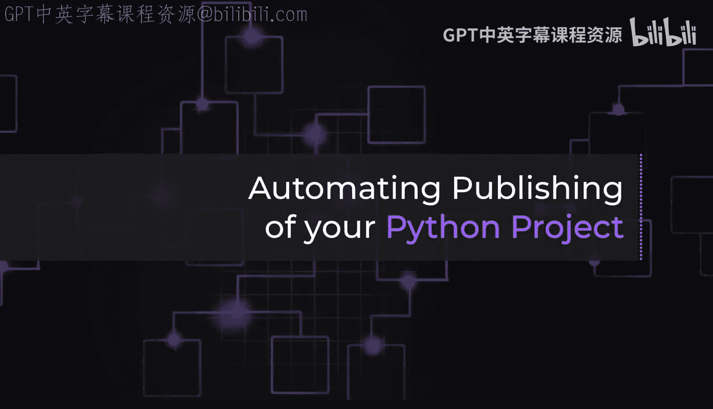
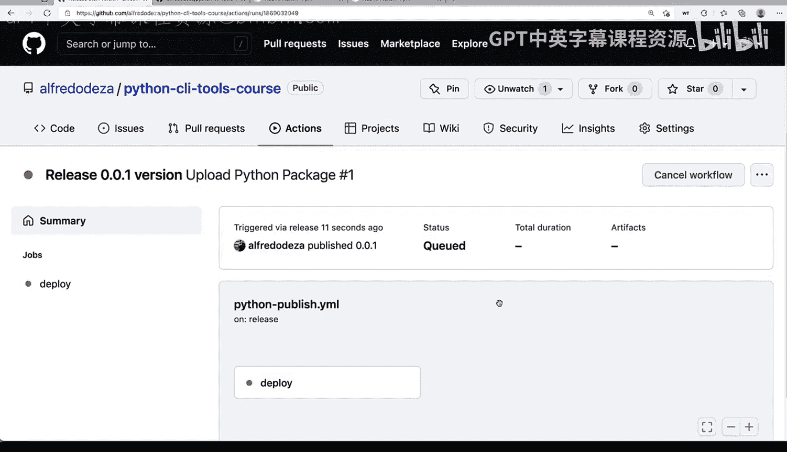
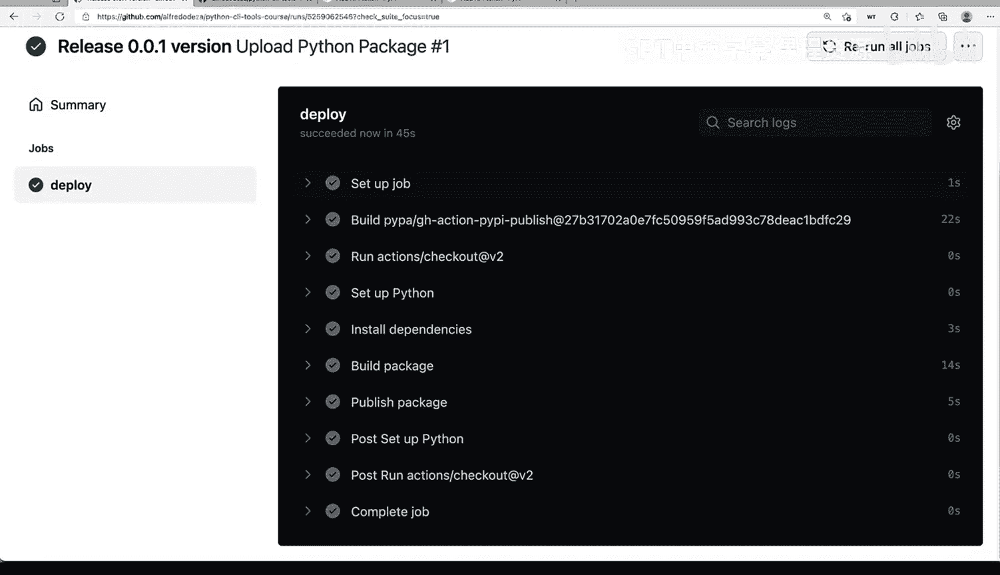
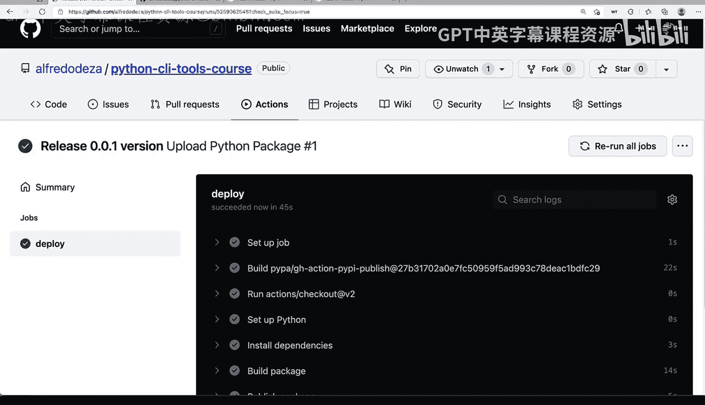
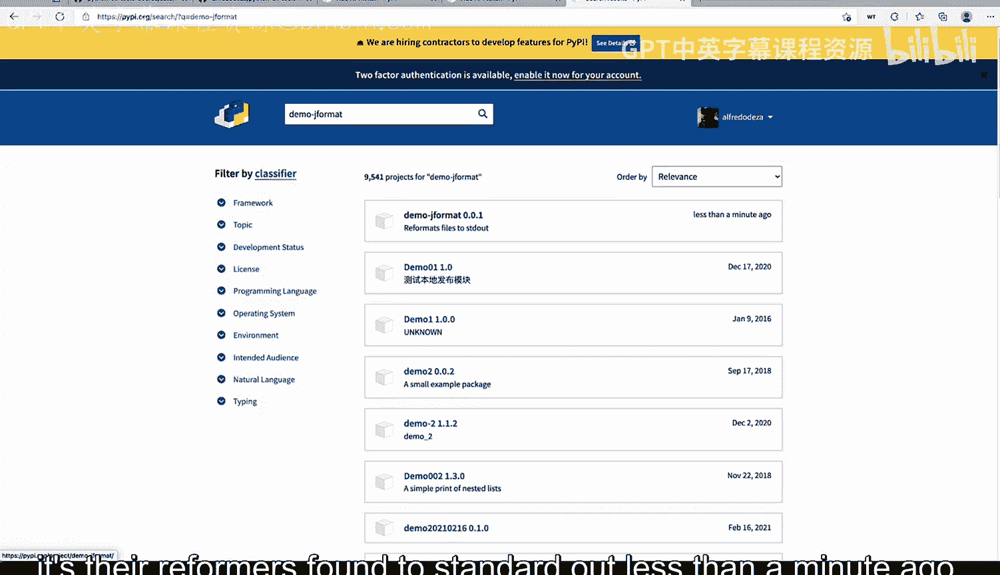
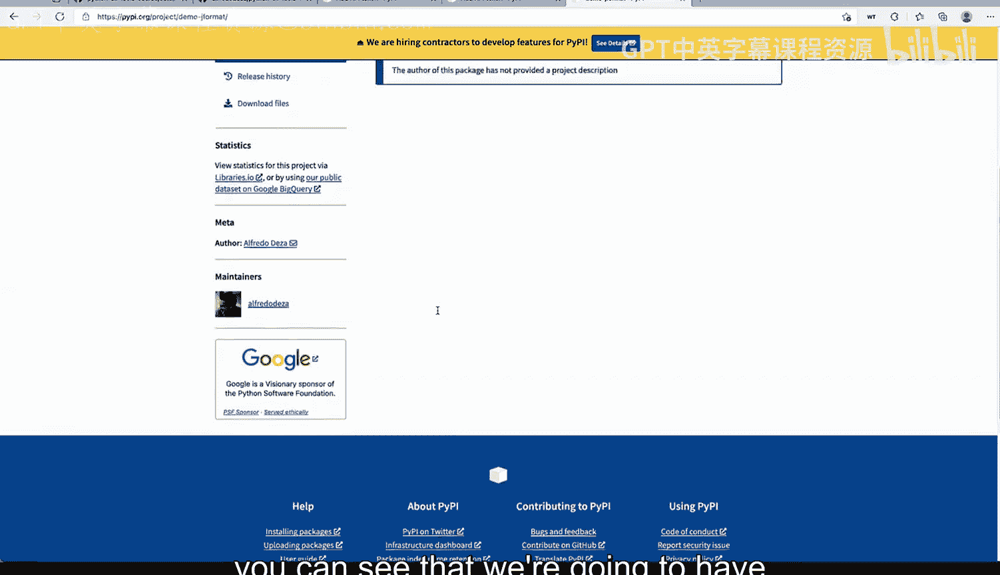
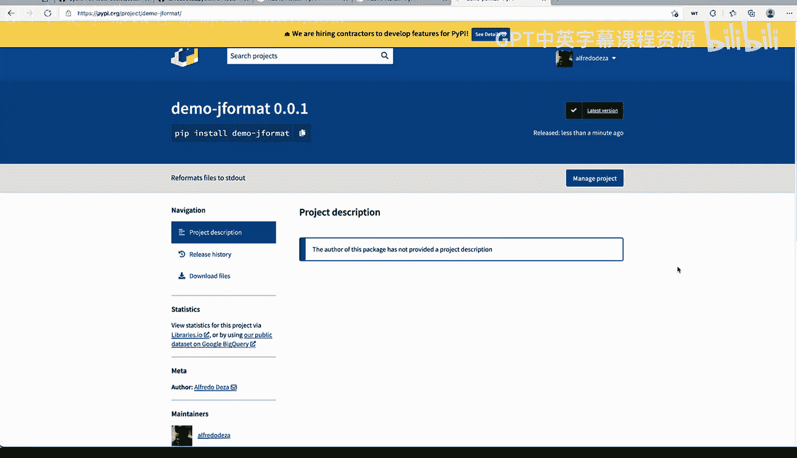
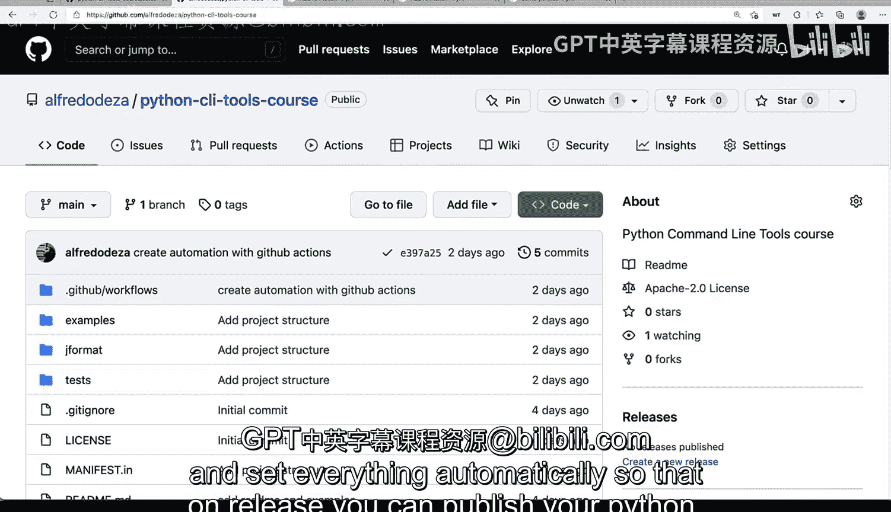

#  175：Python项目自动化发布 🚀

在本节课中，我们将学习如何为Python项目设置自动化发布流程。我们将使用GitHub Actions，在项目创建新版本（Release）时，自动将包构建并发布到Python包索引（PyPI）。整个过程涉及创建PyPI API令牌、在GitHub仓库中配置密钥以及设置自动化工作流。

---

## 准备工作

上一节我们介绍了项目的基本结构。本节中，我们来看看如何为自动化发布做准备。首先，你需要一个PyPI账户。

以下是必要的准备工作步骤：

1.  **访问PyPI网站**：确保你已登录PyPI（`pypi.org`）。如果还没有账户，请先注册。
2.  **创建API令牌**：在PyPI账户设置中，找到“API令牌”部分。创建一个新令牌。
    *   为令牌起一个有意义的名字，例如“GitHub项目自动化”。
    *   选择令牌的作用域。如果是首次发布该项目，通常需要选择“整个账户”作用域。如果项目已发布过，则可以选择仅针对该特定项目的作用域。
3.  **复制令牌**：创建成功后，系统会生成一个令牌字符串。请立即复制并妥善保存，因为它只会显示一次。

## 在GitHub仓库中配置密钥

现在，我们需要让GitHub Actions能够安全地使用这个PyPI令牌。

以下是配置GitHub仓库密钥的步骤：

1.  进入你的GitHub项目仓库。
2.  点击顶部的“Settings”（设置）选项卡。
3.  在左侧边栏中，找到“Secrets and variables”（密钥与变量）下的“Actions”（操作）。
4.  点击“New repository secret”（新建仓库密钥）。
5.  在“Name”（名称）字段中输入 `PYPI_API_TOKEN`。
6.  在“Value”（值）字段中，粘贴你从PyPI复制的API令牌。
7.  点击“Add secret”（添加密钥）完成设置。

这样，我们就创建了一个名为 `PYPI_API_TOKEN` 的密钥，后续的GitHub Actions工作流可以安全地引用它。

## 创建GitHub Actions发布工作流

接下来，我们将在仓库中创建一个自动化工作流。这个工作流会在你创建新的GitHub Release时自动触发。

以下是创建发布工作流的步骤：

1.  在项目仓库中，点击顶部的“Actions”（操作）选项卡。
2.  点击“New workflow”（新建工作流）。
3.  在搜索框中搜索“Python Package”，选择名为“Publish Python Package”的官方工作流。
4.  点击“Configure”（配置）。这个工作流模板已经预配置了构建和发布Python包到PyPI所需的主要步骤。
5.  关键配置点：工作流文件（通常是 `.github/workflows/python-publish.yml`）中已经包含了对 `PYPI_API_TOKEN` 密钥的引用。这正是我们上一步设置的密钥名称，因此无需修改。
6.  点击“Start commit”（开始提交），填写提交信息（例如“添加PyPI发布工作流”），然后提交到仓库的主分支。

提交后，这个工作流文件就会保存在你的仓库中。但请注意，这个工作流被配置为仅在“发布”（Release）事件时触发，目前还不会运行。

## 创建GitHub Release以触发发布

为了触发自动化发布流程，我们需要在GitHub上创建一个正式的发布版本。

以下是创建GitHub Release的步骤：

1.  在项目仓库的主页，点击右侧“Releases”（发布）区域附近的“Create a new release”（创建新发布）按钮。
2.  在“Tag version”（标签版本）字段中，输入你的版本号，例如 `v0.0.1`。这将在仓库中创建一个新的Git标签。
3.  为发布填写一个标题和描述，例如“`demojformat`项目的初始版本”。
4.  点击“Publish release”（发布版本）按钮。

## 验证自动化发布流程

创建Release后，GitHub Actions会自动开始运行发布工作流。

以下是验证流程的步骤：

1.  返回仓库的“Actions”（操作）选项卡。
2.  你应该能看到一个名为“Publish Python Package”的工作流正在运行或已经完成。
3.  点击该运行记录，可以查看详细的构建日志。工作流会依次执行安装依赖、构建包（生成`.whl`和`.tar.gz`文件）、使用`PYPI_API_TOKEN`向PyPI上传包等步骤。
4.  如果所有步骤都显示绿色对勾，则表示发布成功。

发布成功后，你可以访问 `pypi.org`，搜索你的包名（例如 `demojformat`），应该能看到刚刚发布的新版本及其详细信息。

---

本节课中我们一起学习了如何为Python项目搭建完整的自动化发布管道。我们首先在PyPI创建了API令牌，然后在GitHub仓库中将其设置为安全密钥。接着，我们利用GitHub Actions的预置模板创建了发布工作流。最后，通过创建一个GitHub Release触发了整个自动化流程，成功将Python包发布到了PyPI。这套流程极大地简化了软件分发的步骤，确保了发布的一致性和可靠性。