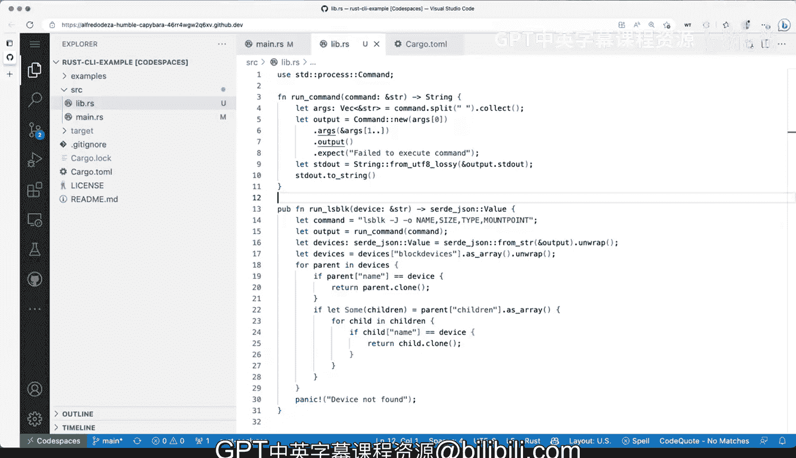

#  181：通过模块与库扩展工具功能


在本节课中，我们将学习如何通过模块化来组织Rust代码。我们将把一个单文件项目拆分为多个模块，以提高代码的可读性和可维护性。我们将从创建一个库文件开始，并学习如何在不同模块间共享函数。

到目前为止，我们的工具使用Rust语言实现了一个`lsblk`命令的功能。我们尚未使用任何模块，仅使用了通过`cargo init`命令自动生成的`main.rs`文件。

将所有代码放在单个文件中是可以的，直到你希望更好地组织代码。这正是我们现在要尝试做的事情。我们将使代码更加模块化，并从Rust应用程序中一个常见的做法开始：向`src`目录添加更多内容。首先，我们将添加一个`lib.rs`文件。

通常，你至少会有一个`main.rs`和一个`lib.rs`。根据你希望的组织方式，你还可以拥有更多文件，甚至包含更多模块和文件的子目录。我们将探索一下，对于我们当前要实现的目标，模块化的Rust代码会是什么样子。有很多不同的选项，但我们将从最简单的开始，即在此处添加一个`lib.rs`文件。

## 创建库模块

首先，我们回到`main.rs`文件，查看已有的内容。我们有`run_command`函数、`run_lsblk`函数以及`main`函数。我们将保持`main`函数不变，选择除`main`函数外的所有内容，并将其剪切。

现在，Rust分析器会报错。这是因为我们无法再访问`run_lsblk`函数。接下来，我们转到`lib.rs`文件，将刚才剪切的所有内容粘贴进去，并保存。

我们仍然看到一些下划线警告。这是因为这些函数未被使用。例如，分析器提示“function `run_command` is never used”。这表明Rust分析器工作正常。

## 从主模块调用库函数

现在，我们回到`main.rs`文件，看看有哪些错误。首先，错误提示“cannot find `run_lsblk` in this scope”。我们知道`run_lsblk`函数存在，但它位于不同的模块中。那么，如何让它工作呢？

如果你记得我们应用程序的名称，可以打开`Cargo.toml`文件查看。你会看到我们的包名是`block_rs`。我们将使用这个包名来调用函数。我们在`main.rs`中通过`block_rs::run_lsblk()`来调用它。

保存后，我们仍然看到一些波浪下划线。这是因为`run_lsblk`函数是私有的。当所有代码都在单个`main.rs`文件中时，函数默认是私有的。现在我们需要将其公开。

## 公开库函数

我们转到`lib.rs`文件，找到`run_lsblk`函数，并在其前面加上`pub`关键字，使其变为公有函数。

```rust
pub fn run_lsblk() -> Result<(), Box<dyn std::error::Error>> {
    // ... 函数实现
}
```

完成修改后，回到`main.rs`文件，之前的错误提示消失了。

## 测试模块化代码

现在，让我们打开终端，运行`cargo run`命令来测试我们的修改。

```bash
cargo run
```

程序成功运行，输出了预期的结果。首次编译可能会稍慢，因为我们做了一些更改。再次运行则会很快，因为Rust知道无需重新编译所有内容。

## 使用`use`声明提高代码清晰度

目前我们处于一个良好的状态，我们有两个模块。你可以继续模块化，使代码随着项目增长而更加有序。目前这样已经足够，并为我们提供了继续扩展的能力。

这种最小化的模块化方式是一个良好的起点。在后续课程中，我们将看到如何进一步推进。现在，你看到了如何实际使用`block_rs`这个包名来调用`run_lsblk`函数。

我们还可以在文件顶部使用`use`声明来引入`run_lsblk`函数，这样做可以使代码更清晰，尤其是当你想明确知道从另一个模块使用了哪些内容时。

以下是具体做法：在`main.rs`文件顶部，添加`use block_rs::run_lsblk;`。然后，在调用函数时，可以直接使用`run_lsblk()`，而无需前缀。

```rust
use block_rs::run_lsblk;

fn main() {
    // ... 其他代码
    if let Err(e) = run_lsblk() {
        eprintln!("Application error: {}", e);
        std::process::exit(1);
    }
}
```

我们也可以对`clap`库做同样的处理，以更清晰地表明我们使用了哪些外部内容。我个人倾向于在文件顶部先声明使用的外部内容，然后是内部内容，这有助于保持组织性。

```rust
use clap::{App, Arg};
use block_rs::run_lsblk;
```

这样，代码顶部更明确地展示了我们使用了哪些内容，而实际的函数调用保持不变。我们的代码因为有了`lib.rs`模块而变得更加有序。

## 总结

本节课中，我们一起学习了如何通过模块化来组织Rust代码。我们从创建`lib.rs`库文件开始，将函数从`main.rs`移动到库中，并通过`pub`关键字公开它们。然后，我们学习了如何在主模块中通过包名调用库函数，以及如何使用`use`声明来提高代码的清晰度和组织性。这种模块化的方法是构建更复杂Rust命令行工具的良好基石。



