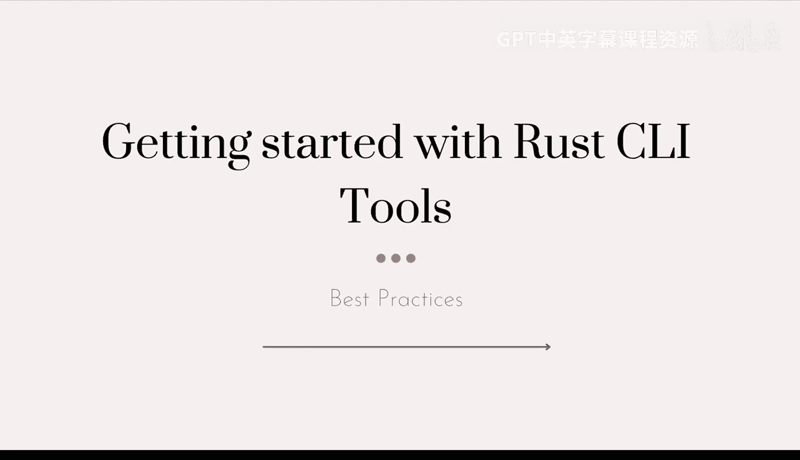
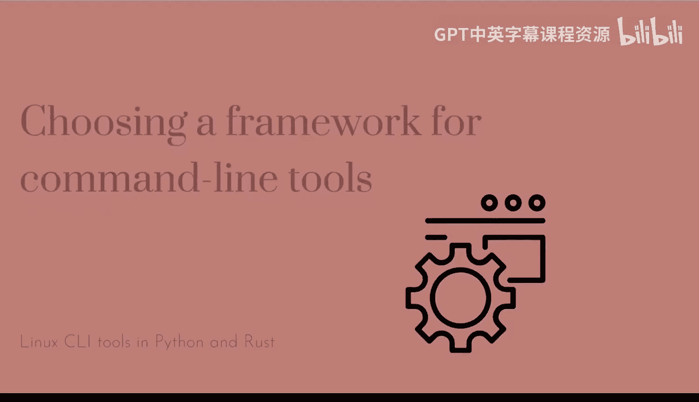
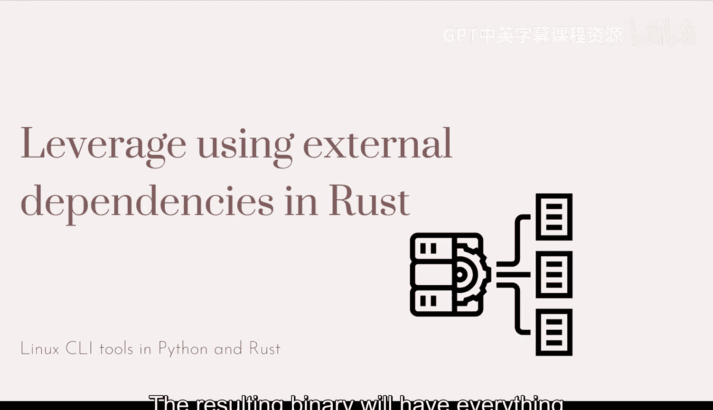
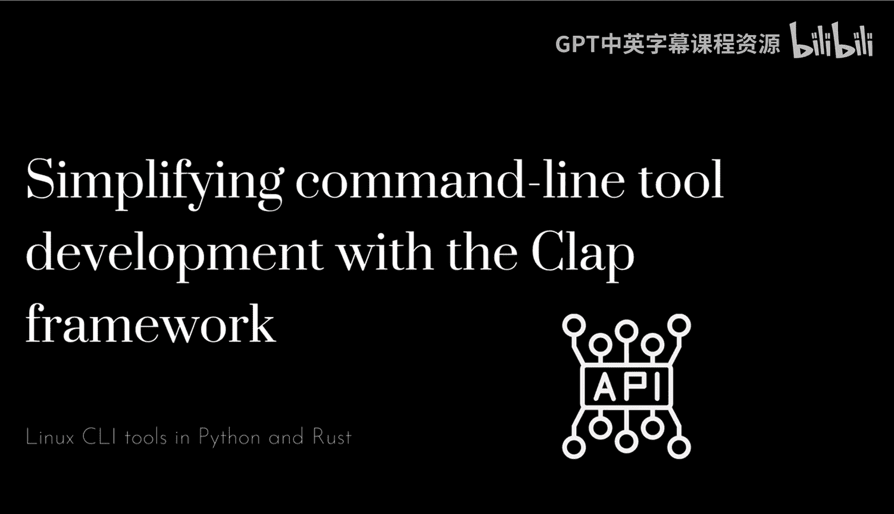
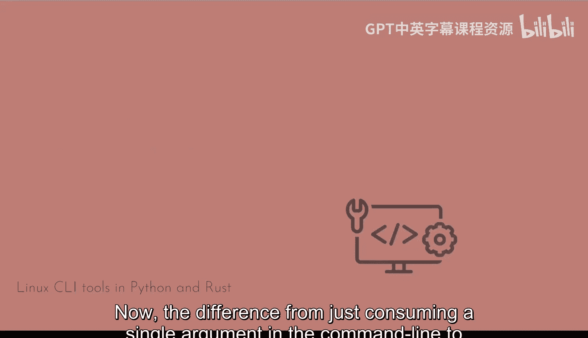
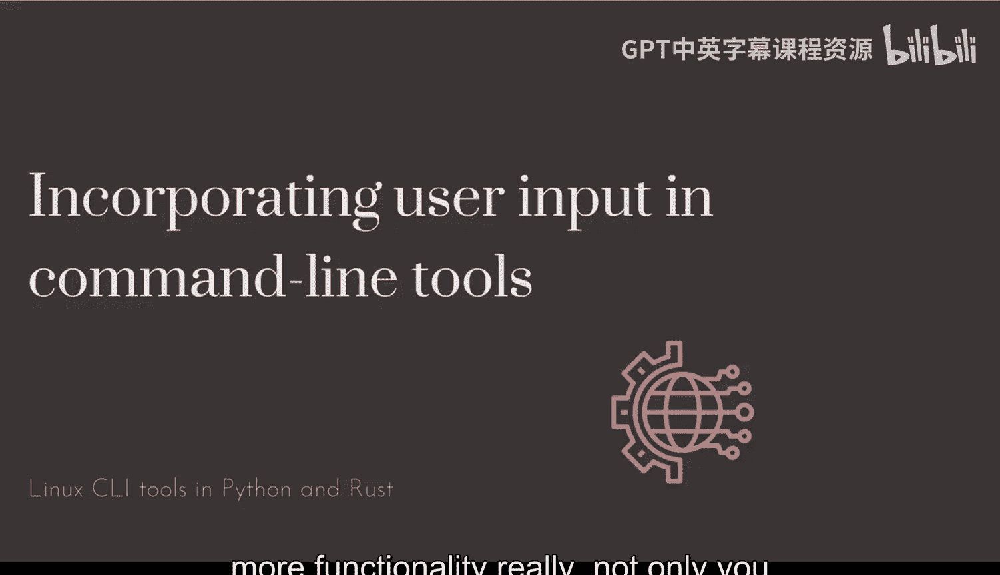
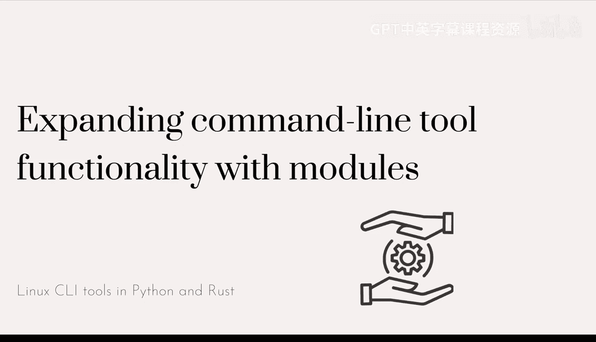
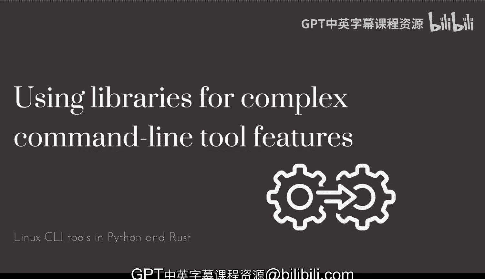

#  183：Rust命令行工具性能优化与最佳实践 🚀

在本节课中，我们将探讨使用Rust构建命令行工具时的一些关键模式、最佳实践和推荐做法。我们将对比Rust与Python的差异，并深入了解如何利用Rust生态系统的优势来创建高效、健壮的工具。

---

## Rust与Python的差异




上一节我们介绍了命令行工具的基础概念，本节中我们来看看Rust与Python在构建命令行工具时的根本区别。

Rust是一种静态类型、编译型语言，而Python是一种解释型语言。这种差异带来了不同的开发与分发模式。

*   **Rust**：代码被编译成独立的二进制可执行文件。
    *   **公式/代码**：`cargo build --release` 生成一个独立的二进制文件。
*   **Python**：用户需要安装Python解释器和相关依赖才能运行脚本。
    *   **公式/代码**：`python your_script.py` 需要系统已安装Python。

Rust的主要优势在于其**极致的运行速度**和**便捷的分发方式**。生成的二进制文件可以在任何兼容的系统上运行，无需用户安装Rust工具链，这解决了Python在部署时对环境依赖的严格要求。

---

## 命令行框架的选择

在Rust生态中，有多种框架可用于构建命令行工具。虽然我们从最简单的直接解析参数开始，但使用成熟的框架能带来显著好处。

以下是Rust中一些流行的命令行框架：

*   **clap**：功能强大、社区活跃，是本教程推荐的选择。
*   **structopt**：基于宏的声明式参数解析，现已整合到clap中。
*   **quick-cli / quicli**：旨在提供更简洁、快速的开发体验。

使用像clap这样的框架，可以自动获得参数解析、输入验证、标志设置、错误报告以及帮助菜单生成等功能，极大地减轻了开发负担。

---



## 依赖管理

Rust的依赖管理与Python有显著不同，这通常是Rust的一个优势。

在Rust中，通过`Cargo.toml`文件声明依赖。这些依赖在编译时会被静态链接到最终的二进制文件中。

**公式/代码**：
```toml
[dependencies]
clap = { version = "4.0", features = ["derive"] }
serde_json = "1.0"
```

这意味着：
1.  最终用户**无需**单独安装这些库。
2.  避免了Python中可能出现的依赖冲突、版本不匹配或跨平台编译问题。
3.  分发时只有一个二进制文件，干净且简单。

---





## 错误处理最佳实践

错误处理是构建健壮命令行工具的关键。Rust提供了强大的`Result`和`Option`类型来显式处理错误，这与许多其他语言中抛出异常的方式不同。

核心原则是：**避免滥用`panic!`**。

*   `panic!`适用于不可恢复的错误或快速原型开发，但不适合生产环境工具。
*   应使用`Result<T, E>`类型来封装可能失败的操作，并通过`?`操作符或`match`表达式优雅地处理错误。

这样做的好处是能为用户提供清晰的错误上下文，说明操作失败的原因，而不是让程序突然崩溃。


---

## 开发工作流与工具

高效的开发离不开好的工具链。在Rust中，以下工具应集成到你的日常开发流程中：

以下是推荐的Rust开发工具：

*   **cargo fmt**：自动格式化代码，保持风格一致。
    *   **公式/代码**：`cargo fmt`
*   **cargo clippy**：代码静态分析，提供改进建议。
    *   **公式/代码**：`cargo clippy`
*   **cargo check**：快速检查代码能否编译，不生成可执行文件。
    *   **公式/代码**：`cargo check`

此外，为你的代码编辑器（如VS Code）安装**rust-analyzer**扩展，它能提供实时的语法检查、类型提示和自动补全，显著提升开发效率。



---

## 工具的可扩展性

从一个简单的单参数工具开始，到使用框架支持多参数、标志和子命令，这大大增强了工具的灵活性和健壮性。

随着功能增长，良好的代码组织至关重要。你可以将代码拆分为不同的模块。



**公式/代码**：
```rust
// 在 src/lib.rs 中定义库功能
pub mod utils;
pub mod processor;

// 在 src/main.rs 中调用
use my_tool::processor::process_data;
```

这种结构允许你：
1.  分离核心逻辑与命令行接口。
2.  提高代码的可测试性和可重用性。
3.  更轻松地添加新功能。

---

## 使用外部库

不要害怕使用外部库来实现复杂功能。Rust的包管理器Cargo使得添加和管理依赖非常简单可靠。



例如，虽然clap内置了对彩色输出的支持，但如果你需要更复杂的终端交互、进度条或特殊格式输出，可以轻松引入像`indicatif`、`colored`或`tui`这样的库。

需要权衡的是，添加的依赖越多，项目的**初始编译时间**可能会越长。但最终的二进制文件大小通常仍然可控，且由于静态链接，分发和运行时的性能与可靠性是其主要优势。

---

## 总结



本节课中我们一起学习了使用Rust构建命令行工具的核心最佳实践。我们了解了Rust编译型语言带来的性能与分发优势，探讨了clap等框架如何简化开发，掌握了通过`Result`进行健壮错误处理的方法，并熟悉了格式化、检查等必备开发工具。记住，良好的模块化设计和对可靠外部库的利用，是构建功能丰富且易于维护的命令行工具的关键。