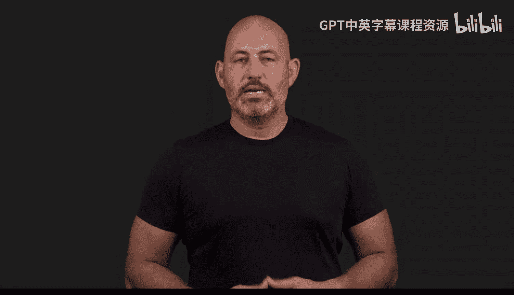

# 数据工程基础：2-4：认识课程讲师诺亚·吉夫特 👨‍🏫

在本节课中，我们将认识本课程的核心讲师之一——诺亚·吉夫特，了解他的专业背景和行业经验，这有助于我们理解课程内容的设计视角。

大家好，我是诺亚·吉夫特。我是Coursera专项课程“数据工程基础”的讲师之一。

我是杜克大学MIDS项目和电子工程系的兼职教授。

我在软件行业拥有超过20年的经验，涉足领域包括SaaS、社交媒体、电影和游戏。我曾担任过多种角色，例如咨询首席技术官、独立贡献者、首席技术官以及机器学习和人工智能部门负责人。

我撰写了超过八本书籍，其中包括《Python for DevOps》和《Practical MLOps》。此外，我还负责另一个杜克大学的Coursera专项课程“面向数据的云计算”。

我很高兴能与大家分享我的知识。让我们开始学习吧。

---

本节课中，我们一起认识了讲师诺亚·吉夫特。他丰富的行业经验和学术背景，为我们学习数据工程提供了坚实的实践与理论基础。在接下来的课程中，我们将基于这些宝贵的经验，深入探索Python、Bash和SQL在数据工程中的应用。