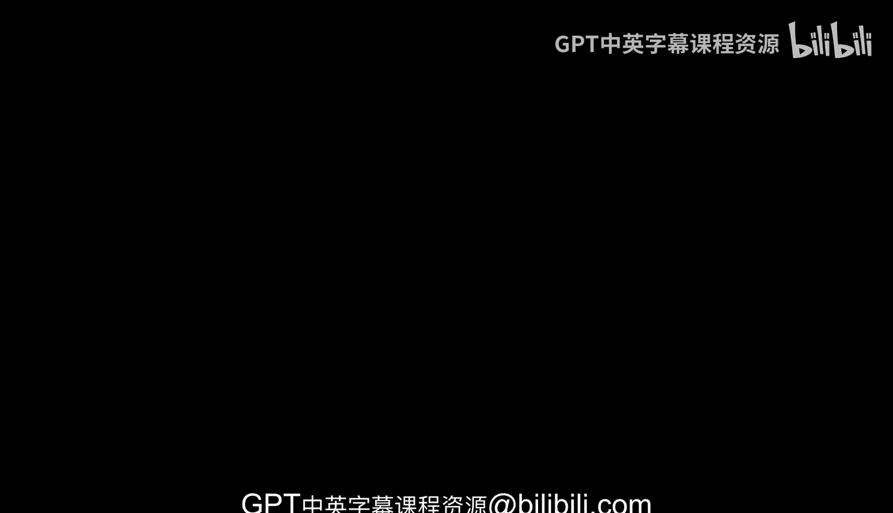
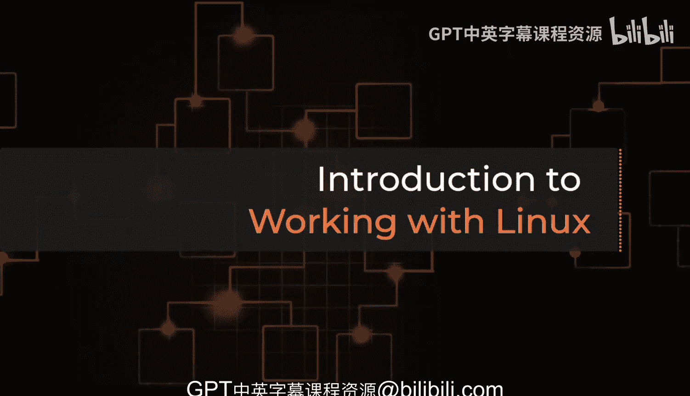

# 杜克大学｜Python、Bash和SQL数据工程基础：2-4：Linux操作入门

在本周课程中，我们将学习如何使用Linux来解决软件工程、数据工程和机器学习领域中常见的技术问题。我们将了解Linux Shell的核心组成部分，并学习如何在常见场景中应用这些知识。

接下来，让我们明确第一周的学习目标。

## 🎯 第一周学习目标

在本周学习结束时，你将能够：

*   识别Linux Shell的关键组成部分。
*   创建Shell管道。
*   解释SSH是什么，以及如何使用它来解决问题。

---

上一节我们明确了本周的学习目标，本节中我们将开始深入探讨Linux Shell的基础知识。

## 🐚 认识Linux Shell

Linux Shell是一个命令行解释器，它为用户提供了与操作系统内核交互的界面。你可以将它想象成一个强大的控制台，通过输入特定的文本命令，就能指挥计算机完成各种任务。

对于数据工程师而言，熟练使用Shell至关重要，因为它能高效地处理文件、管理进程和自动化任务。

---

了解了Shell的基本概念后，我们来看看它的几个关键组成部分。

## ⚙️ Shell的关键组成部分

以下是Linux Shell的几个核心组件：

*   **终端（Terminal）**：这是一个应用程序，提供了一个输入和显示文本的窗口，让你能够与Shell进行交互。
*   **Shell程序**：这是运行在终端内的实际程序，负责解析并执行你输入的命令。常见的Shell包括Bash（Bourne Again Shell）和Zsh。
*   **命令（Command）**：你输入的具体指令，例如 `ls`（列出文件）、`cd`（切换目录）或 `grep`（搜索文本）。
*   **文件系统**：Linux以层级目录结构组织所有文件和目录，Shell命令让你能够在这个结构中导航和操作。

---

掌握了Shell的基本构成，我们就可以学习如何将多个命令组合起来，实现更强大的功能。

## 🔗 创建Shell管道

在Linux中，管道（Pipeline）是一个强大的功能，它允许你将一个命令的输出直接作为另一个命令的输入。这通过竖线符号 `|` 实现。

**管道的基本语法是：**
`command1 | command2`

这意味着 `command1` 的输出会传递给 `command2` 进行处理。

例如，如果你想列出当前目录的所有文件，但只显示其中包含“log”字样的行，可以使用：
`ls -la | grep log`

这个例子中，`ls -la` 命令列出了所有文件的详细信息，然后通过管道 `|` 将结果传递给 `grep log` 命令进行过滤，最终只显示包含“log”的行。

---

学会了在本地使用命令和管道后，我们常常需要连接到远程服务器进行操作，这就需要用到SSH。

## 🔐 理解并使用SSH

SSH（Secure Shell）是一种网络协议，用于在不安全的网络上安全地进行远程登录和其他网络服务。

你可以把它想象成一把加密的钥匙，让你能够从本地计算机安全地访问和控制另一台远程计算机（通常是Linux服务器）。

**基本的SSH连接命令是：**
`ssh username@remote_host_address`

例如，要连接到IP地址为 `192.168.1.100` 的服务器，用户名为 `data_engineer`，命令如下：
`ssh data_engineer@192.168.1.100`

输入该命令并验证密码后，你的终端就会连接到远程服务器，之后输入的所有命令都将在那台服务器上执行。这对于管理云服务器、部署应用或访问远程数据至关重要。

---

## 📚 本周总结

在本节课中，我们一起学习了Linux操作入门的基础知识。

我们首先明确了本周的目标是掌握Linux Shell的核心用法。接着，我们认识了什么是Linux Shell及其在数据工程中的重要性。然后，我们分解了Shell的关键组成部分：终端、Shell程序、命令和文件系统。在此基础上，我们学习了如何通过管道符号 `|` 将多个命令串联起来，构建强大的数据处理流程。最后，我们介绍了SSH协议，学会了如何使用 `ssh` 命令安全地连接到远程服务器进行管理。

掌握这些基础技能，是你迈向高效数据工程实践的重要第一步。