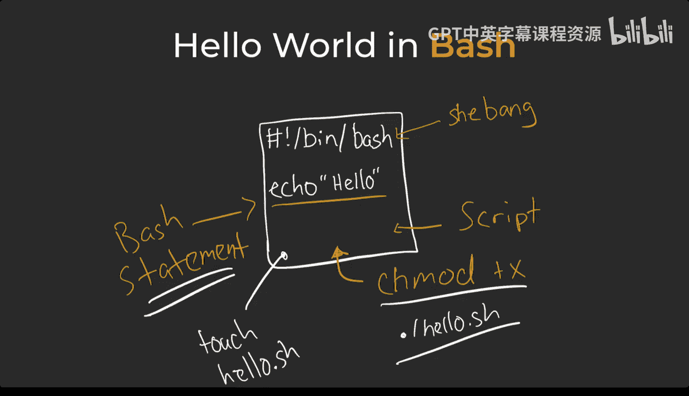
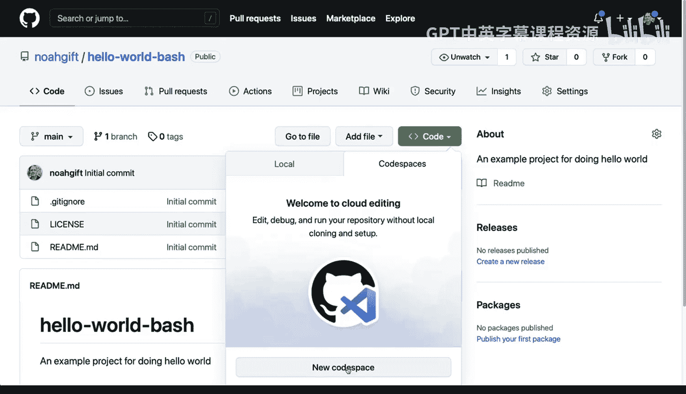
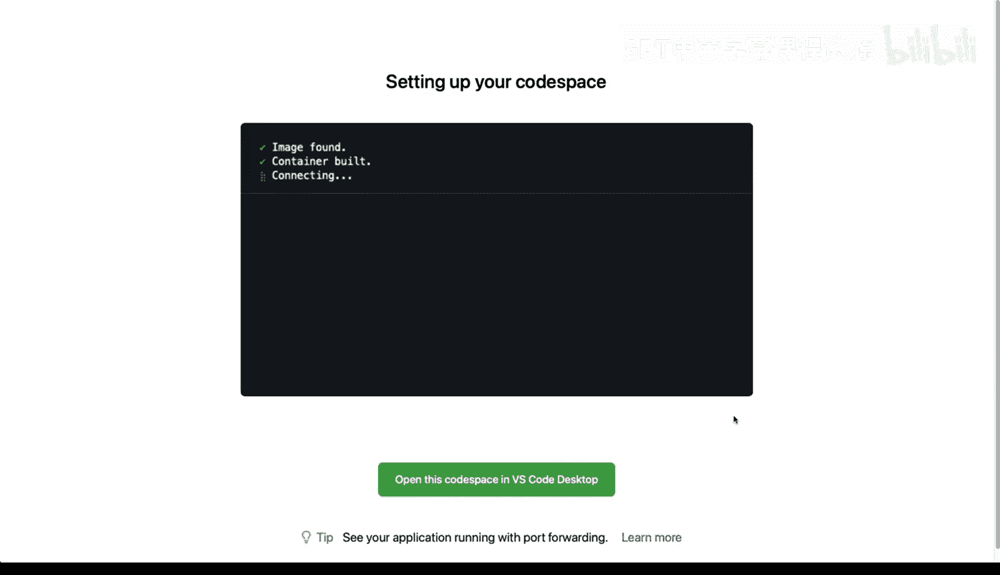
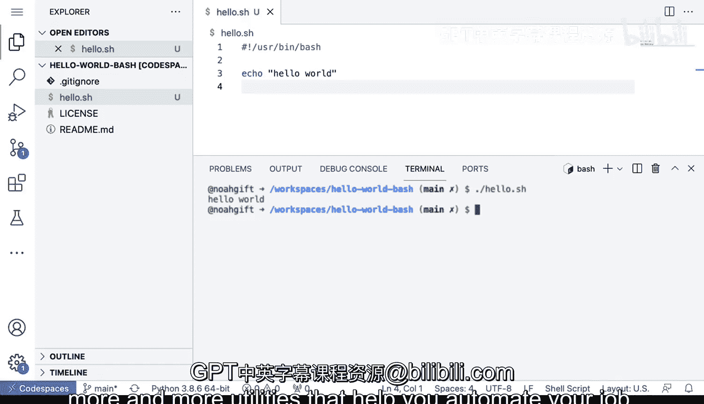

# 数据工程基础：2-4：编写Hello World Bash脚本 🐚


在本节课中，我们将学习如何创建一个最简单的Bash脚本——“Hello World”。我们将从创建一个空文件开始，逐步添加脚本内容，并最终使其成为一个可执行的实用工具。通过这个过程，你将理解Bash脚本的基本结构和运行原理。

---

## 创建脚本文件

首先，我们需要创建一个空的脚本文件。这通常可以通过 `touch` 命令来完成。`touch` 命令会创建一个指定名称的空文件，如果文件已存在，则更新其时间戳。

以下是创建名为 `hello.sh` 的脚本文件的命令：
```bash
touch hello.sh
```
执行此命令后，你将在当前目录下看到一个名为 `hello.sh` 的新文件。你可以使用任何文本编辑器（如Vim或VS Code）来编辑它。

---

## 理解脚本结构

一个基本的Bash脚本包含几个关键部分。上一节我们创建了文件，本节中我们来看看脚本内部的结构。

### Shebang行



脚本的第一行通常是 **Shebang行**。它的作用是告诉操作系统使用哪个解释器来执行这个脚本。对于Bash脚本，Shebang行如下：
```bash
#!/usr/bin/bash
```
这行代码以 `#!` 开头，后面跟着Bash解释器的路径。这样，当你直接运行脚本时，系统就知道应该用Bash来解析它，而无需你在命令行中手动输入 `bash` 命令。

### 脚本主体

Shebang行之后，就是脚本要执行的实际命令。在Bash脚本中，你可以写入任何在终端中能直接运行的命令。

例如，一个打印“Hello World”的脚本主体就是：
```bash
echo "Hello World"
```
编写脚本的优势在于，你可以将一系列复杂的终端命令保存到一个文件中，实现自动化。

---

## 使脚本可执行

创建并编写好脚本后，它默认是不可执行的。我们需要修改文件的权限，使其可以被运行。



### 查看当前权限



在修改权限前，可以使用 `ls -l` 命令查看文件的详细权限信息。
```bash
ls -l hello.sh
```
输出结果中，开头的字符表示文件类型和权限。例如 `-rw-r--r--` 表示文件所有者可以读写，但所有人都不能执行（缺少 `x` 标志）。

### 添加执行权限

使用 `chmod`（change mode）命令可以修改文件权限。`+x` 标志表示为文件添加执行权限。
```bash
chmod +x hello.sh
```
执行此命令后，再次运行 `ls -l hello.sh`，你会看到权限中已经包含了 `x`，例如 `-rwxr-xr-x`。现在，所有用户都可以执行这个脚本了。

---

## 运行脚本

完成以上所有步骤后，你就可以运行你的第一个Bash脚本了。

在脚本所在目录，使用以下命令运行它：
```bash
./hello.sh
```
命令开头的 `./` 表示在当前目录下寻找可执行文件 `hello.sh` 并运行。如果一切正常，终端将输出 “Hello World”。

这种方法的强大之处在于，无论脚本是用Bash、Python还是Perl编写的，只要正确设置了Shebang行和执行权限，都可以用相同的方式运行和集成到更大的工作流中。

---

## 总结



本节课中我们一起学习了如何从零开始创建一个Bash脚本。我们首先使用 `touch` 命令创建了一个脚本文件，然后理解了脚本的核心结构：**Shebang行** 用于指定解释器，脚本主体用于存放要执行的命令。接着，我们使用 `chmod +x` 命令赋予了脚本执行权限。最后，我们使用 `./script_name.sh` 的方式成功运行了脚本，并看到了输出结果。掌握这些基础步骤，是使用Bash进行自动化任务和数据工程工具开发的第一步。