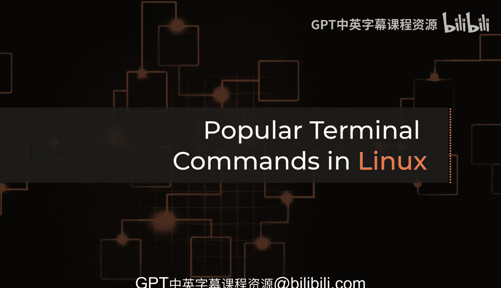
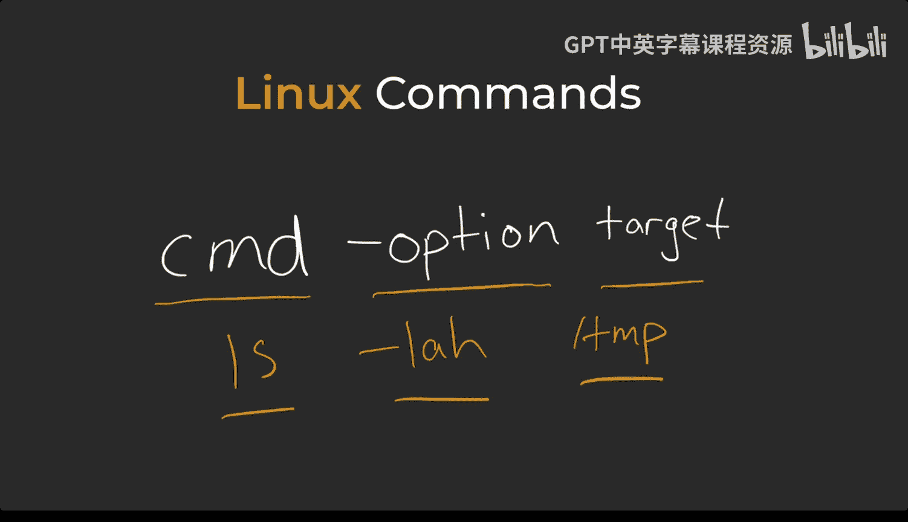
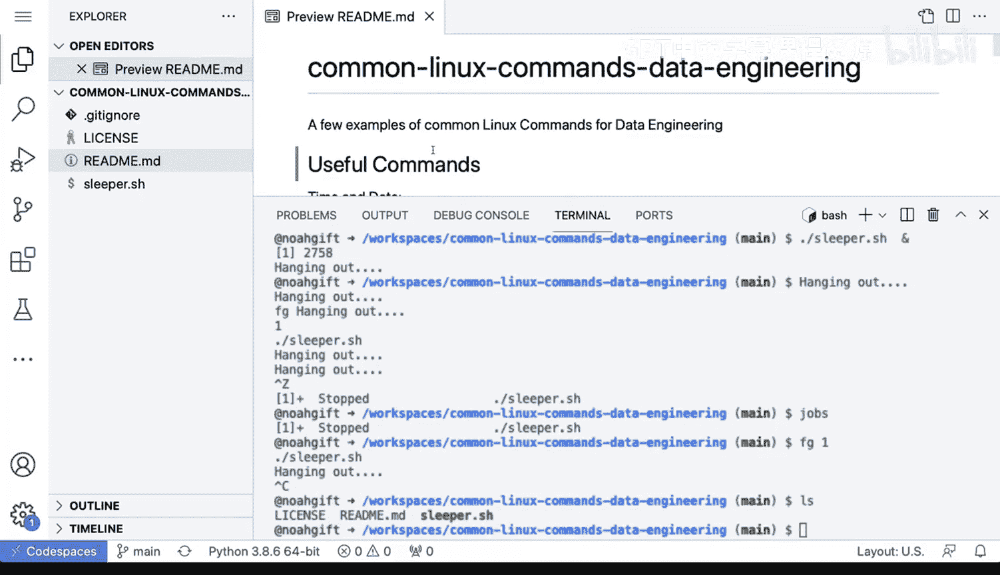
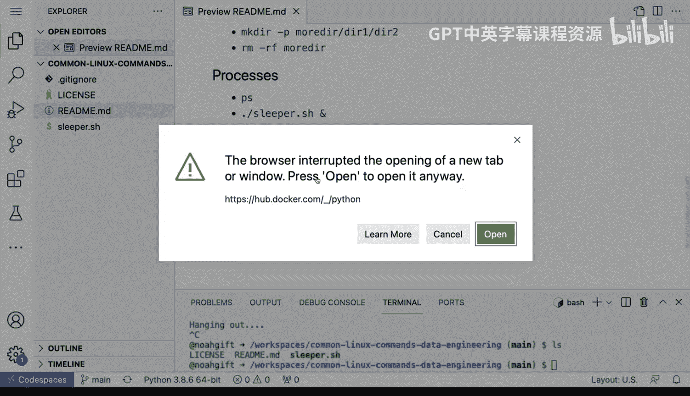
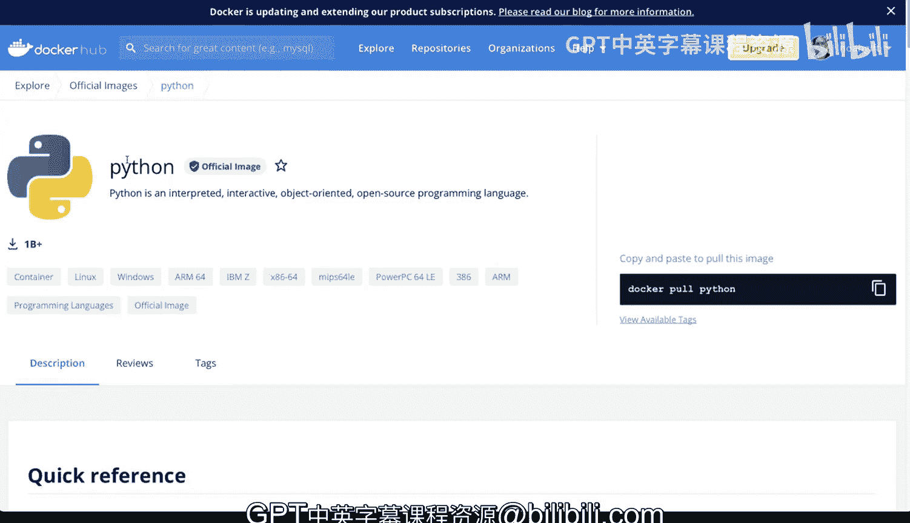
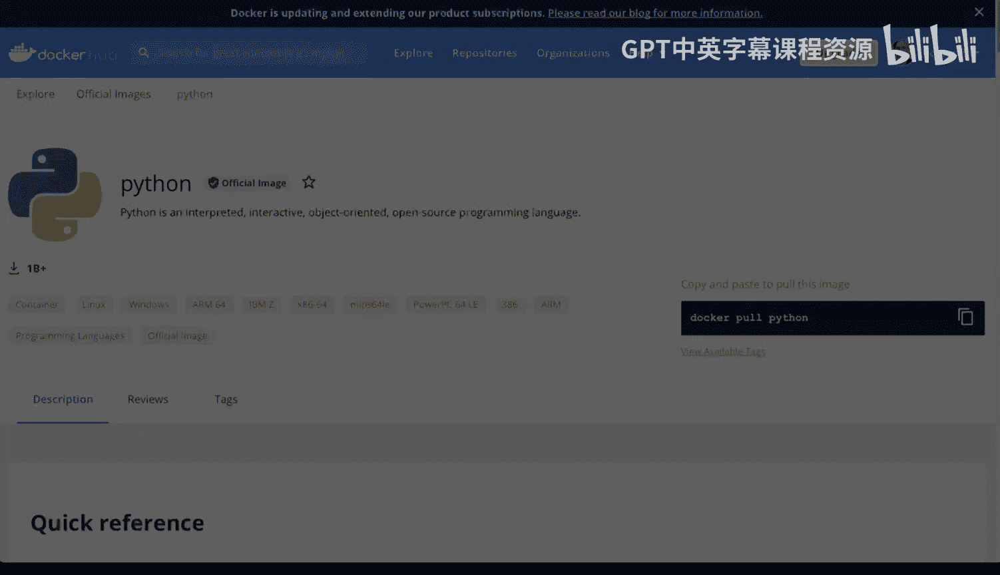

# 数据工程基础：2-4：Linux常用终端命令 🐧




在本节课中，我们将学习Linux终端命令的核心结构与常用操作。掌握这些命令是成为Bash专家的基础，能帮助你高效地管理文件、查看系统状态和处理进程。



## 命令核心结构

Linux命令通常遵循一个核心结构：**命令**、**选项**和**目标**。有时还会包含**目的地**。一个通用的表示方式是：
```
命令 [选项] [目标] [目的地]
```

一个典型的例子是 `ls` 命令。你可以输入选项 `-lh`，并指定目标目录，例如 `/tmp`：
```bash
ls -lh /tmp
```
这是一种极其常见的命令结构。理解它之后，你就能在Linux上运行任何类型的命令。

接下来，让我们通过实践一些基础命令来练习如何成为Bash专家。

## 常用命令实践

以下是成为Bash专家的最佳方式之一：动手尝试各种命令。

首先，我们从几个时间和日期命令开始。在终端中输入 `cal`，它会清晰地显示当前月份的日历，并用方框高亮标出今天的日期。输入 `date` 命令则会显示当前的日期和时间。

许多有用的命令都内置在Bash中。你可以使用 `which date` 来查看 `date` 命令的存放位置（通常在 `/usr/bin`）。我们可以进入该目录查看所有可用的命令：
```bash
cd /usr
ls -l
```
这是学习Bash的好方法：逐一尝试这些命令，通过实践你终将成为专家。

现在，让我们更聚焦一些，回到工作目录。使用 `df -h` 命令可以查看磁盘使用情况，`-h` 选项使其以人类可读的格式（如GB、MB）显示。这对于数据工程师来说是一个非常重要的命令。

另一个有用的命令是 `du -sh`，它可以显示指定目录（如 `/usr/bin/*`）下各工具的大小，帮助你识别哪些可能是大型工具。同样，你也可以在当前工作目录中使用它来查找大文件。

`top` 命令在运行程序时非常有用，它能实时显示系统的进程状态。按 `q` 键可以退出。

## 探索Shell环境

探索Shell环境同样重要。`pwd` 命令可以显示当前工作目录的完整路径，这在脚本编写或设置环境变量时非常方便。

`ls -lah` 命令会以长列表格式显示文件信息，包括Unix权限、所属用户/组以及文件大小，是浏览目录的得力工具。

`cd` 命令用于在文件系统中导航。例如，`cd /tmp` 进入 `/tmp` 目录，`cd ~` 则返回用户主目录。

`which` 命令用于定位可执行文件。例如，`which python3` 会显示Python3解释器的具体路径。这在系统存在多个版本时（如Python 2和Python 3）尤其有用，可以帮助你确认正在使用的版本。

## 查看文件内容

查看文件内容是非常常见的操作。`less /etc/passwd` 命令会分页显示 `/etc/passwd` 文件的内容，你可以使用上下箭头键滚动浏览。而 `cat /etc/passwd` 命令则会一次性将整个文件内容打印到终端。对于大文件，`less` 是更好的选择。

`wc -l` 命令用于统计文件的行数。例如，`wc -l /etc/passwd` 会显示该文件有多少行。

## 修改文件与目录

现在，让我们看看如何修改文件和目录。

`touch new_file.txt` 命令可以创建一个新的空文件。之后，你可以使用文本编辑器向其中添加内容。

`mkdir new_dir` 命令用于创建新目录。

`mv` 命令用于移动或重命名文件。其基本结构是 `mv [源] [目标]`。例如，`mv new_file.txt new_dir/` 将文件移动到新目录中。同样，`mv old_name.txt new_name.txt` 可以重命名文件。

`mkdir -p` 命令可以一次性创建多级目录。例如，`mkdir -p a/b/c/d` 会创建完整的目录树。

最后，`rm -rf` 命令可以递归地强制删除整个目录及其内容。使用此命令务必小心。

## 管理进程

进程管理是另一个关键技能。`ps` 命令可以列出当前运行的进程。例如，在一个终端运行 `python` 交互界面，在另一个终端使用 `ps | grep python` 就能找到对应的Python进程。

我们可以创建一个简单的脚本 `sleeper.sh`，它包含一个无限循环，不断打印“hanging out...”。运行它：
```bash
./sleeper.sh
```
按 `Ctrl+C` 可以终止该进程。按 `Ctrl+Z` 则可以挂起（停止）该进程。之后，使用 `jobs` 命令可以查看被挂起的作业，使用 `fg %1` 命令可以将编号为1的作业恢复到前台继续运行。

另一种方式是在启动命令时加上 `&` 符号，使其在后台运行：
```bash
./sleeper.sh &
```
对于后台进程，你需要先用 `fg %1` 将其调回前台，然后再用 `Ctrl+C` 终止。

## 向专家学习





成为专家的一个好方法是学习优秀开源项目的实践。例如，查看官方Python Docker镜像的Dockerfile，你会发现其中大量使用了我们刚才练习过的命令（如 `rm -rf`），以及 `&&` 这样的逻辑操作符（表示前一个命令成功后才执行下一个）。通过研究这些成熟项目的脚本，你可以学到很多Bash编程的最佳实践。

## 总结





本节课我们一起学习了Linux终端命令的核心结构，并实践了日期查看、文件浏览、系统监控、目录导航、文件操作和进程管理等常用命令。记住，熟练使用Bash的关键在于不断练习和探索。通过理解命令的基本模式并模仿专家们的写法，你将能够高效地利用命令行工具来完成数据工程中的各项任务。