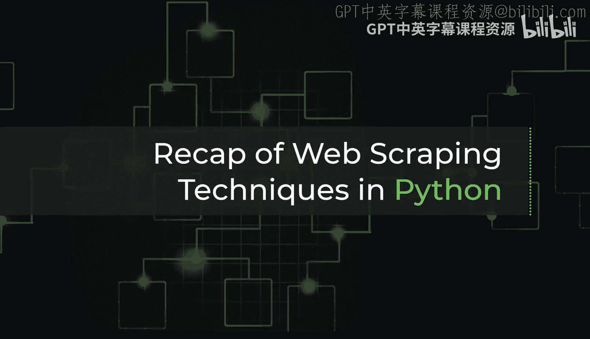

# Python、Bash和SQL数据工程基础：2-4：Python网络爬虫技术回顾 🕸️

在本节课中，我们将回顾如何使用Python从非结构化的HTML中抓取数据。我们将学习利用Python标准库和HTML解析器来完成这项任务，无需安装任何外部库。这是一种在找到具有特定结构的HTML后，提取数据的直接方法。同时，我们也会探讨使用HTML解析器和基于类的方法时可能遇到的一些困难。

## 使用Python标准库解析HTML


上一节我们介绍了网络爬虫的基本概念。本节中，我们来看看如何利用Python内置的工具来解析HTML文档。



Python的标准库提供了处理HTML的模块，例如 `html.parser`。通过它，我们可以将HTML字符串转换为一个可遍历的树状结构对象，从而定位和提取所需的数据。

以下是使用 `HTMLParser` 类的基本步骤：

```python
from html.parser import HTMLParser

class MyHTMLParser(HTMLParser):
    def handle_starttag(self, tag, attrs):
        print(f"遇到开始标签: {tag}")
    def handle_data(self, data):
        print(f"遇到数据: {data}")

parser = MyHTMLParser()
parser.feed('<html><body><h1>标题</h1></body></html>')
```

## 基于类的方法与解析难点

虽然使用 `HTMLParser` 类提供了很大的灵活性，但它也带来了一些挑战。这种方法需要我们手动定义处理不同HTML元素（如开始标签、结束标签、数据）的回调函数，逻辑可能变得复杂。

以下是使用基于类的方法时常见的几个难点：

1.  **状态管理复杂**：当需要根据嵌套的标签结构来提取信息时，需要在类中维护状态变量，代码容易出错。
2.  **对不规范HTML容错性差**：如果网页HTML结构不规范（如标签未闭合），`html.parser` 可能无法正确解析。
3.  **代码冗长**：对于简单的数据提取任务，编写一个完整的解析器类可能显得过于繁琐。

因此，对于复杂的网页抓取任务，开发者通常会转向更强大、更易用的第三方库，如 `BeautifulSoup` 或 `lxml`。这些库提供了更简洁的API来查询和遍历HTML文档。

## 总结

本节课中我们一起学习了使用Python标准库进行网络爬虫的核心技术。我们了解到，通过 `html.parser` 模块可以解析HTML并提取数据，这是一种无需额外依赖的方法。同时，我们也认识到，基于 `HTMLParser` 类的方法在应对复杂结构或需要精细控制时，会面临状态管理和代码复杂度增加的挑战。这为我们在后续课程中选择更合适的爬虫工具提供了重要的参考依据。