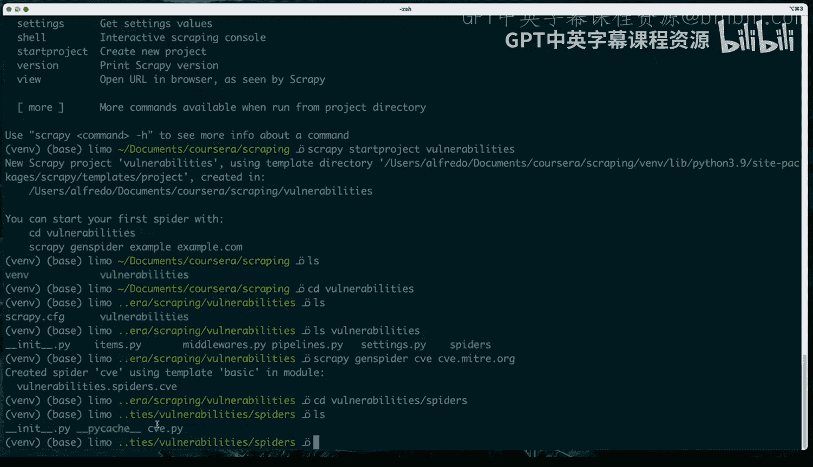
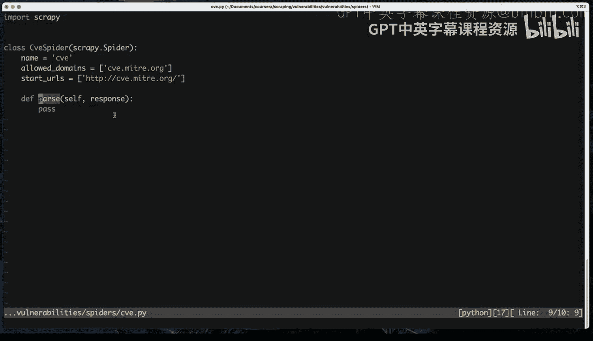
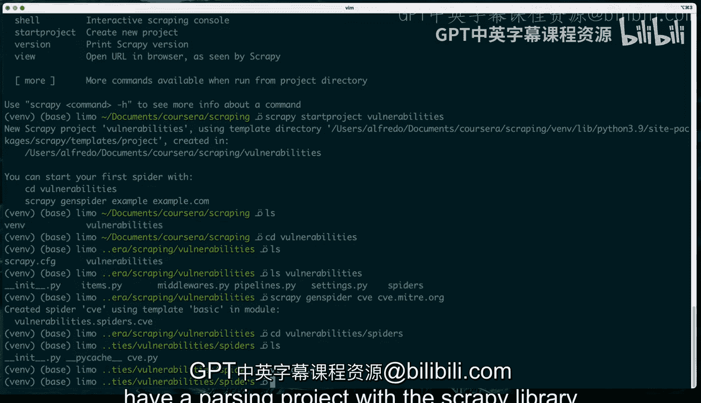

# 数据工程基础：2-4：使用Scrapy在Python中创建网络爬虫项目


在本节课中，我们将学习如何使用Scrapy框架来创建一个网络爬虫项目。Scrapy是一个功能强大的Python框架，专门用于高效地从网站提取结构化数据。我们将从零开始，逐步完成项目的初始搭建。

## 概述

要使用Scrapy开始爬取网站并创建项目，需要几个关键步骤。本节将引导你完成从创建虚拟环境到生成第一个爬虫的完整过程。

## 创建虚拟环境

首先，我们需要创建一个独立的Python虚拟环境。这能确保项目依赖与其他项目隔离。

以下是具体步骤：

1.  打开终端，进入一个空目录。
2.  使用以下命令创建名为 `venv` 的虚拟环境：
    ```bash
    python3 -m venv venv
    ```
3.  激活虚拟环境：
    ```bash
    source venv/bin/activate
    ```
4.  验证 `pip` 命令是否来自虚拟环境：
    ```bash
    which pip
    ```
    确认输出路径包含 `venv/bin/pip`。

## 安装Scrapy

虚拟环境激活后，我们可以在其中安装Scrapy框架。

使用 `pip` 安装Scrapy：
```bash
pip install scrapy
```
此命令会下载并安装Scrapy及其所有必要的依赖库（如 `lxml` 和 `Twisted`）。Scrapy是一个功能完备的框架，因此依赖项比Python标准库中的 `HTMLParser` 等工具更多。

## 创建Scrapy项目

安装完成后，我们可以开始创建Scrapy项目。Scrapy提供了便捷的命令来生成项目脚手架。

首先，确认 `scrapy` 命令可用：
```bash
which scrapy
scrapy --help
```

接下来，使用 `startproject` 命令创建新项目。该命令需要一个项目名称作为参数。

例如，创建一个名为 `vulnerabilities` 的项目：
```bash
scrapy startproject vulnerabilities
```
命令执行后，会生成一个名为 `vulnerabilities` 的目录，其中包含项目的标准结构和配置文件（如 `scrapy.cfg`）。

## 生成爬虫（Spider）

上一节我们创建了项目框架，本节中我们来看看如何生成一个具体的爬虫。爬虫是定义如何爬取网站并解析数据的核心组件。

项目创建成功后，终端会提示你可以使用 `genspider` 命令来创建第一个爬虫。我们需要进入项目目录并执行此命令。

以下是生成爬虫的步骤：

1.  进入项目目录：
    ```bash
    cd vulnerabilities
    ```
2.  使用 `genspider` 命令生成爬虫。此命令需要两个参数：爬虫名称和允许爬取的域名。
    ```bash
    scrapy genspider cve cve.mitre.org
    ```
    本例中，我们创建了一个名为 `cve` 的爬虫，并限制其爬取 `cve.mitre.org` 域名下的内容。域名限制有助于在发起多个请求时控制爬取范围。

命令执行成功后，会在 `vulnerabilities/spiders/` 目录下生成一个名为 `cve.py` 的文件。这个文件包含一个基本的爬虫类，其中定义了一个名为 `parse` 的方法。这就是使用Scrapy库开始解析项目所需的最初脚手架。

## 总结







本节课中我们一起学习了使用Scrapy创建网络爬虫项目的完整初始流程。我们首先创建并激活了虚拟环境，然后安装了Scrapy框架。接着，我们使用 `startproject` 命令搭建了项目结构，最后通过 `genspider` 命令生成了第一个包含基础解析方法的爬虫文件。至此，项目的基础设置已经完成，为后续编写具体的爬取和解析逻辑做好了准备。