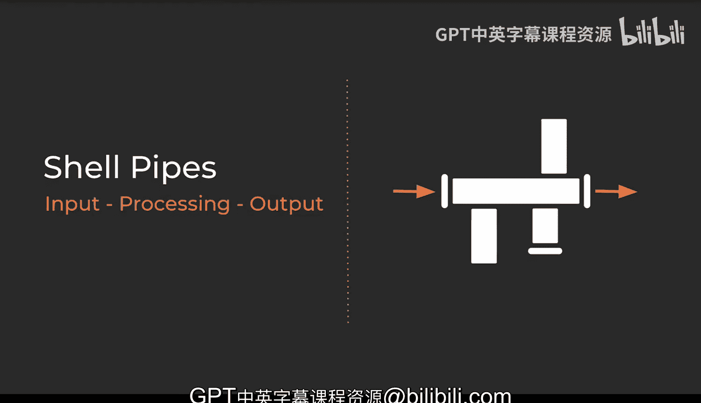

# 数据工程基础：2-4：Shell管道入门 🚀


在本节课中，我们将要学习Shell管道的基础知识。Shell管道是连接多个命令的强大工具，它允许你将一个命令的输出作为另一个命令的输入，从而实现数据的连续处理。我们将从概念入手，逐步深入到实际应用。


## 什么是Shell管道？ 💡

上一节我们介绍了Shell的基本概念，本节中我们来看看Shell管道的核心定义。Shell管道本质上是一系列“管道”，数据从一端流入，经过处理，再从另一端流出。你可以把它想象成家中的水管系统：水（数据）从源头进入，经过洗碗机（处理程序）的处理，然后被送往污水处理厂（输出或下一个处理环节）。

**核心概念**：`命令1 | 命令2 | 命令3 ...`
在这个公式中，竖线 `|` 是管道符号，它将左侧命令的标准输出连接到右侧命令的标准输入。

## Shell管道的工作原理 ⚙️

理解了基本概念后，我们来探讨其工作机制。Shell管道在实践中是如何运作的呢？它的核心在于输入、处理和输出这三个环节。

以下是其工作流程的关键步骤：

*   **输入**：数据从文件、用户输入或上一个命令进入管道。
*   **处理**：数据被管道中的命令（如 `grep`， `sort`， `awk`）进行处理或转换。
*   **输出**：处理后的数据被发送到屏幕、文件，或作为输入传递给管道中的下一个命令。

整个过程是流式的，这意味着数据可以立即被处理，而无需等待前一个命令完全结束。

## 实践：Shell管道示例 🛠️

理论需要实践来巩固。现在，我们通过一系列例子来看看如何在实际中使用Shell管道。这些例子将帮助你掌握如何格式化代码，以便与内置的Unix工具良好协作。

以下是一个经典示例，演示了如何查看文件、筛选内容并进行统计：

```bash
# 示例：统计一个日志文件中包含“ERROR”关键词的行数
cat application.log | grep “ERROR” | wc -l
```

让我们分解这个命令：

*   `cat application.log`：读取 `application.log` 文件的内容。
*   `grep “ERROR”`：从上游输入中筛选出包含“ERROR”字符串的行。
*   `wc -l`：统计上游输入的行数。

通过这个管道，我们无需创建任何中间临时文件，就高效地完成了数据的读取、过滤和计数。

## 总结 📝



本节课中我们一起学习了Shell管道。我们从“一系列管道”这个比喻开始，理解了Shell管道是关于**输入、处理和输出**的流程。接着，我们探讨了其工作原理，并通过一个统计日志错误行数的具体例子，实践了如何将多个命令用管道符 `|` 连接起来，构建高效的数据处理流程。掌握Shell管道是提升命令行效率和数据处理能力的关键一步。