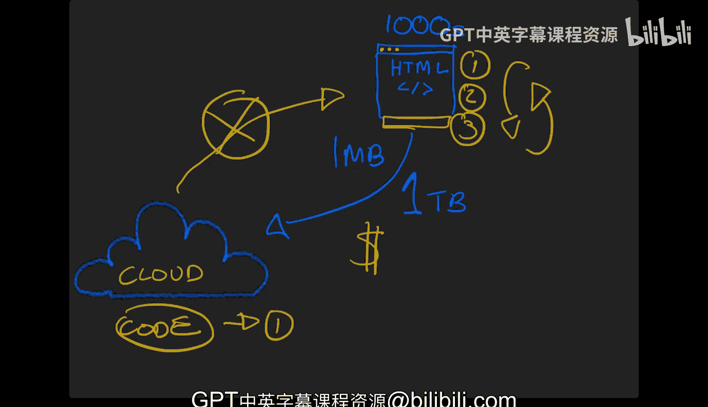

# 数据工程基础：2-4：网络爬虫挑战概览 🕸️


在本节课中，我们将要学习网络爬虫过程中可能遇到的主要挑战。即使你已经制定了一个良好的爬取策略，在实际操作中仍然会面临一些复杂问题。了解这些挑战是构建健壮、高效数据管道的第一步。

## 动态网站结构带来的挑战

上一节我们介绍了网络爬虫的基本概念，本节中我们来看看实际操作中的第一个主要挑战：目标网站的动态变化。

假设你正在从云端访问一个远程网站，其内容由HTML构成。你可能认为已经准备好开始爬取数据了。然而，网站的结构和内容并非一成不变。我们可以将初始的网站结构称为 **版本1**。

```python
# 假设的爬虫代码，针对网站版本1
response = requests.get('https://example.com/v1')
soup = BeautifulSoup(response.content, 'html.parser')
data = soup.find('div', class_='target-data')  # 依赖于版本1的特定结构
```

问题在于，网站可能决定发布**版本2**。而你部署在云端的代码是为解析**版本1**的HTML结构而编写的。这会导致你的爬虫立即失效，因为代码无法在新结构中找到预期的数据。此时，你需要分析新版本，并重新实现一套爬取策略。

这个过程成本高昂。试想，如果问题规模扩大，挑战将变得更加严峻。

## 规模扩展带来的复杂性与成本

以下是当爬虫任务规模增长时，随之而来的几个核心挑战：

*   **目标数量增长**：如果从爬取一个网站变为需要解析**数百或数千个**不同网站，维护每个网站的特定解析逻辑将变得极其复杂。
*   **数据量激增**：如果每次爬取返回的数据量从**1兆字节（MB）** 增长到**1太字节（TB）**，这将带来巨大的网络传输成本、存储成本和数据处理压力。
*   **操作成本高昂**：频繁地重新编写爬虫以适应网站变化，以及处理海量数据，会成为一项非常昂贵且耗时的操作。

我们的目标是避免这种复杂性，并尽可能降低成本。因此，我们需要采用一些技术来更高效、更直接地解决这些问题。

## 应对策略与目标

面对上述挑战，关键在于构建一个更具适应性和效率的爬虫系统。

无论目标网站存在多少个版本，或者其结构如何频繁变化，一个优秀的爬虫系统都应做好准备来解析和获取数据。在后续课程中，我们将探讨一些能够帮助你更好地完成这项任务、提升效率的技术，例如：

*   使用更健壮的解析方法（如CSS选择器、XPath结合正则表达式）。
*   实现错误处理和重试机制。
*   设计可扩展的架构来处理大规模数据抓取。
*   设置监控告警，及时发现网站结构变更。



本节课中我们一起学习了网络爬虫面临的两大核心挑战：**网站动态变化**与**规模扩展带来的成本问题**。理解这些挑战是设计出稳定、可维护且经济高效的数据获取流程的基础。在接下来的内容中，我们将深入探讨解决这些挑战的具体方法和技术。