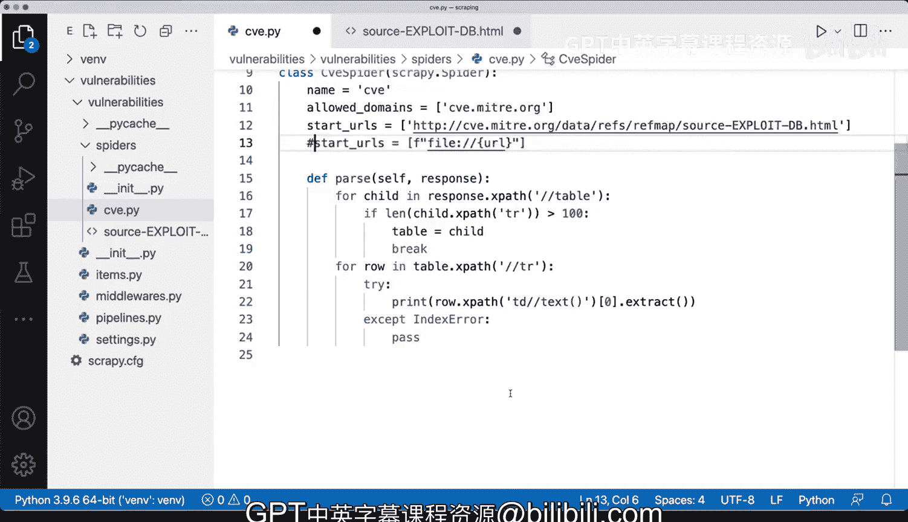

# 数据工程基础：2-4：本地爬取实践 🕷️💾


在本节课中，我们将学习如何通过下载网页的HTML文件到本地，来优化和测试网络爬虫。这种方法可以避免频繁请求在线服务器，提高开发效率，并允许我们更安全地进行代码调试。

## 概述

上一节我们创建了一个漏洞扫描项目。现在，我们将回顾用于从目标网站抓取漏洞信息的爬虫。我们将重点介绍如何通过本地处理HTML文件来改进爬虫，使其运行更快、更高效，并便于测试。

## 回顾现有爬虫

我们的爬虫项目位于 `vulnerabilities` 目录下，核心文件是 `cve.py`。在这个文件中，`start_urls` 列表定义了爬虫开始工作的起点。

```python
start_urls = ['https://www.exploit-db.com/html']
```

这意味着每当爬虫启动时，它都会访问这个在线网址。如果只是抓取少量信息，这没有问题。但设想一下，如果需要测试多个不同网站，或提取数百GB的数据，频繁的网络请求将变得非常消耗资源和时间。

## 本地处理的优势

一种缓解方法是预先下载HTML文件。这样做有几个好处：
*   可以进行离线测试。
*   可以自由修改本地文件以测试代码的健壮性。
*   可以避免因频繁请求而给目标服务器带来负担，做一个“友好的”数据抓取者。

接下来，我们将实践这一方法。

## 下载HTML文件

我们将使用命令行工具 `wget` 来下载目标网页。首先，打开终端并导航到爬虫项目所在的目录。

```bash
cd path/to/vulnerabilities/spiders
wget https://www.exploit-db.com/html -O exploit-db.html
```

命令执行后，一个约1.56MB的 `exploit-db.html` 文件会被下载到当前目录。如果需要对几十个网站进行类似操作，本地处理的效率优势将非常明显。

作为对比，我们可以用 `time` 命令计时运行一次原始爬虫，看看在线抓取需要多长时间。

```bash
time scrapy crawl cve
```

执行结果显示，整个过程（包括网络请求、数据抓取和解析）大约需要2秒。其中，网络请求和加载到内存占用了大部分时间。

## 修改爬虫以读取本地文件

现在，我们修改 `cve.py` 文件，让爬虫从刚下载的本地HTML文件读取数据，而不是访问在线网址。

首先，我们需要导入 `os` 模块来构建文件路径。

```python
import os
from os.path import dirname, join
```

接着，我们定义当前文件所在的目录，并拼接出HTML文件的绝对路径。

```python
# 获取当前脚本文件（cve.py）所在的目录
current_dir = dirname(__file__)
# 构建本地HTML文件的完整路径
html_file_path = join(current_dir, 'exploit-db.html')
```

最后，修改 `start_urls`。Scrapy框架支持使用 `file://` 协议来加载本地文件。

```python
# 注释掉原来的在线URL
# start_urls = ['https://www.exploit-db.com/html']
# 改为使用本地文件路径
start_urls = [f'file://{html_file_path}']
```

## 测试与对比

完成修改后，我们再次运行爬虫并计时。

```bash
time scrapy crawl cve
```

现在，执行时间缩短到不足1秒。因为所有处理都在内存和本地文件中进行，消除了网络延迟。

为了感受差异，我们可以将 `start_urls` 改回在线网址再运行一次，会发现速度明显变慢（尽管可能受到缓存影响）。这个练习的核心在于，通过本地处理HTML，可以极大地提升效率。

## 本地文件的更多用途

使用本地HTML文件的另一个重要优势是便于**防御性编程**和**调试**。

我们可以直接打开 `exploit-db.html` 文件，观察其结构。例如，检查表格行（`<tr>`）的排列。如果我们想在代码中添加逻辑来防止因页面结构意外变化而导致的索引错误（`IndexError`），就可以在本地文件上直接进行测试。

例如，在解析代码中，可以添加判断：

```python
# 假设 rows 是我们选取的所有表格行
if len(rows) > expected_count:
    # 安全地处理数据
    process_data(rows[expected_index])
else:
    # 处理结构不符的情况
    logging.warning("HTML structure changed.")
```

如果直接对在线网站进行测试，我们无法控制其HTML结构，也无法快速验证错误处理逻辑。而使用本地文件，我们可以随意添加或删除HTML标签，模拟各种页面结构变化，从而确保爬虫代码更加健壮。

## 总结

本节课我们一起学习了网络爬虫的优化技巧——本地爬取实践。我们了解到，通过 `wget` 等工具将目标网页下载到本地，并修改爬虫的 `start_urls` 指向本地文件（使用 `file://` 协议），可以带来多重好处：
1.  **大幅提升爬取速度**，消除网络请求开销。
2.  **减轻目标服务器压力**，遵守良好的网络礼仪。
3.  **便于代码测试与调试**，可以在本地文件上模拟各种页面结构，实践防御性编程，使爬虫更健壮。



虽然本例只使用了一个HTML文件，但在处理大量页面时，这种先下载后解析的模式能显著提高开发效率和程序性能。这是一个非常实用且值得掌握的数据工程技巧。