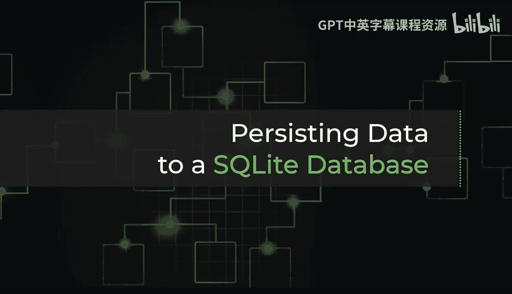
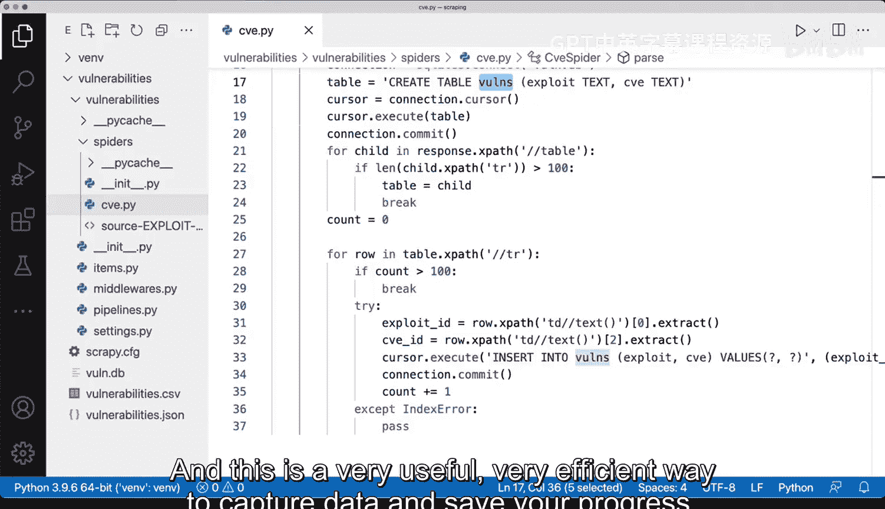

# 数据工程基础：2-4：将数据持久化到SQLite数据库



在本节课中，我们将学习如何将数据持久化存储到SQLite数据库中。我们将了解为什么数据库存储比CSV或JSON文件更高效，并逐步实践如何创建数据库连接、定义表结构以及插入数据。

## 概述

将数据持久化到数据库是一种高效保存工作进度的方法。与CSV和JSON文件相比，数据库能更好地支持持续的数据添加和进度保存。本节我们将使用SQLite3来解决数据持久化问题。

## 创建数据库连接

首先，我们需要建立与SQLite数据库的连接。连接是后续所有数据库操作的基础。

以下是创建连接的代码：
```python
import sqlite3
connection = sqlite3.connect('bo.db')
```
这段代码使用`sqlite3`模块的`connect`方法。如果当前目录下存在名为`bo.db`的文件，它将打开该数据库文件；如果不存在，则会创建一个新的数据库文件。

## 定义数据表结构

建立连接后，下一步是定义存储数据的表结构。我们需要明确表中包含哪些列以及它们的数据类型。

以下是创建表的SQL语句：
```sql
CREATE TABLE booms (
    exploit TEXT,
    cve TEXT
)
```
我们创建了一个名为`booms`的表，它包含两个文本类型的列：`exploit`和`cve`。为了示例的简洁，我们暂时没有定义主键。

## 执行表创建操作

定义了SQL语句后，我们需要通过数据库游标来执行它，并将更改提交到数据库。

以下是执行和提交的代码：
```python
cursor = connection.cursor()
table_sql = \"CREATE TABLE booms (exploit TEXT, cve TEXT)\"
cursor.execute(table_sql)
connection.commit()
```
我们首先从连接对象创建了一个游标。游标是用于执行SQL命令的接口。然后，我们执行了创建表的SQL语句，并通过`connection.commit()`将创建表的操作永久保存到数据库中。

## 向表中插入数据

表创建完成后，我们就可以开始向其中插入数据了。这通常在数据处理的循环中进行。

以下是插入数据的代码示例：
```python
exploit_id = \"sample_exploit\"
cve_id = \"CVE-2023-XXXXX\"
cursor.execute(\"INSERT INTO booms (exploit, cve) VALUES (?, ?)\", (exploit_id, cve_id))
connection.commit()
```
我们使用`INSERT INTO`语句向`booms`表添加数据。SQLite的API推荐使用问号`?`作为占位符来安全地传递值，这可以防止SQL注入攻击。`execute`方法的第二个参数是一个元组，其中包含了要插入的实际值。每次插入后，都需要调用`connection.commit()`来提交事务，确保数据被写入磁盘。

## 验证数据持久化

操作完成后，我们可以验证数据是否已成功保存到数据库中。

我们可以使用SQLite命令行工具或直接在Python中查询来检查数据：
```sql
SELECT * FROM booms;
```
运行此查询将显示`booms`表中所有已插入的记录，确认我们的数据已被持久化保存。

## 总结



本节课我们一起学习了如何将数据持久化到SQLite数据库。我们首先创建了数据库连接，然后定义了表结构并执行创建，最后在循环中向表中插入了数据并提交了更改。与文件存储相比，数据库存储提供了更可靠、更高效的方式来保存和处理大量数据，特别是在需要持续追加数据和跟踪进度的场景中。你现在已经掌握了使用SQLite进行基本数据持久化的方法。