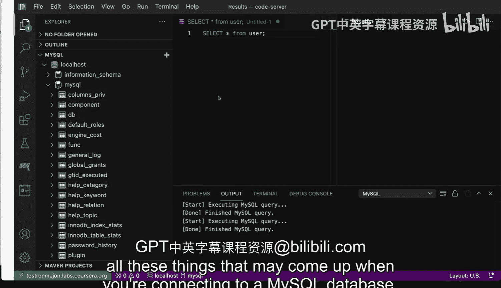

# 数据工程基础：2-4：连接MySQL服务器 🗄️


在本节课中，我们将学习如何在VS Code环境中连接到一个MySQL数据库。我们将使用一个浏览器内的VS Code实例，通过MySQL管理扩展来建立连接、浏览数据库结构并执行简单的SQL查询。

## 概述

上一节我们介绍了数据工程的基本工具。本节中，我们来看看如何具体连接到一个MySQL服务器。我们将从检查扩展开始，逐步完成连接配置，并最终运行一个查询来验证连接。

## 连接步骤

以下是连接MySQL服务器的详细步骤。

### 1. 检查并确认MySQL扩展

首先，我们需要确保VS Code中安装了MySQL管理扩展。这个扩展允许我们列出服务器、数据库、表、列以及运行查询。

*   在VS Code左侧活动栏中，点击“扩展”图标。
*   在搜索框中输入“MySQL”。
*   确认名为“MySQL”的管理工具扩展已安装。如果未安装，你需要在此处点击安装。

### 2. 打开MySQL视图

扩展安装后，我们需要找到并使用它。

*   回到“资源管理器”视图。
*   在视图顶部，你会发现一个“MySQL”选项。点击它。
*   此时，MySQL视图面板会打开，但里面是空的，因为我们尚未连接到任何数据库。

### 3. 创建新连接

要连接到数据库，我们需要创建一个新的连接配置。

*   在MySQL视图面板的顶部，点击加号（+）按钮来添加连接。
*   系统会提示你输入连接信息。

### 4. 输入连接参数

创建连接需要提供以下几项信息，请按顺序填写：

*   **主机名**：数据库所在服务器的地址。对于本地数据库，输入 `localhost`。对于远程数据库，则需要输入IP地址或完整的域名。
*   **用户名**：用于认证的MySQL用户。在本示例中，我们使用拥有全部权限的 `root` 用户。在实际生产环境中，建议使用权限受限的特定用户。
*   **密码**：对应用户的密码。本例中的测试数据库`root`用户没有密码，因此直接按回车键跳过。生产环境中必须设置强密码。
*   **端口**：MySQL服务监听的端口。默认是 `3306`，如果使用默认端口，直接按回车确认即可。
*   **SSL证书路径**：如果数据库连接启用了SSL加密，则需要提供证书路径。本例未使用SSL，因此留空并按回车跳过。

### 5. 验证连接

完成上述步骤后，连接 `localhost` 应该会出现在MySQL视图面板中。点击其左侧的展开箭头，你应该能看到四个默认的数据库（如 `mysql`, `information_schema` 等）。这表示连接成功。

## 执行SQL查询

成功连接后，我们可以尝试执行一个SQL查询。

1.  在MySQL视图面板中，展开 `localhost` 连接，再展开 `mysql` 数据库以查看其下的表。
2.  在 `user` 表上点击右键，在上下文菜单中选择“新建查询”。这会在编辑器区域创建一个新文件。
3.  在新文件中输入SQL语句：
    ```sql
    SELECT * FROM user;
    ```
4.  **重要**：不要点击编辑器右上角的“运行”按钮来执行此查询，这会导致错误。
5.  正确的方法是使用命令面板。通过菜单 **查看 -> 命令面板** 或快捷键（Mac上是 `Shift + Command + P`，Windows/Linux上是 `Ctrl + Shift + P`）打开命令面板。
6.  在命令面板中输入并选择“运行 MySQL 查询”。
7.  查询结果将显示在编辑器下方的“输出”面板中。

## 总结



本节课中我们一起学习了在VS Code中连接MySQL数据库的完整流程。关键步骤包括：确认MySQL扩展、通过MySQL视图添加新连接、填写必要的主机、用户、端口等连接参数，以及通过命令面板正确执行SQL查询。请记住，在生产环境中，务必使用强密码并遵循最小权限原则来管理数据库用户。