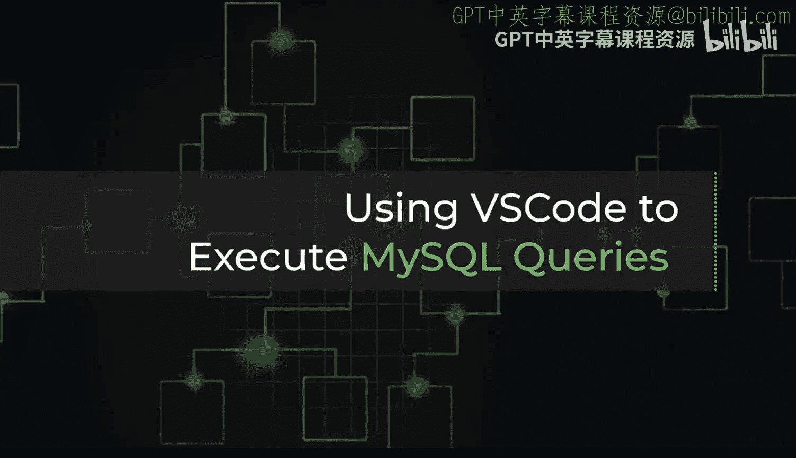
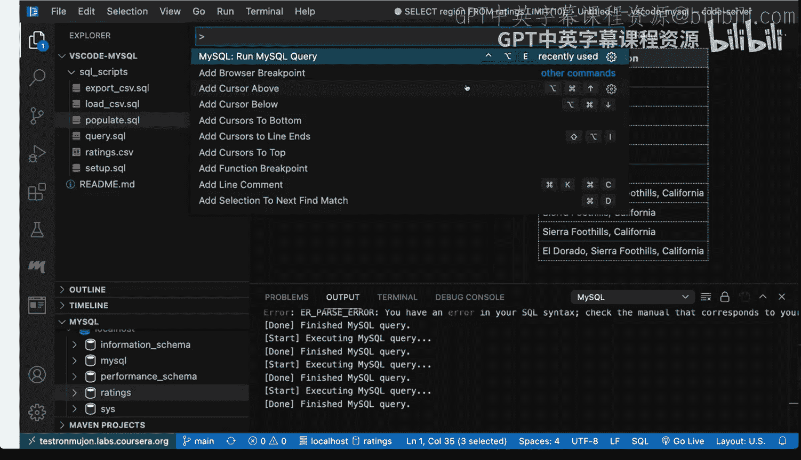
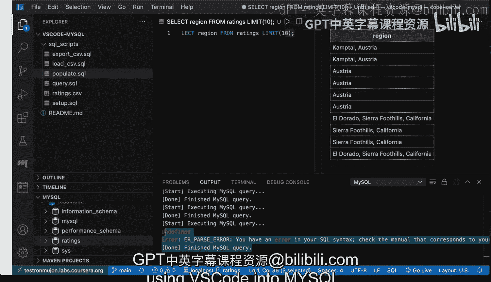

# 数据工程基础：2-4：使用VSCode执行MySQL查询 🛠️




在本节课中，我们将学习如何使用VSCode连接并操作MySQL数据库。我们将涵盖创建数据库、执行SQL脚本、填充数据以及运行查询等核心操作。

---

上一节我们介绍了如何连接到MySQL数据库。本节中，我们来看看如何在VSCode中与数据库进行更深入的交互。

我们已通过VSCode连接到本地MySQL服务器。在界面中可以看到四个系统自带的内部数据库。接下来，我们将创建一个新的数据库并运行一些查询。

## 创建新数据库

以下是创建新数据库的步骤。

首先，我们需要运行一个SQL脚本来创建数据库和表。在VSCode的资源管理器中，打开一个名为 `setup.sql` 的脚本文件。该脚本内容如下：

```sql
CREATE DATABASE IF NOT EXISTS ratings;
USE ratings;
CREATE TABLE ratings (
    name TEXT(556),
    rating TEXT(120),
    region TEXT(256)
);
```

这段代码执行三个操作：
1.  创建一个名为 `ratings` 的数据库（如果它尚不存在）。
2.  切换到 `ratings` 数据库。
3.  在 `ratings` 数据库中创建一个名为 `ratings` 的表，该表包含三个文本类型的列：`name`、`rating` 和 `region`。

要执行此脚本：
1.  确保在VSCode的MySQL扩展中已选中 `localhost` 连接。
2.  打开 `setup.sql` 文件。
3.  使用命令面板（Ctrl+Shift+P 或 Cmd+Shift+P），搜索并选择 **“Run MySQL Query”**。

执行后，输出面板会显示操作结果，如“affected rows”。此时，左侧的数据库列表可能不会立即刷新。只需在“MySQL”视图中的 `localhost` 上右键点击，选择 **“Refresh”**，即可看到新创建的 `ratings` 数据库及其内部的表结构。

## 向数据库填充数据

数据库创建好后，下一步是向表中插入数据。

我们打开另一个SQL脚本文件，例如 `populate_data.sql`。该文件的第一行通常是 `USE ratings;`，用于确保在正确的数据库中操作，其后包含大量的 `INSERT` 语句。

再次使用命令面板的 **“Run MySQL Query”** 来执行这个脚本。脚本运行后，数据便被插入到 `ratings` 表中。

为了验证数据是否成功插入，我们可以在 `ratings` 数据库上右键点击，选择 **“New Query”**。这会在编辑器中打开一个新的SQL文件。

## 执行查询与验证数据

现在，我们可以编写SQL查询来检查数据。

在新打开的查询编辑器中，输入以下查询语句，用于查看表中的前100条记录：

```sql
SELECT * FROM ratings LIMIT 100;
```

同样，通过命令面板执行 **“Run MySQL Query”**。结果面板会显示查询到的数据，包括 `name`、`rating` 和 `region` 字段。

我们也可以执行更具体的查询。例如，只想查看 `region` 字段的前10个结果：

```sql
SELECT region FROM ratings LIMIT 10;
```

执行后，输出将只包含地区信息。输出面板不仅显示数据，还能在SQL语法出现错误时提供详细的错误信息，这对于调试非常有帮助。

## 处理错误与使用技巧

VSCode的MySQL扩展提供了便捷的查询历史对比功能。你可以通过结果面板的选项卡在不同查询结果之间切换。

如果查询语句存在语法错误，扩展会明确提示。例如，在LIMIT子句中错误地添加了括号（某些SQL方言支持，但MySQL不支持）：

```sql
SELECT * FROM ratings LIMIT(10);
```

执行此错误查询后，输出面板会显示具体的错误信息，帮助你快速定位和修正问题。



---



本节课中我们一起学习了使用VSCode操作MySQL数据库的完整流程。我们掌握了如何执行SQL脚本来创建数据库和表，如何向表中填充数据，以及如何运行查询来验证和探索数据。同时，我们也了解了如何利用VSCode的输出面板来查看结果和调试SQL语句错误。这些技能是进行数据操作和分析的基础。