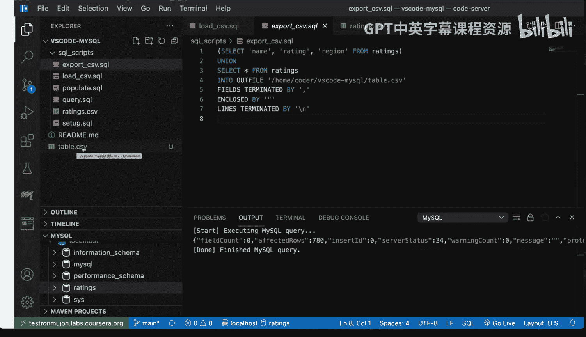

# 数据工程基础：2-4：将CSV数据导入MySQL 📊


## 概述
在本节课中，我们将学习如何将CSV格式的数据导入到MySQL数据库中，以及如何将MySQL中的数据导出为CSV文件。这是数据工程中常见的数据交换操作。

## 导入CSV数据到MySQL
将数据导入MySQL通常通过SQL文件完成。然而，使用其他格式（如CSV）导入数据也是完全可行的。本节中，我们来看看如何将CSV文件加载到MySQL中。

这个过程涉及几个步骤，可能会有些复杂。我们有一个名为 `load_csv.sql` 的SQL文件。在第一行，它这样写道：

```sql
LOAD DATA LOCAL INFILE 'ratings.csv' INTO TABLE ratings
```

这条语句意味着它将读取 `ratings.csv` 文件，并将其数据加载到名为 `ratings` 的表中。

以下是定义数据格式的选项：

*   **字段分隔符**：对于CSV文件，字段通常由逗号分隔。你可以根据实际分隔符进行调整。
*   **行终止符**：每条记录（行）由换行符终止。
*   **变量映射**：一个有趣的特性是，你可以为数据的每个部分命名并设置变量。例如，使用 `@name`、`@rating`、`@region` 这样的变量来捕获CSV中的列，然后在语句的右侧将它们映射到数据库表的对应列。这不是一个直观的语法，但这是实现此功能的方式。

现在，如果我尝试运行这个查询，可能会遇到问题。执行 `run mysql query` 命令后，系统可能会报错：“Loading local data is disabled; this must be enabled both on the client and server sides”。

这个错误意味着客户端和服务器都必须启用从本地文件加载数据的功能，此操作才能成功。如果你的环境已启用此功能，那么上述方法就是导入CSV的标准流程。

## 从MySQL导出数据到CSV
上一节我们介绍了如何导入，本节中我们来看看如何从MySQL数据库导出数据为CSV格式。假设我们的 `ratings` 表中已有数百条记录，我们希望将其导出。

我们来看一个名为 `export_csv.sql` 的导出文件示例。在这个文件中，我们执行以下操作：

首先，我们编写一个查询，从 `ratings` 表中选择 `name`、`rating` 和 `region` 字段。然后，我们使用 `UNION` 语句（如果需要合并初始标题行和实际数据）。最后，我们使用 `INTO OUTFILE` 子句将结果输出到指定路径。

以下是导出时可以定义的格式参数：

*   **输出路径**：需要提供一个绝对路径来指定CSV文件的生成位置。
*   **字段分隔符**：使用 `FIELDS TERMINATED BY` 指定，对于CSV，通常是逗号 `,`。
*   **值包围符**：使用 `ENCLOSED BY` 指定，例如双引号 `"`。这提供了灵活性，如果你的数据本身包含双引号，可以选择其他字符以避免转义问题。
*   **行终止符**：使用 `LINES TERMINATED BY` 指定，通常是换行符。



现在，我们执行这个导出查询。运行 `run mysql query` 命令后，你可以在左侧文件列表中看到新生成的 `table.csv` 文件。点击查看，你会发现它包含了数据库中 `ratings` 表的所有数据。

这是一种从MySQL导出数据的非常有效且便捷的方法。导出的CSV文件可以很方便地加载到Python中（例如使用pandas库）进行进一步的数据处理，使得数据在不同工具间的流转更加顺畅。

## 总结
本节课中，我们一起学习了在MySQL中进行CSV格式数据导入和导出的方法。虽然SQL文件仍是MySQL数据迁移更常见的方式，但掌握CSV的导入导出能让你在处理需要与其他数据分析工具（如Python/pandas）交互的数据时更加得心应手。我们了解了导入时可能遇到的本地文件加载权限问题，以及导出时如何灵活定义字段分隔符、文本包围符等格式细节。