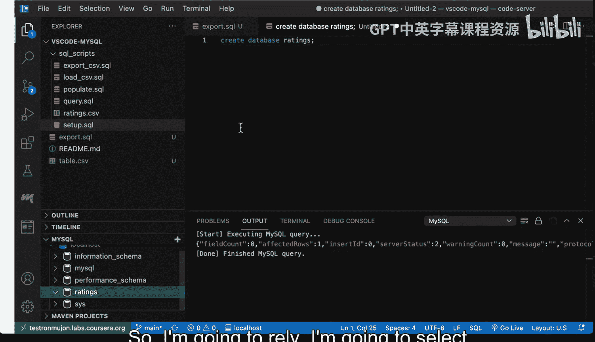
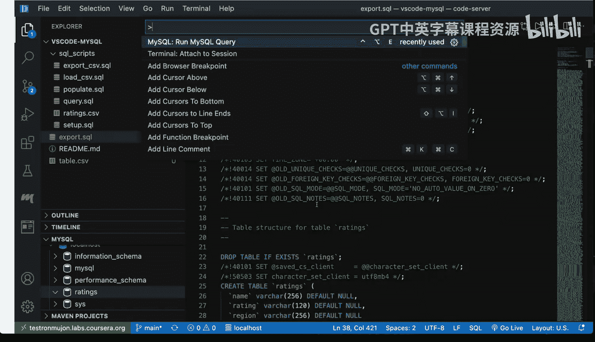
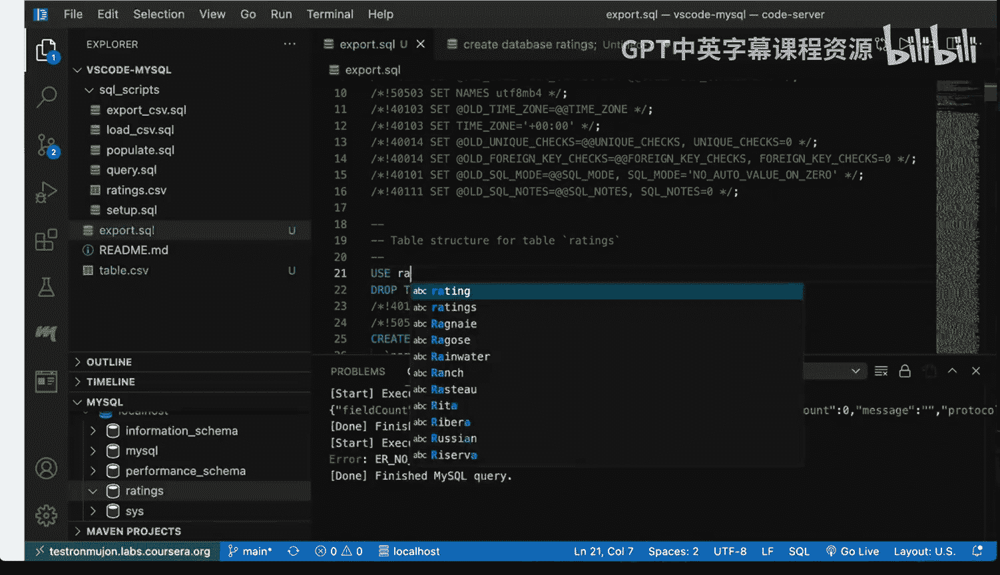
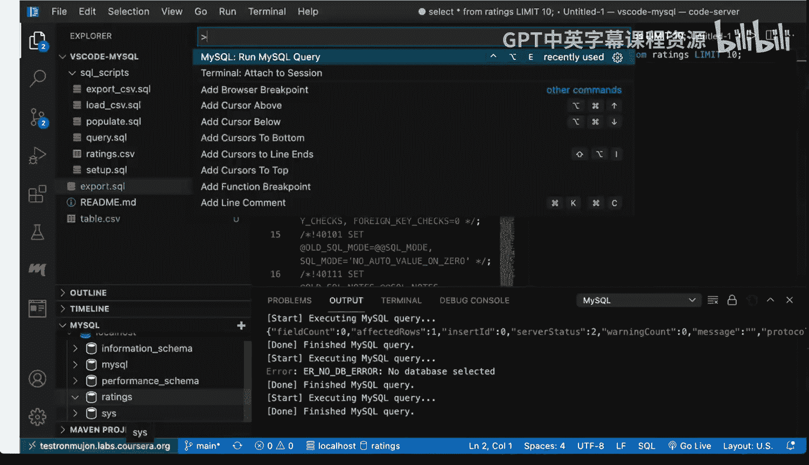

# 数据工程基础：2-4：从MySQL导出数据 📤


在本节课中，我们将学习如何从MySQL数据库中导出数据。导出数据是数据工程中的一项重要技能，它允许我们备份数据、迁移数据或在不同的系统之间共享数据。我们将重点介绍使用 `mysqldump` 命令行工具来完成这项任务。

上一节我们介绍了如何向MySQL导入数据，本节中我们来看看如何将数据从MySQL中导出。

## 准备工作

首先，你需要确保你的系统上安装了 `mysqldump` 工具。在Linux或类Unix系统中，你可以使用 `which` 命令来检查。

```bash
which mysqldump
```
如果该工具已安装，此命令将返回 `mysqldump` 的安装路径。

## 使用 `mysqldump` 导出数据

`mysqldump` 是一个功能强大的工具，它可以生成一个包含数据库结构和数据的SQL脚本文件。以下是导出数据库的基本步骤。

以下是使用 `mysqldump` 导出名为 `ratings` 的数据库的命令示例：

```bash
mysqldump -u root -p ratings > export.sql
```
在这个命令中：
*   `-u root` 指定用户名为 `root`。
*   `-p` 表示稍后会提示你输入密码。为了安全，不建议在命令行中直接输入密码。
*   `ratings` 是要导出的数据库名称。
*   `> export.sql` 使用重定向操作符 `>` 将命令的输出（即SQL语句）保存到名为 `export.sql` 的文件中。

执行命令后，系统会提示你输入密码。输入正确密码后，`export.sql` 文件就会被创建在当前目录下。

## 理解导出文件

生成的 `export.sql` 文件包含了重建整个数据库所需的所有SQL命令。它主要包含以下内容：

1.  **删除和创建表的语句**：首先会删除已存在的表（如果存在），然后重新创建它们，并指定正确的存储引擎和字符集。
2.  **插入数据的语句**：文件会将所有数据打包成一个或多个 `INSERT` 语句。为了提高效率，它通常会将大量数据合并到一个大型的 `INSERT` 语句中，而不是分成许多小语句。

## 实践：还原导出的数据

为了验证导出文件的有效性，我们可以模拟一个数据恢复的场景：先删除原数据库，然后利用导出的SQL文件重建它。





以下是操作步骤：



1.  **删除原数据库**：在MySQL客户端或管理工具中执行以下命令。
    ```sql
    DROP DATABASE ratings;
    ```
    执行后，`ratings` 数据库将被移除。

2.  **创建空数据库**：我们需要先创建一个同名的空数据库。
    ```sql
    CREATE DATABASE ratings;
    ```



3.  **还原数据**：现在，使用我们之前导出的 `export.sql` 文件来填充这个新数据库。首先，需要确保SQL文件在操作前选择了正确的数据库。你可以在文件开头添加 `USE ratings;` 语句，或者在使用 `mysql` 命令还原时指定数据库。
    使用 `mysql` 命令行还原：
    ```bash
    mysql -u root -p ratings < export.sql
    ```
    或者在MySQL客户端中直接运行 `export.sql` 文件中的SQL语句。

4.  **验证数据**：数据还原后，可以运行一个简单的查询来验证。
    ```sql
    SELECT * FROM ratings LIMIT 10;
    ```
    如果查询成功返回之前的数据行，说明导出和还原过程成功。

## 总结

本节课中我们一起学习了如何使用 `mysqldump` 工具从MySQL数据库导出数据。我们了解了导出命令的基本语法，生成了一个包含数据库结构和数据的SQL文件，并通过一个完整的删除与重建的流程，实践了如何利用这个导出文件来恢复数据库。这种方法是一种非常直接且有效的数据库备份和迁移方式，`mysqldump` 工具会处理服务器配置等细节，确保数据库能被无缝重建。