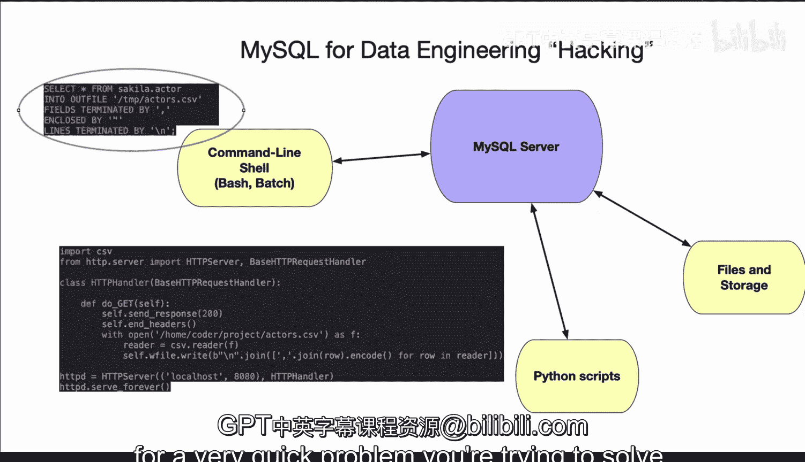

# 数据工程基础：2-4：MySQL高级操作概览 🛠️


在本节课中，我们将学习几种与MySQL交互的“黑客式”高效方法。这些方法不依赖于图形界面或复杂的SDK，而是利用Python、Bash等系统自带工具，帮助你在资源有限或需要快速原型开发的环境中，灵活地处理数据。

## 核心概念：命令行与标准库的力量 💪

上一节我们介绍了数据库的基本操作，本节中我们来看看如何利用系统原生工具进行高效的数据交互。其核心优势在于**避免陷入复杂的包管理**，并能**快速构建解决方案**。

## 方法一：查询结果导出到文件 📁

你可以将MySQL的查询结果直接导出到磁盘文件，例如CSV格式。之后，便能使用Linux命令行工具或Python标准库对其进行处理。

以下是使用`mysql`命令行客户端导出查询结果到CSV文件的基本命令：

```bash
mysql -u [用户名] -p[密码] -h [主机] [数据库名] -e "SELECT * FROM [表名];" | sed 's/\t/,/g' > output.csv
```

**代码解释**：
*   `mysql -e` 执行后面的SQL语句。
*   `sed 's/\t/,/g'` 将制表符（默认分隔符）替换为逗号，以生成CSV格式。
*   `> output.csv` 将输出重定向到文件。

## 方法二：使用Python标准库构建简易Web服务 🌐

Python标准库功能强大，无需安装第三方库即可完成许多任务，例如快速搭建一个临时的Web服务来提供数据。

以下是使用Python标准库`http.server`模块快速启动一个Web服务，并读取CSV文件的基本思路：

1.  首先，将MySQL数据导出为CSV文件（如上述方法）。
2.  编写一个简单的Python脚本，使用`http.server`模块创建服务，并在请求时读取并返回CSV文件内容。

```python
# 这是一个简化的示例逻辑
import http.server
import socketserver

PORT = 8000

class MyHandler(http.server.SimpleHTTPRequestHandler):
    def do_GET(self):
        # 在此处添加读取CSV文件并返回内容的逻辑
        self.send_response(200)
        self.end_headers()
        # 示例：返回文件内容
        with open('output.csv', 'r') as f:
            self.wfile.write(f.read().encode())

with socketserver.TCPServer(("", PORT), MyHandler) as httpd:
    print(f"服务启动于端口 {PORT}")
    httpd.serve_forever()
```

**应用场景**：这种方法适用于黑客松、实验室快速原型验证等需要极速搭建数据接口的场景。

## 方法三：使用`mysqldump`与Linux工具链 🔧

另一种强大的方式是使用`mysqldump`工具导出整个数据库或特定表的SQL格式备份，然后结合Linux文本处理工具进行解析和操作。

以下是相关命令示例：

```bash
# 导出整个数据库的结构和数据
mysqldump -u [用户名] -p[密码] [数据库名] > dump.sql

# 结合grep、sed等工具处理导出的SQL文件
# 例如：查找包含特定关键词的INSERT语句
grep "特定关键词" dump.sql | head -n 20
```

**优势**：你可以利用`grep`、`sort`、`awk`、`sed`等强大的Linux命令行工具，对导出的结构化SQL数据进行灵活的过滤、分析和转换，无需启动完整的数据库服务。

## 总结 📝

本节课中我们一起学习了三种与MySQL交互的高级操作方法：
1.  **导出查询结果到文件**：便于使用通用工具进行后续处理。
2.  **利用Python标准库构建Web服务**：快速创建临时的数据API接口。
3.  **结合`mysqldump`与Linux工具链**：对数据库转储文件进行灵活的文本级操作。



这些“黑客风格”的技巧强调利用现有环境工具，以最小依赖和最快速度解决数据提取、共享和初步处理的问题。在考虑引入复杂的工业级框架或库之前，尝试这些基础方法往往能更高效地应对临时性需求或完成概念验证。