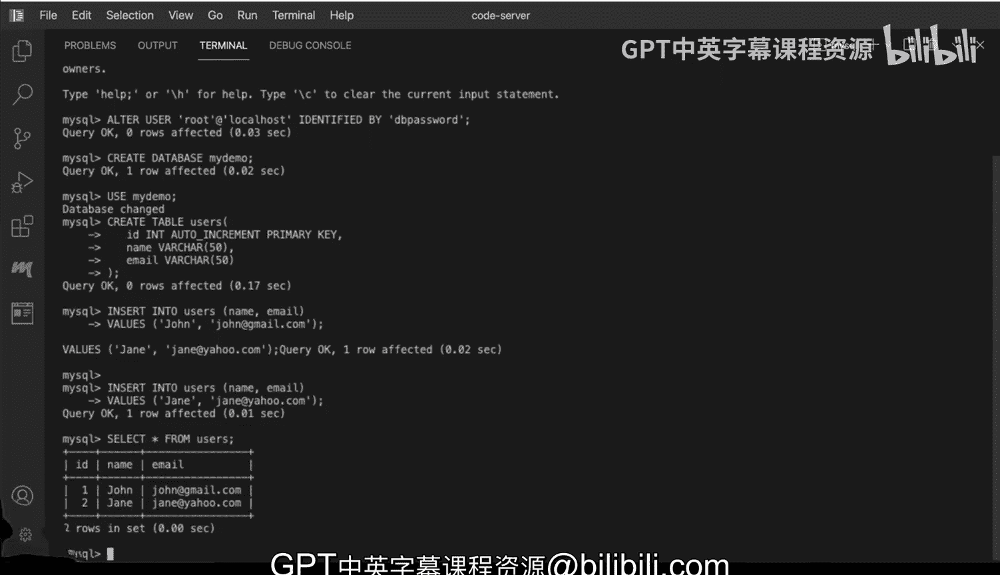

# 数据工程基础：2-4：终端操作MySQL 🖥️


在本节课中，我们将学习如何在终端环境中操作MySQL数据库。我们将从登录开始，逐步完成创建数据库、定义表结构、插入数据以及查询数据等核心操作。通过终端直接与数据库交互，可以帮助你更清晰地理解每个步骤背后的原理。

## 登录MySQL

首先，我们需要登录到MySQL服务器。我们将以`root`用户身份登录，这是新安装MySQL后的默认管理员账户。

以下是登录命令：
```bash
mysql -u root
```
执行此命令后，系统会提示你输入密码（如果已设置）。对于新安装，初始密码可能为空。

## 修改用户密码

成功登录后，一个常见的后续步骤是修改`root`用户的密码，以增强安全性。

我们可以使用`ALTER USER`语句来完成此操作。以下是修改密码的命令：
```sql
ALTER USER 'root'@'localhost' IDENTIFIED BY 'DB_password';
```
请将`'DB_password'`替换为你想要设置的新密码。

## 创建数据库

修改密码后，下一步是创建一个新的数据库。默认情况下，MySQL安装后没有用户数据库。

以下是创建名为`my_demo`的数据库的命令：
```sql
CREATE DATABASE my_demo;
```

## 选择数据库

创建数据库后，我们需要明确指定要使用哪个数据库来进行后续操作。

使用`USE`语句来选择我们刚刚创建的数据库：
```sql
USE my_demo;
```
执行此命令后，终端提示符可能会发生变化，表明当前会话已切换到`my_demo`数据库。

## 创建数据表

选择了数据库，我们就可以在其中创建存储数据的表。可以将表想象成电子表格，它由行和列组成，但每一列都需要预先定义数据类型。

以下是创建一个简单用户表的命令。该表包含`id`、`name`和`email`三列：
```sql
CREATE TABLE users (
    id INT AUTO_INCREMENT PRIMARY KEY,
    name VARCHAR(100),
    email VARCHAR(100)
);
```
在这个例子中：
*   `id` 是整数类型，并设置为自动递增的主键。
*   `name` 和 `email` 都是可变长度的字符串类型，最大长度为100个字符。

## 向表中插入数据

表结构定义好后，我们就可以向其中添加数据了。使用`INSERT INTO`语句来添加新记录。

以下是向`users`表中插入两条用户记录的示例：
```sql
INSERT INTO users (name, email) VALUES
('John', 'john@gmail.com'),
('Jane', 'jane@yahoo.com');
```
这条命令会向表中添加两行数据，分别对应John和Jane的用户信息。

## 查询数据

数据插入后，我们就可以使用`SELECT`语句来查询和查看表中的数据了。这是与数据库交互中最常用的操作之一。

要查看`users`表中的所有数据，可以使用以下命令：
```sql
SELECT * FROM users;
```
执行后，终端会返回一个结果集，显示表中所有的行和列，即我们刚刚插入的John和Jane的信息。

## 总结



本节课中，我们一起学习了在终端中操作MySQL数据库的完整基础工作流程。我们从登录MySQL开始，依次完成了修改密码、创建数据库、选择数据库、定义表结构、插入数据以及最终查询数据。这个流程是理解数据库操作的核心，通过在终端中直接实践，你能更牢固地掌握每个命令的作用和数据库的基本概念。