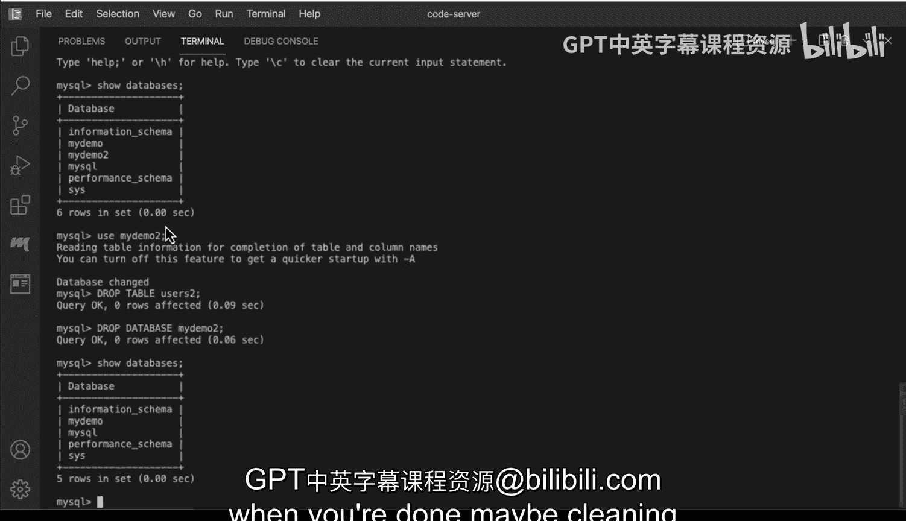

# 数据工程基础：2-4：数据库归档与删除


在本节课中，我们将学习MySQL数据库的两个核心操作：备份（归档）与删除。你将掌握如何安全地备份整个数据库，如何在不同数据库间复制数据，以及如何谨慎地执行删除操作。这些是数据工程师在管理和维护数据库时必须掌握的基本技能。

## 数据库备份

上一节我们介绍了数据库的基本操作，本节中我们来看看如何为数据库创建安全备份。在执行任何重大变更（如数据迁移或结构修改）之前，备份数据库是一项至关重要的最佳实践。

以下是使用 `mysqldump` 命令进行完整备份的步骤：

1.  打开终端，输入备份命令。该命令将连接MySQL并导出指定数据库的所有内容。
    ```bash
    mysqldump -u root -p my_demo > backup_my_demo.sql
    ```
2.  系统会提示输入 `root` 用户的密码，输入后命令开始执行。
3.  备份完成后，建议立即检查备份文件以确保其有效。首先，可以查看文件大小，确认其不为空。
    ```bash
    du -h backup_my_demo.sql
    ```
4.  接着，可以查看备份文件的开头部分，确认其中包含正确的SQL语句（如 `CREATE TABLE`）和数据。
    ```bash
    head -n 100 backup_my_demo.sql
    ```

通过以上步骤，我们就获得了一个包含数据库完整结构和原始数据的备份文件。这是一个非常实用的技术。

## 数据库间复制数据

现在我们已经有了一个安全的备份，接下来可以尝试对数据库进行一些操作。本节我们将学习如何在不同的数据库之间复制数据。

首先，我们需要连接到MySQL服务器：
```bash
mysql -u root -p
```
输入密码后，我们便进入了MySQL交互界面。

我们可以先列出所有数据库，确认目标数据库存在：
```sql
SHOW DATABASES;
```

假设我们想创建一个新数据库 `my_demo_2`，并将原数据库 `my_demo` 中的 `users` 表复制过来。以下是操作流程：

1.  创建新数据库。
    ```sql
    CREATE DATABASE my_demo_2;
    ```
2.  切换到新数据库。
    ```sql
    USE my_demo_2;
    ```
3.  通过 `CREATE TABLE ... AS SELECT ...` 语句，从原数据库复制表结构和数据。
    ```sql
    CREATE TABLE users_2 AS SELECT * FROM my_demo.users;
    ```
4.  操作完成后，可以退出MySQL，然后重新连接并列出数据库，验证 `my_demo` 和 `my_demo_2` 都已存在。

这个技巧非常有用，无论是用于数据归档、创建测试环境，还是迁移部分数据。

## 删除表与数据库

最后，我们来学习如何清理不再需要的实验性数据。删除操作需要格外谨慎，因为一旦执行，数据可能无法恢复。这正是我们在第一步进行备份的原因。

假设我们要清理刚才创建的 `my_demo_2` 数据库：

1.  确保当前使用的是目标数据库。
    ```sql
    USE my_demo_2;
    ```
2.  首先删除其中的表。
    ```sql
    DROP TABLE users_2;
    ```
3.  最后，删除整个数据库。
    ```sql
    DROP DATABASE my_demo_2;
    ```
4.  执行 `SHOW DATABASES;` 命令，可以看到 `my_demo_2` 已不存在。

**注意**：`DROP DATABASE` 是一个极其危险的命令，它会永久删除数据库及其所有内容。务必在确认无误并拥有备份的情况下执行。



本节课中我们一起学习了MySQL数据库管理的三个关键操作：使用 `mysqldump` 进行备份、在不同数据库间复制数据、以及安全地执行删除。请始终牢记，在执行任何可能影响数据的操作前进行备份，是保障数据安全的最重要原则。