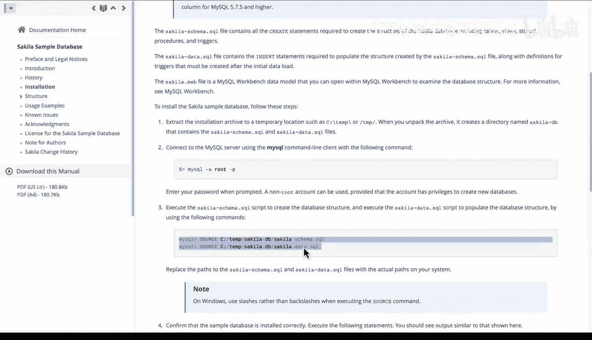
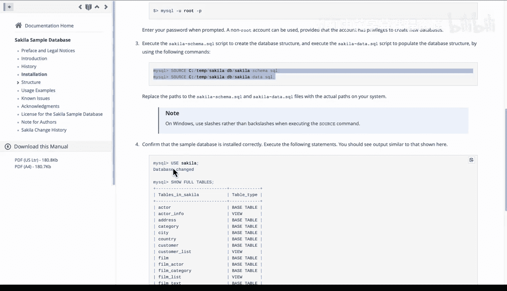
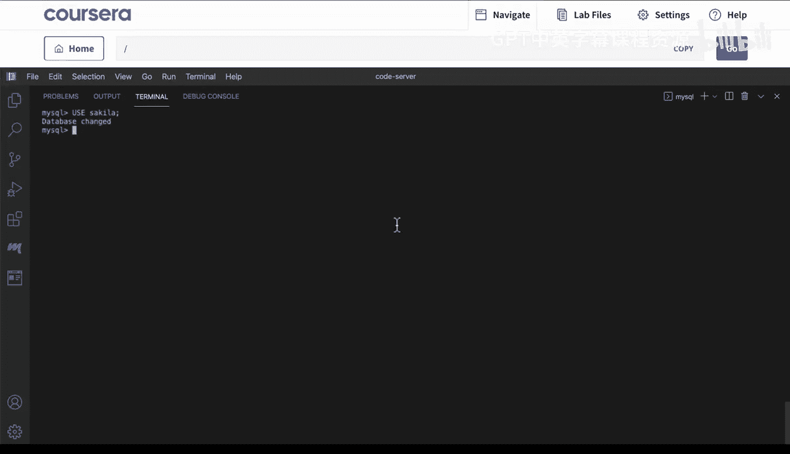
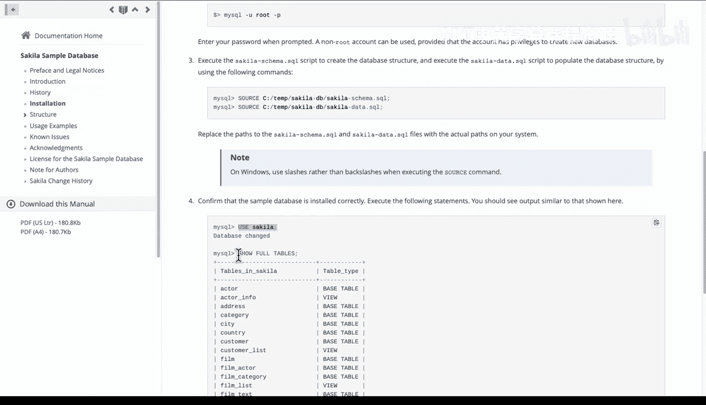
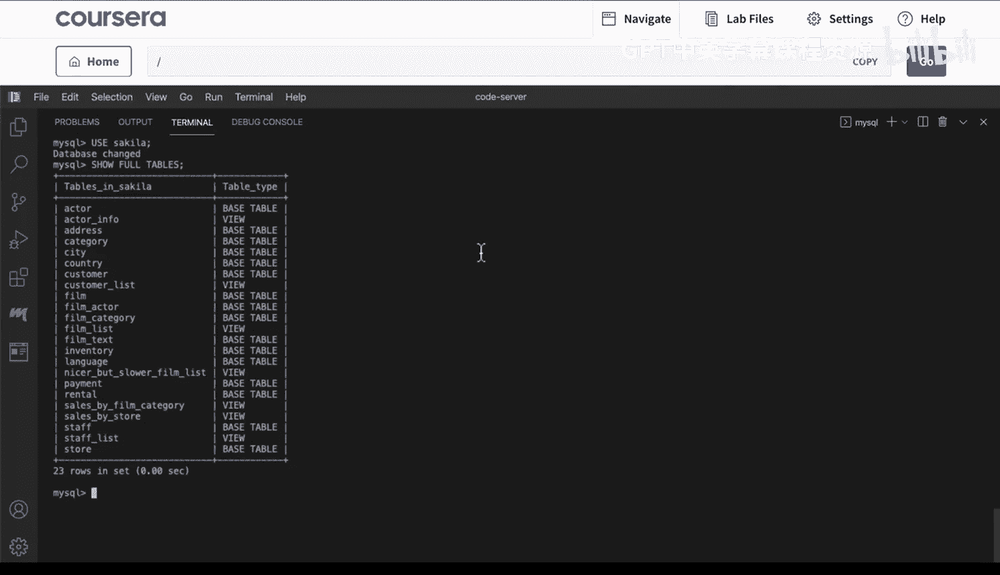
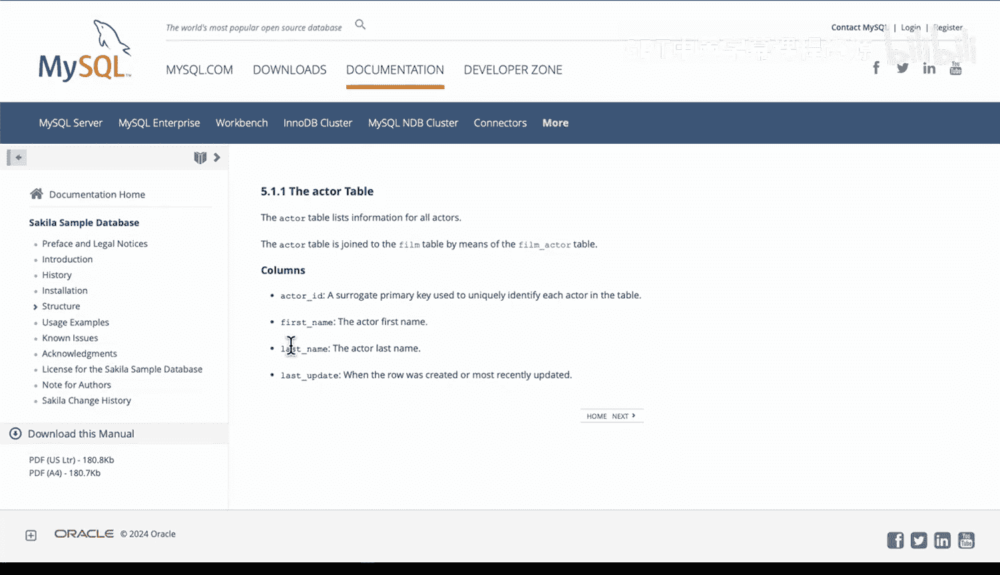
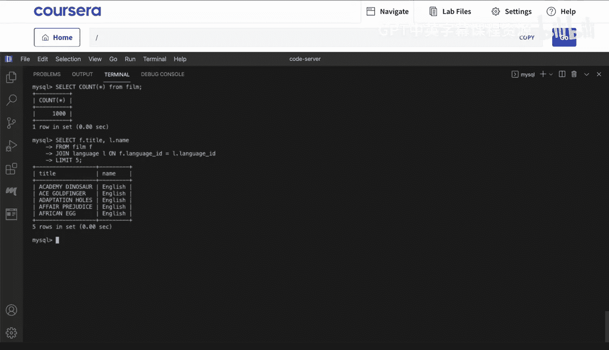

# 数据工程基础：2-4：导入并使用Sakila示例数据库


在本节课中，我们将学习如何下载、导入并使用MySQL官方提供的Sakila示例数据库。这是一个经典的电影租赁数据库，非常适合用于练习SQL查询和数据库操作。

## 获取Sakila数据库

首先，我们需要获取Sakila数据库。这是一个很好的参考数据库，可以帮助你理解特定类型数据库的结构和操作。



你可以从MySQL官方网站获取该数据库的文档和下载文件。访问以下链接：
`dev.mysql.com/doc/index-other.html`

下载包中通常包含三个文件：
*   **Schema文件**：用于创建数据库表结构。
*   **Data文件**：包含填充表的数据。
*   **.MWB文件**：用于MySQL Workbench，我们暂时不需要关注。

## 在终端中导入数据库

上一节我们介绍了如何获取数据库文件，本节中我们来看看如何在MySQL命令行中导入它们。

首先，我们可以在终端中查看一下下载的文件。使用`ls`命令可以看到文件列表，其中数据文件通常较大，而结构文件较小。你也可以用`tail`命令预览一下数据文件的内容，感受一下数据的格式。


接下来，我们需要登录MySQL并导入文件。具体步骤如下：



1.  登录MySQL服务器：
    ```bash
    mysql -u root -p
    ```
    输入密码后进入MySQL命令行界面。



2.  导入数据库结构文件（schema）：
    ```sql
    SOURCE /完整路径/sakila-schema.sql;
    ```
    这个过程可能需要一些时间来创建所有表。



3.  导入数据文件（data）：
    ```sql
    SOURCE /完整路径/sakila-data.sql;
    ```
    这个过程会将示例数据填充到刚创建的表中。

## 探索数据库结构

成功导入数据库后，下一步就是探索它的结构。参考官方文档总是一个好主意。





首先，切换到sakila数据库：
```sql
USE sakila;
```

然后，查看数据库中的所有表：
```sql
SHOW FULL TABLES;
```
你会看到数据库中包含`actor`、`film`、`language`、`category`等表。

官方文档的“结构”部分非常有用，它可以展示每张表的详细信息。例如，如果你想查看`actor`表的结构，可以查看其列定义。此外，文档还提供了数据库的**模式图**，展示了表与表之间的关系。

对于数据库工程师或数据工程师来说，在开始构建结构化数据库之前，花时间理解模式图是至关重要的。你需要理清数据的连接关系以及如何构建查询。

## 执行基础查询操作

了解了数据库结构后，我们现在可以开始执行一些查询来熟悉数据。

探索一张新表时，通常的第一步是查看其结构：
```sql
DESCRIBE actor;
```
这能显示`actor`表包含哪些列及其数据类型。

接下来，我们可以进行简单的数据查询。在不确定查询结果大小时，使用`LIMIT`子句是个好习惯：
```sql
SELECT * FROM actor LIMIT 5;
```
这将只返回前5行数据。你可以将`LIMIT 5`改为`LIMIT 20`来获取更多记录。

## 实践复杂查询：表连接

为了获取更有价值的信息，我们经常需要连接多张表。以下是一个连接查询的例子，它从多张表中组合信息：
```sql
SELECT f.title, f.rental_rate, a.first_name, a.last_name
FROM film f
JOIN film_actor fa ON f.film_id = fa.film_id
JOIN actor a ON fa.actor_id = a.actor_id
LIMIT 10;
```
这个查询将电影标题、租金、以及出演该电影的演员姓名组合在一起。这类查询可用于构建数据看板或报告。

## 使用聚合函数

除了连接，聚合函数也是数据分析的利器。例如，如果你想统计数据库中有多少部电影：
```sql
SELECT COUNT(*) AS total_films FROM film;
```
查询结果显示共有1000部电影。

我们也可以结合连接进行稍复杂的聚合查询。例如，一个更简单的连接查询可以获取电影及其对应的语言信息：
```sql
SELECT f.title, l.name AS language
FROM film f
JOIN language l ON f.language_id = l.language_id
LIMIT 10;
```
通过这个查询，我们可以看到每部电影对应的语言。

## 总结



本节课中我们一起学习了如何导入并使用Sakila示例数据库。我们首先从MySQL官网下载了数据库文件，然后在终端中通过`SOURCE`命令将其导入。接着，我们使用`USE`、`SHOW TABLES`和`DESCRIBE`等命令探索了数据库结构。最后，我们实践了基础查询、表连接（`JOIN`）和聚合函数（如`COUNT`）等核心SQL操作。


Sakila数据库因其完善的官方文档而成为提升SQL技能的绝佳工具。通过反复查询和探索这个结构清晰的示例数据库，你可以深入理解数据库设计的细节和复杂查询的构建方法。