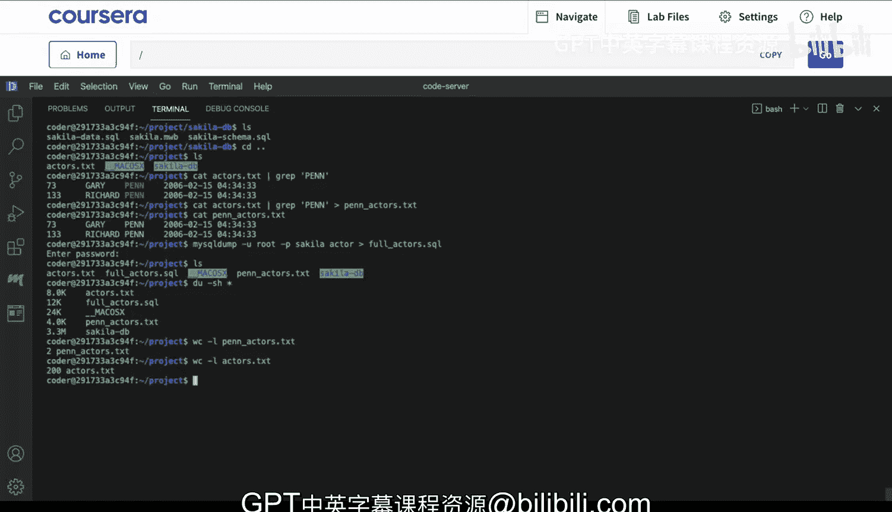

# 数据工程基础：2-4：使用Bash管道与MySQL交互 🛠️💾


在本节课中，我们将学习如何结合使用Bash Shell和MySQL数据库。这种技术能让数据工程师在不依赖特定编程语言的情况下，高效地执行SQL查询、处理数据并实现自动化工作流。

---

上一节我们介绍了Bash和MySQL的基础操作，本节中我们来看看如何将两者结合，通过管道（Pipe）实现数据交互。

## 连接数据库与初始查询

首先，我们需要连接到MySQL数据库。使用以下命令，以root用户身份登录：

```bash
mysql -u root -p
```

连接成功后，我们可以查看当前服务器上有哪些数据库：

```sql
SHOW DATABASES;
```

假设我们有一个名为 `sakila` 的数据库（这是一个示例演员-电影数据库）。我们选择使用这个数据库：

```sql
USE sakila;
```

现在，我们可以执行一个简单的查询来验证连接和数据。例如，从 `actor` 表中查询前5条记录：

```sql
SELECT * FROM actor LIMIT 5;
```

## 将查询结果导出到文件

直接在MySQL客户端查看结果很有用，但更强大的功能是将数据导出到文件，以便后续在Bash中进行处理。

我们可以修改上面的查询，使用 `INTO OUTFILE` 语句将结果直接保存到磁盘。以下是具体步骤：

1.  执行一个查询，并将其结果输出到指定路径的文件中。
2.  我们将文件保存在一个名为 `coder/project` 的目录下，文件名为 `actors.txt`。

对应的SQL命令如下：

```sql
SELECT * FROM actor INTO OUTFILE '/path/to/coder/project/actors.txt';
```

**注意**：你需要将 `/path/to/coder/project/` 替换为你系统上的实际路径。执行此命令后，查询结果将保存到该文本文件中。

## 在Bash中处理导出的数据

将数据导出为文件后，我们可以退出MySQL，回到Bash Shell环境进行进一步操作。

```bash
exit
```

然后，切换到文件所在的目录：

```bash
cd /path/to/coder/project
```

现在，我们可以使用各种Bash命令来处理 `actors.txt` 文件。以下是几个例子：

*   **查看文件内容**：使用 `cat` 命令。
*   **过滤数据**：使用 `grep` 命令查找包含特定字符串的行。例如，查找姓氏为“Penn”的演员：

```bash
cat actors.txt | grep Penn
```

执行后，你可能会看到类似“Gary Penn”和“Richard Penn”的结果。

*   **将过滤结果保存到新文件**：我们可以将上一步的过滤结果重定向到一个新文件。

```bash
cat actors.txt | grep Penn > penn_actors.txt
```

现在，`penn_actors.txt` 文件只包含了姓氏为“Penn”的演员数据。这个新文件可以被加载到另一个数据库表，或用于其他分析。

## 不登录MySQL直接导出数据

除了在MySQL内部操作，我们还可以完全不进入MySQL客户端，直接使用命令行工具导出数据。`mysqldump` 是一个强大的工具，用于备份或导出数据库和表。

例如，我们可以直接导出整个 `sakila` 数据库中的 `actor` 表的结构和数据：

```bash
mysqldump -u root -p sakila actor > full_actors_dump.sql
```

系统会提示你输入密码。执行成功后，`full_actors_dump.sql` 文件将包含创建 `actor` 表及插入所有数据的SQL语句。

## 对比与分析数据文件

回到Bash，我们可以轻松对比不同方式生成的数据文件大小，以验证我们的操作。

使用 `ls -lh` 命令查看目录下文件的详细信息：

```bash
ls -lh
```

输出可能显示：
*   `actors.txt`：8KB（直接从 `SELECT ... INTO OUTFILE` 导出的纯数据）
*   `full_actors_dump.sql`：12KB（包含SQL语句的完整转储）
*   `penn_actors.txt`：4KB（我们过滤后的子集）

这直观地展示了我们如何通过不同方法获取和筛选数据。

我们还可以使用 `wc`（word count）命令来统计文件的行数，这对于快速了解数据规模非常有用：

```bash
wc -l penn_actors.txt  # 统计penn_actors.txt的行数
wc -l actors.txt       # 统计原始actors.txt的行数
```

第一个命令可能输出 `2`，表示有2位姓“Penn”的演员。第二个命令可能输出 `200`，表示原表中共有200位演员。

---

本节课中我们一起学习了如何将Bash Shell与MySQL数据库协同工作。核心在于利用管道和重定向，将SQL的查询能力与Bash的文件处理、文本过滤能力结合起来。你掌握了：
1.  在MySQL中使用 `INTO OUTFILE` 导出数据。
2.  在Bash中使用 `grep`、`>` 等命令处理和分析导出的数据。
3.  使用 `mysqldump` 工具直接从命令行备份数据库表。
4.  通过 `ls` 和 `wc` 命令快速检查文件属性和数据规模。



这种方法避免了为了简单数据操作而编写Python或Ruby脚本的复杂性，让数据工程师能够快速、灵活地完成许多常见任务。