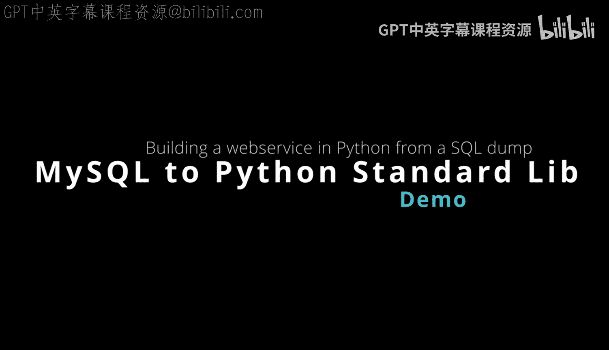
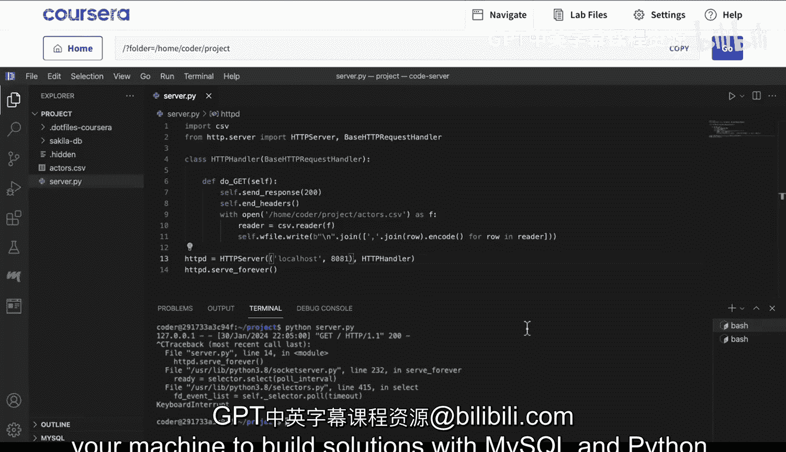
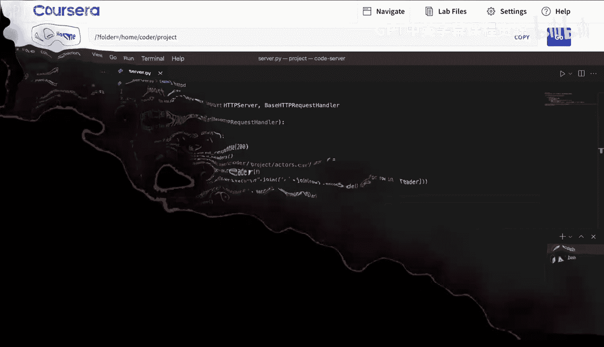

# 数据工程基础：2-4：通过Python标准库Web服务器连接MySQL 🐍



在本节课中，我们将学习如何结合使用MySQL、Bash和Python标准库，快速构建一个简单的数据服务。具体流程是：从MySQL数据库中提取数据，将其保存为CSV文件，然后使用Python内置的HTTP服务器创建一个可通过网络访问该数据的Web服务。

---

上一节我们介绍了数据提取的基本方法，本节中我们来看看如何将数据发布为Web服务。

首先，我们需要从MySQL数据库中查询数据。以下步骤在终端中完成。

1.  连接到MySQL服务器：
    ```bash
    mysql -u root -p
    ```
2.  查看并选择包含目标数据的数据库：
    ```sql
    SHOW DATABASES;
    USE sequila;
    ```
3.  确认目标表存在：
    ```sql
    SHOW TABLES;
    ```
4.  执行查询并将结果导出到CSV文件。此查询会进行一些数据清洗以确保格式正确：
    ```sql
    SELECT * FROM actor INTO OUTFILE '/tmp/actors.csv'
    FIELDS TERMINATED BY ',' OPTIONALLY ENCLOSED BY '"'
    LINES TERMINATED BY '\n';
    ```
5.  完成操作后，退出MySQL：
    ```sql
    EXIT;
    ```

---

现在，我们已经得到了数据文件 `actors.csv`。接下来，我们将使用Python标准库创建一个Web服务器来提供这些数据。

以下是实现此功能的核心Python代码 `server.py`：

```python
import csv
from http.server import HTTPServer, BaseHTTPRequestHandler

class SimpleHandler(BaseHTTPRequestHandler):
    def do_GET(self):
        # 设置响应头，表明返回的是CSV格式数据
        self.send_response(200)
        self.send_header('Content-type', 'text/csv')
        self.end_headers()

        # 打开CSV文件并将其内容写入HTTP响应体
        with open('/tmp/actors.csv', 'r') as csvfile:
            reader = csv.reader(csvfile)
            writer = csv.writer(self.wfile)
            for row in reader:
                writer.writerow(row)

# 在8081端口启动HTTP服务器
if __name__ == '__main__':
    server_address = ('', 8081)
    httpd = HTTPServer(server_address, SimpleHandler)
    print("Server started on port 8081...")
    httpd.serve_forever()
```

代码解析：
*   `SimpleHandler` 类继承自 `BaseHTTPRequestHandler`，用于处理HTTP GET请求。
*   `do_GET` 方法定义了服务器收到GET请求时的行为：设置正确的HTTP头，然后读取CSV文件的内容并流式传输回客户端。
*   脚本最后部分创建了一个 `HTTPServer` 实例，并使其在端口8081上永久运行。

---

运行服务器非常简单。在终端中执行以下命令：

```bash
python server.py
```

服务器启动后，您会看到提示信息。现在，可以通过多种方式访问数据服务。

使用 `curl` 命令在终端中获取数据：
```bash
curl http://localhost:8081
```

您也可以在浏览器中直接访问 `http://localhost:8081`，浏览器会提示下载或显示CSV文件内容。

---

本节课中我们一起学习了如何利用现有的基础工具链构建快速数据解决方案。我们首先使用MySQL和SQL语句查询并导出了数据，然后仅用Python标准库中的 `http.server` 和 `csv` 模块，就创建了一个轻量级的Web数据服务。





这个过程展示了Python标准库的强大功能。很多时候我们过于关注复杂的第三方库，但对于构建快速、简单的原型或工具，熟练运用Bash、SQL和Python标准库，就能高效地开发出实用的解决方案。