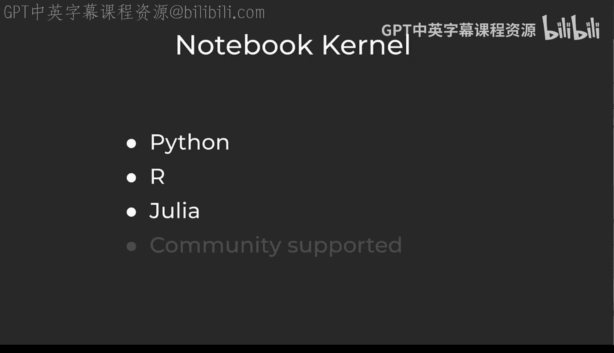
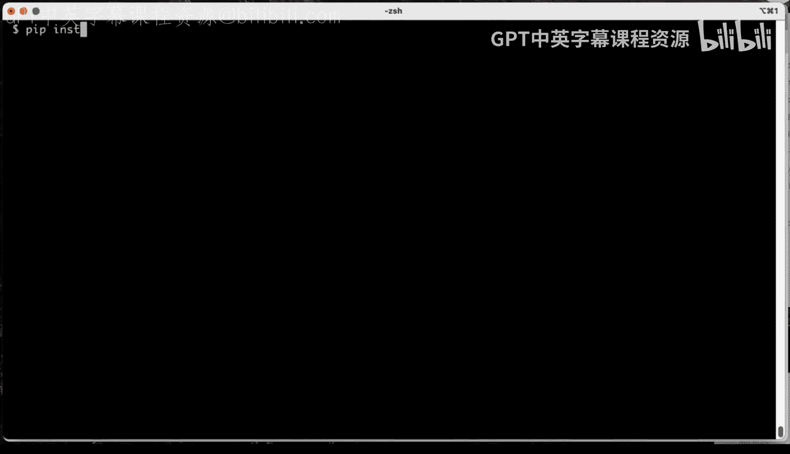
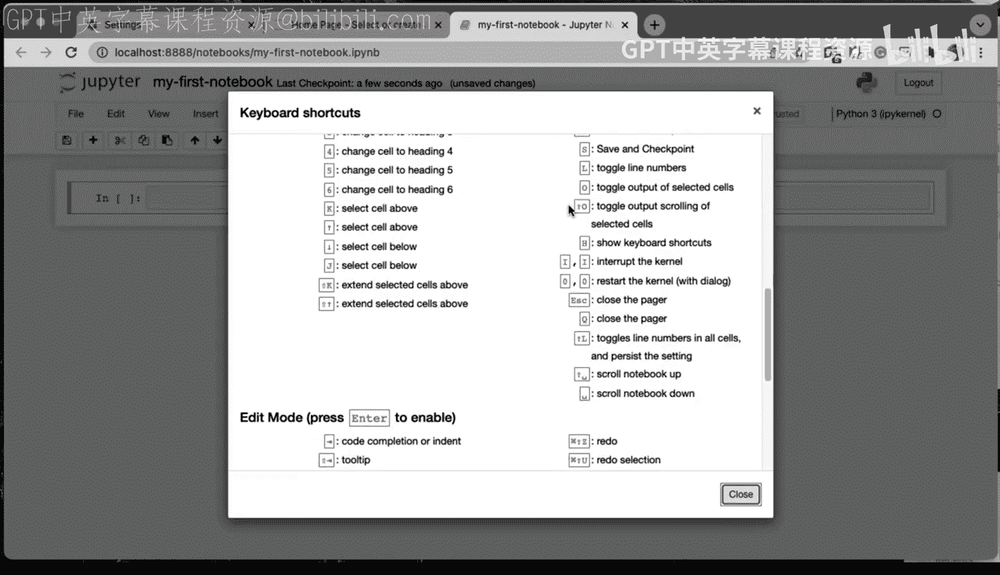
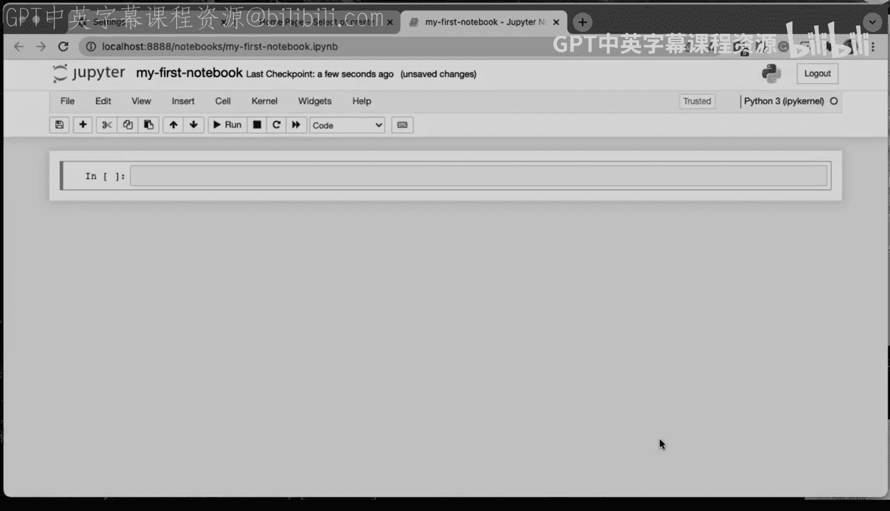

# 数据工程基础：2-4：Jupyter入门指南 🚀


在本节课中，我们将学习Jupyter Notebook的核心组成部分，包括代码单元格、文本单元格、魔法命令的使用以及Jupyter Lab界面的基本操作。Jupyter Notebook是一个强大的交互式文档工具，广泛应用于数据科学和工程领域。

## 从IPython到Jupyter

Jupyter项目源于2006年开始的IPython项目。IPython是一个增强的交互式Python shell。2014年，Jupyter项目从IPython项目中分离出来，成为该项目中与编程语言无关的部分。

Jupyter Notebook是一种可执行文档。它包含多个单元格，这些单元格可以容纳代码、文本或图像。代码单元格在“内核”中运行。官方为Python、R和Julia语言提供了内核，其他内核则由更广泛的社区维护。

## 安装与启动Jupyter

我们可以使用Python的包管理工具`pip`来安装Jupyter。





```bash
pip install jupyter
```

安装过程需要一些时间。安装完成后，我们可以使用以下命令启动Jupyter Notebook。

```bash
jupyter notebook
```

此命令通常会**自动**在您的浏览器中打开一个Notebook窗口。如果浏览器没有自动打开，您可以查看命令行终端的输出。输出信息中会提供一个URL，您可以将其复制到浏览器地址栏中手动打开。

## Jupyter Notebook界面初探

启动后，我们进入了Jupyter的界面，但此时还没有任何Notebook文件。我们可以通过选择内核来创建一个新的Notebook。

这是Notebook的主界面。顶部的“Untitled”是Notebook的名称，它也将作为保存时的文件名。Jupyter会定期自动保存您的工作。

界面上方有一系列控制按钮，用于执行各种操作，如运行单元格、保存文件等。您也可以按下 `Esc` 键，然后按 `H` 键，来调出键盘快捷键列表，这能极大提高操作效率。

## 总结





本节课我们一起学习了Jupyter Notebook的起源、基本概念以及如何安装和启动它。我们了解到Jupyter Notebook由代码、文本和图像单元格构成，并在特定的内核中运行代码。掌握这些基础知识是后续进行高效数据工程和科学计算的第一步。