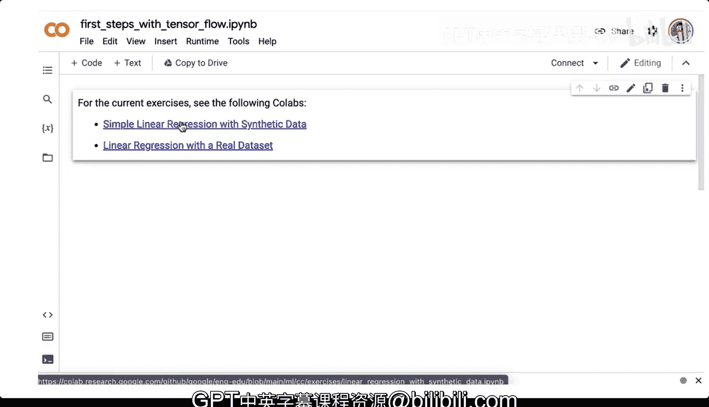

# 数据工程基础：2-4：Google Colab导论 🚀

在本节课中，我们将学习Google Colab。我们将讨论托管笔记本环境，查看文本单元格预览，学习如何在Colab笔记本中挂载Google Drive，以及如何管理Colab笔记本。


---

## 什么是Google Colab？ ☁️

Google Colab是一个托管环境。它托管在云端。它是一个Jupyter笔记本，但带有额外的功能。它预装了数据科学包。因此，对于你将进行的大部分工作，你无需担心环境或任何类型的设置。

Google Colab与普通的Jupyter Notebooks不同，它**仅支持Python**。使用Google账户可以免费使用。由于它在云端，文档天生就是可共享的，就像你共享其他类型的Google文档一样。它拥有一个庞大的共享集合生态系统。

---

## 探索共享生态系统：AI Hub（原Seed Bank） 📚

接下来，我们来看看AI Hub，它以前被称为Seed Bank。在AI Hub中，有大量示例笔记本。你可以通过这些笔记本学习与机器学习和数据科学相关的不同主题。

如果我们选择一个笔记本，可以在这里阅读它。或者，我们可以在Google Colab中自己打开这个笔记本。这为我们提供了一个可以随意修改的笔记本副本。

---

## 核心功能与操作

上一节我们介绍了Colab的基本概念和共享资源。本节中，我们来看看它的核心功能与具体操作。

### 文本单元格预览

Colab笔记本包含文本单元格和代码单元格。文本单元格支持Markdown格式，可以用于编写说明文档。

### 挂载Google Drive


你可以在Colab笔记本中挂载你的Google Drive，以便直接访问其中的文件。这通过以下代码实现：

```python
from google.colab import drive
drive.mount('/content/drive')
```

执行此代码后，按照提示完成授权，你的Google Drive就会被挂载到指定路径。

### 管理Colab笔记本

以下是管理Colab笔记本的几个关键点：
*   **创建与保存**：你可以创建新的笔记本，或从GitHub、Google Drive导入。笔记本会自动保存到你的Google Drive。
*   **运行环境**：Colab提供免费的GPU和TPU资源，可以在“运行时”菜单中更改硬件加速器类型。
*   **共享与合作**：像共享Google文档一样，你可以通过链接邀请他人查看或编辑你的Colab笔记本。

---

## 总结



本节课中我们一起学习了Google Colab。我们了解到它是一个基于云端的、免费的Python托管笔记本环境，预装了数据科学包，简化了设置流程。我们探索了AI Hub上的共享笔记本资源，并学习了如何挂载Google Drive以及管理笔记本的基本操作。这些功能使得Colab成为进行数据科学和机器学习实验的强大且便捷的工具。