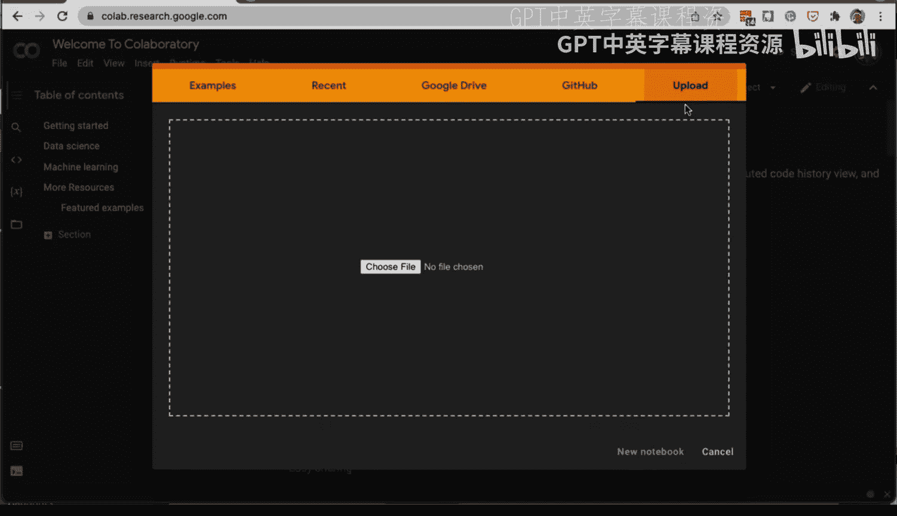
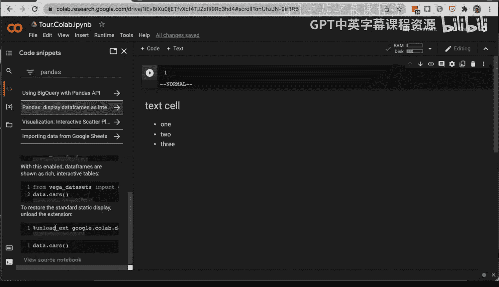
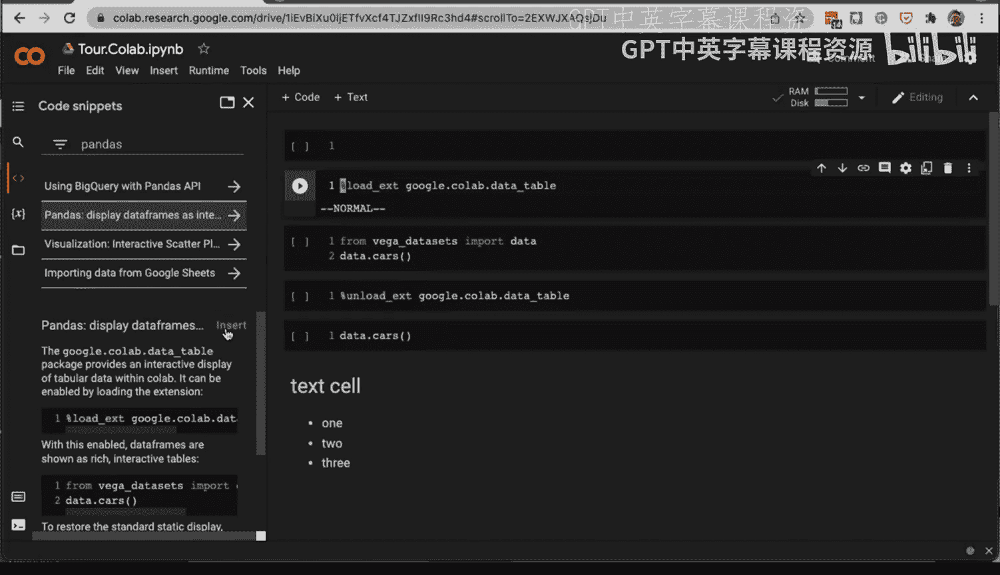
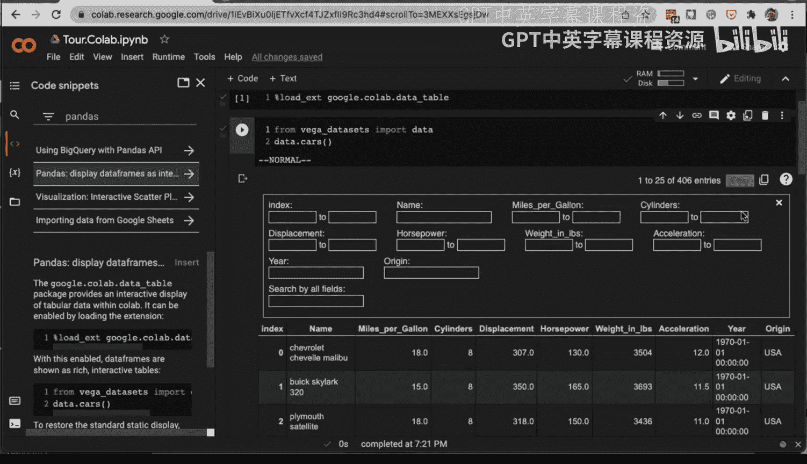

# 数据工程基础：2-4：Google Colab 功能导览 🧭

在本节课中，我们将一起探索 Google Colab 的主要界面和功能。Colab 是一个基于云端的 Python 开发环境，尤其适合数据科学和机器学习项目。我们将学习如何访问它、熟悉其布局，并了解一些能提升效率的特色工具。

## 访问与初始界面

要访问 Google Colab，请打开浏览器并前往 `colab.research.google.com`。

进入网站后，您将看到初始界面。这个界面提供了几个主要选项：
*   **最近打开的笔记本**：如果您之前使用过 Colab，可以在这里快速打开。
*   **示例笔记本**：Google 提供的一系列教程和示例项目。
*   **Google 云端硬盘中的笔记本**：打开您存储在 Google Drive 上的笔记本。
*   **GitHub**：从 GitHub 仓库直接打开笔记本。
*   **上传**：从您的本地计算机上传一个 Jupyter Notebook 文件（.ipynb）。
*   **新建笔记本**：创建一个全新的 Colab 笔记本。

由于 Colab 笔记本仅基于 Python 内核，因此创建时没有选择其他内核的选项。

## 界面布局概览

现在，让我们看看 Colab 笔记本的界面布局。它的设计与 Jupyter Lab 非常相似。

在顶部菜单栏，您可以点击此处来更改笔记本的名称。这个操作也会同步改变保存时的文件名。与 Jupyter 一样，Colab 笔记本会定期自动保存，防止数据丢失。

在界面左侧，有一个侧边栏，包含多个实用面板：
*   **目录**：如果您的笔记本使用了标题，它们会在这里显示，方便快速导航。
*   **查找和替换**：在整个笔记本中搜索和替换文本。
*   **代码片段**：这是一个非常有用的功能，我们稍后会详细介绍。
*   **变量管理器**：跟踪代码中变量的当前值。
*   **文件和数据**：管理项目文件和数据集，我们将在后续课程中深入探讨。

## 编辑与预览功能

在编辑方面，Colab 提供了一些便利功能。当您添加新单元格时，可以直接选择添加一个文本单元格，而无需像在经典 Jupyter 中那样先添加代码单元格再转换类型。

更重要的是，在您编写 Markdown 文本时，Colab 会实时显示预览效果。这意味着您无需运行单元格就能看到最终的渲染样式，这大大提升了文档编写的效率。

## 使用代码片段

上一节我们介绍了界面布局，本节中我们重点来看看“代码片段”这个强大工具。代码片段是预先编写好的示例代码块，涵盖了数据加载、可视化、机器学习等多种常见任务。

它们是非常有用的学习参考和效率工具。您可以通过搜索框快速查找需要的片段。

以下是使用代码片段的步骤：
1.  在左侧边栏打开“代码片段”面板。
2.  浏览或搜索您需要的功能（例如“加载数据”）。
3.  选中一个片段后，下方会显示该片段的说明、解释和部分代码预览。
4.  点击“插入”按钮，该段代码就会被添加到您当前光标所在的单元格中。
5.  插入后，像运行普通代码一样运行该单元格即可。

例如，插入一个展示表格的代码片段并运行后，它可能会加载一个数据集并以交互式表格的形式呈现。您可以直接在表格界面中进行排序、筛选等操作，体验类似于使用电子表格软件。

---

本节课中我们一起学习了 Google Colab 的基本使用方法。我们了解了如何访问 Colab、认识了其核心界面布局，并掌握了使用代码片段来加速开发的重要技巧。这些功能使得 Colab 成为一个强大且用户友好的云端 Python 编程环境。