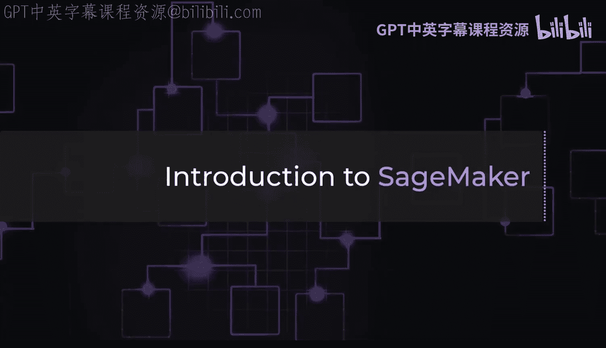
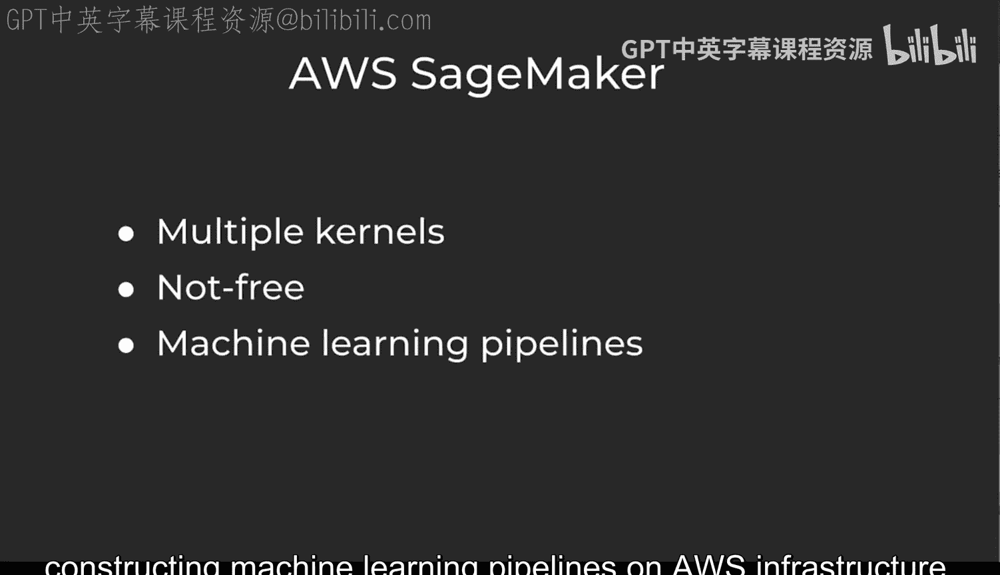
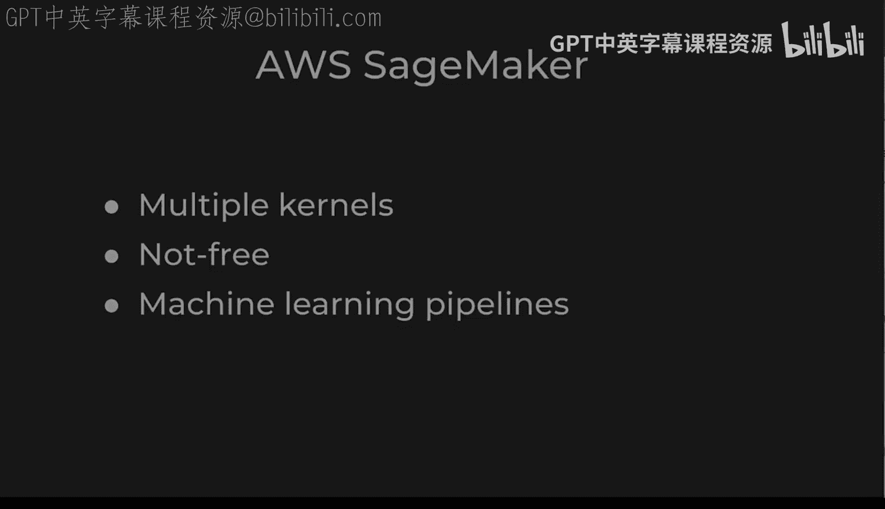
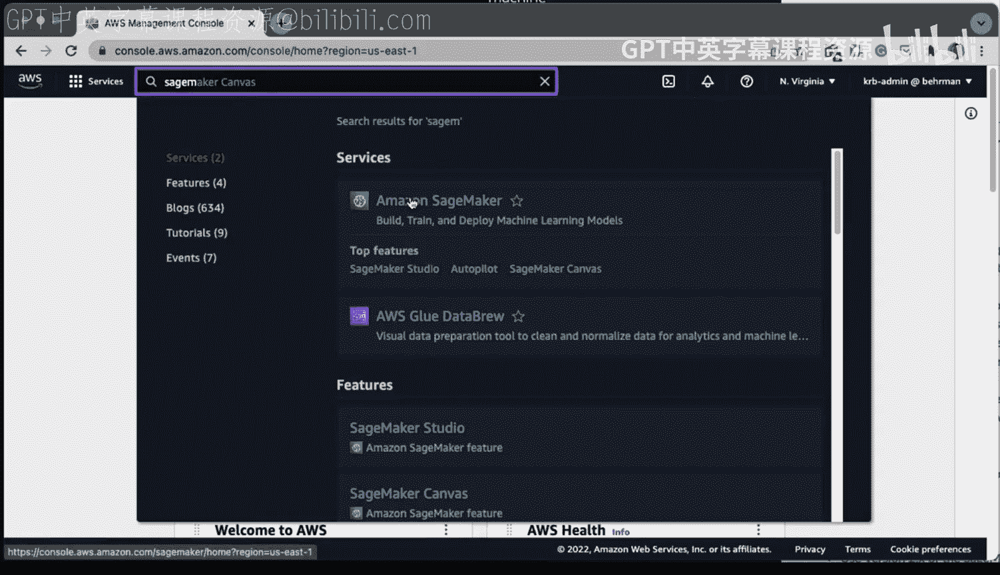
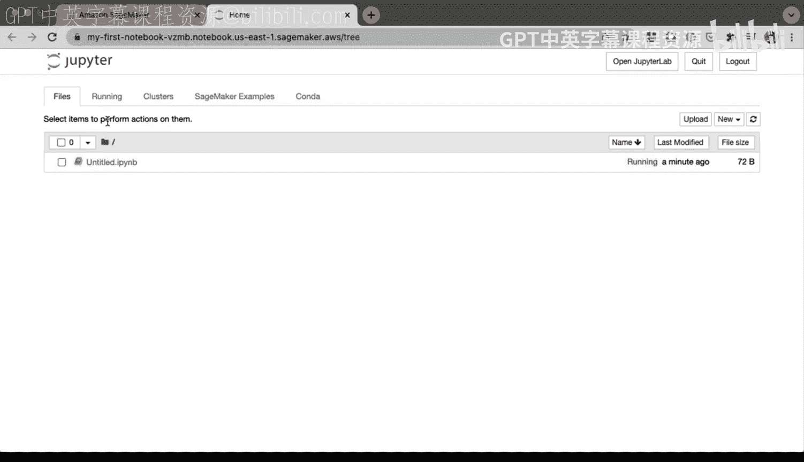

# 数据工程基础：2-4：AWS SageMaker 导论 🚀

在本节课中，我们将学习AWS SageMaker。我们将创建一个SageMaker笔记本实例，概览SageMaker Studio，并了解如何使用流水线进行数据和特征工程。AWS SageMaker是AWS托管的笔记本环境。与Google Colab不同，它提供多种可用的内核。同时，它也不是免费的。SageMaker专为在AWS基础设施上构建机器学习流水线而设计。

---

## 访问与设置SageMaker

上一节我们介绍了SageMaker的基本概念，本节中我们来看看如何访问和设置它。

登录AWS控制台后，可以通过搜索找到SageMaker服务。

使用SageMaker的第一步是设置一个SageMaker域。你可以看到该域正在创建的状态。这需要一些时间。

现在我们的域已准备就绪，我们可以创建一个笔记本实例。

---

## 创建笔记本实例

以下是创建新笔记本实例的步骤：

1.  在界面中选择“笔记本”选项。
2.  你可以搜索现有的笔记本或创建一个新的。
3.  为你的笔记本命名。
4.  在此处选择你希望笔记本运行的实例类型。

需要谨慎选择实例类型，不要选择比你所需更大或更强大的实例，因为你将为此付费。向下滚动，你可以看到T系列、M系列、计算优化型、加速计算型和内存优化型等选项。你还有其他选择。

为了本示例的简洁性，我们将使用默认设置创建一个笔记本。

可以看到这里的状态是“待处理”。笔记本创建需要一些时间。

---

## 使用SageMaker笔记本

现在我们的笔记本已创建，我们可以打开它。要打开它，选择Jupyter风格的单笔记本界面。

在这里打开Jupyter，你可以看到我们拥有正常的Jupyter界面。Amazon提供了相当多的内核，包括R和Python。在这里，我们有一个在AWS环境中运行的Jupyter笔记本。

通常，这些笔记本的运行方式与你期望的正常Jupyter笔记本一样。Amazon提供的一个特别之处是一个特殊的SDK。它让你能够访问一整套用于机器学习的工具，包括用于训练和构建模型的工具、用于访问AWS资源的工具以及执行许多其他操作的工具。

例如，如果我们想查找运行笔记本的环境，可以通过调用 `boto3.session.Session().region_name` 来获取。你可以看到我运行在 `us-east-1` 区域。

当我们完成笔记本工作并关闭它时，请务必也停止它。

---

## 总结

本节课中我们一起学习了AWS SageMaker的基础知识。我们了解了如何访问SageMaker服务、设置SageMaker域、创建并配置一个笔记本实例，以及如何在其中使用Jupyter环境和AWS提供的特殊SDK进行工作。记住，使用完毕后及时停止实例以避免不必要的费用。