# 数据工程基础：2-4：为持续集成设置Python项目结构 🏗️

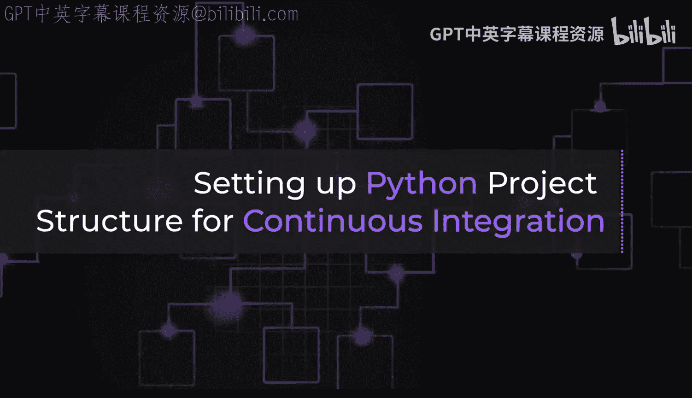

在本节课中，我们将学习如何为Python项目设置一个持续集成（CI）生态系统。核心目标是建立一个项目结构，使得每次开发者向Git仓库推送更改时，都能自动进行代码测试、代码规范检查和代码格式化。这是确保项目质量、为后续部署做好准备的关键一步。

## 项目结构与核心概念

上一节我们介绍了持续集成的目标，本节中我们来看看一个为持续集成和持续交付（CI/CD）准备好的项目具体包含哪些关键组件。

一个典型的项目结构包含以下核心部分：

*   **GitHub工作流**：这是自动化构建系统的配置区域。在本例中，我们使用GitHub Actions，但你也可以使用Jenkins、AWS CodeBuild等其他工具。它定义了在每次代码推送时自动执行的任务。
*   **Makefile**：这是一个包含一系列“配方”的文件，用于在本地或构建服务器上执行标准化命令，例如安装依赖、代码检查、运行测试和格式化代码。
*   **项目代码与配置文件**：包括源代码、测试文件、依赖清单（如`requirements.txt`）和说明文档（如`README.md`）。

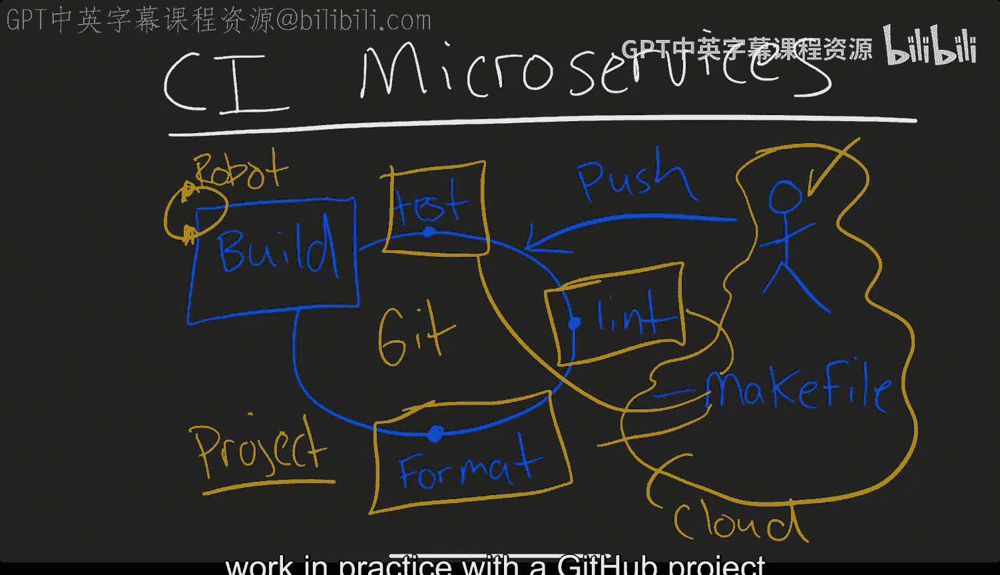

这种结构的核心优势在于，它通过一个**Makefile**将关键操作封装成简单的命令，例如`make lint`（代码检查）、`make test`（运行测试）和`make format`（格式化代码）。开发者可以在本地执行这些命令，而构建服务器（即“机器人”）会在每次代码提交后自动执行相同的流程，从而持续保证代码质量。

## 实战演练：剖析一个CI项目

接下来，让我们通过一个实际的GitHub项目，看看上述概念是如何具体实现的。

### 1. 自动化工作流配置

以下是项目自动化流程的核心配置，它定义在`.github/workflows/main.yml`文件中：

```yaml
name: CI Pipeline
on: [push]
jobs:
  build:
    runs-on: ubuntu-latest
    steps:
      - uses: actions/checkout@v2
      - uses: actions/setup-python@v2
        with:
          python-version: '3.8'
      - run: make install
      - run: make lint
      - run: make test
      - run: make format
```

这个配置意味着：每当有代码推送（`push`）事件时，GitHub Actions会启动一个Ubuntu虚拟机，安装Python 3.8，并依次执行`make install`（安装依赖）、`make lint`（代码检查）、`make test`（运行测试）和`make format`（代码格式化）命令。

### 2. 项目文件组成

现在，我们来看看项目仓库中包含的其他关键文件：

*   **`README.md`**：项目说明文档，通常包含构建状态徽章。
*   **`main.py`**：项目源代码文件，例如一个简单的加法函数。
*   **`test_main.py`**：对应的单元测试文件，用于验证代码功能。
*   **`requirements.txt`**：项目依赖包及其精确版本的清单。这确保了开发环境和构建环境的一致性，是实现**可重现性**的关键。
*   **`Makefile`**：本地和CI流程的指挥中心，定义了所有标准化操作命令。

### 3. Makefile详解

`Makefile`是连接本地开发与自动化流程的桥梁。其基本结构如下：

```makefile
install:
    pip install -r requirements.txt

lint:
    pylint --disable=R,C main.py

test:
    python -m pytest -v test_main.py

format:
    black main.py test_main.py

all: install lint test format
```

通过运行`make all`，你可以一次性执行安装、检查、测试和格式化所有步骤，快速获得项目状态的反馈。

## 在开发环境中实践

我们可以在一个云开发环境（如GitHub Codespaces）中打开这个项目，并实际操作这些组件，观察整个流程如何工作，以及当代码出现问题时如何快速发现。

1.  在终端中运行 `make all` 命令。这将启动完整的本地CI流程：安装依赖、进行代码规范检查、运行测试并格式化代码。如果一切正常，你会看到所有步骤都成功的反馈。
2.  **模拟一个错误**：在`main.py`中引入一个代码问题，例如将一个变量赋值给它自身（`x = x`），这是一个无意义且可能导致错误的操作。
3.  再次运行 `make lint` 或 `make all`。此时，代码检查工具（如pylint）会捕获这个“bug”，并在终端输出错误或警告信息，明确指出问题所在的行和原因。
4.  修复代码问题后，将更改提交并推送到Git仓库。

## 观察自动化构建流程

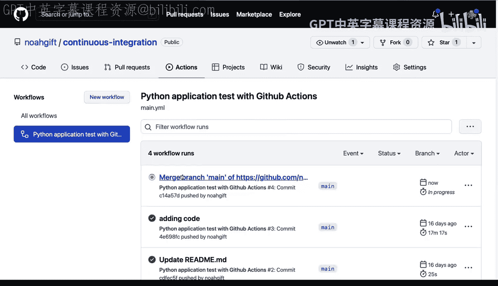

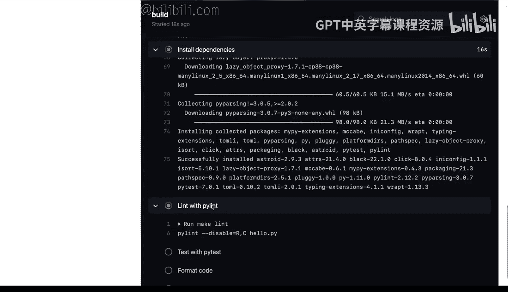

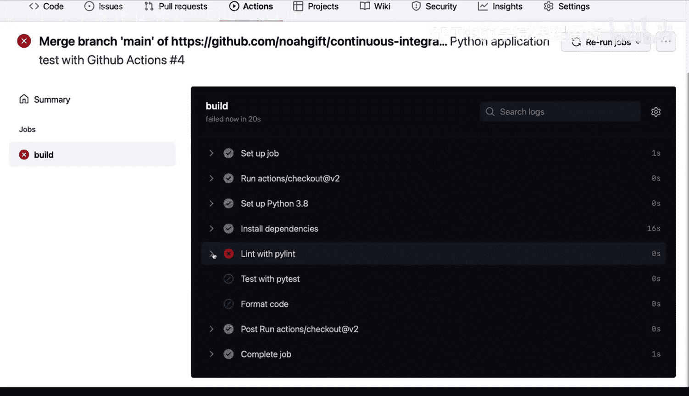

当你将包含问题的代码推送到GitHub后，持续集成的威力就显现出来了。

1.  前往GitHub仓库的“Actions”选项卡，你可以看到一个自动触发的构建任务正在运行。
2.  由于我们推送的代码存在规范问题，构建任务会在执行到 `make lint` 步骤时失败。构建服务器会清晰地标记出失败的任务，并展示详细的错误日志。
3.  此时，你甚至不需要打开本地开发环境。可以直接在GitHub的网页界面上编辑有问题的文件，删除或修复错误的代码行，然后再次提交。
4.  新的提交会再次触发自动化构建。这一次，所有步骤（安装、检查、测试、格式化）都会顺利通过，构建状态将显示为成功的绿色对勾。

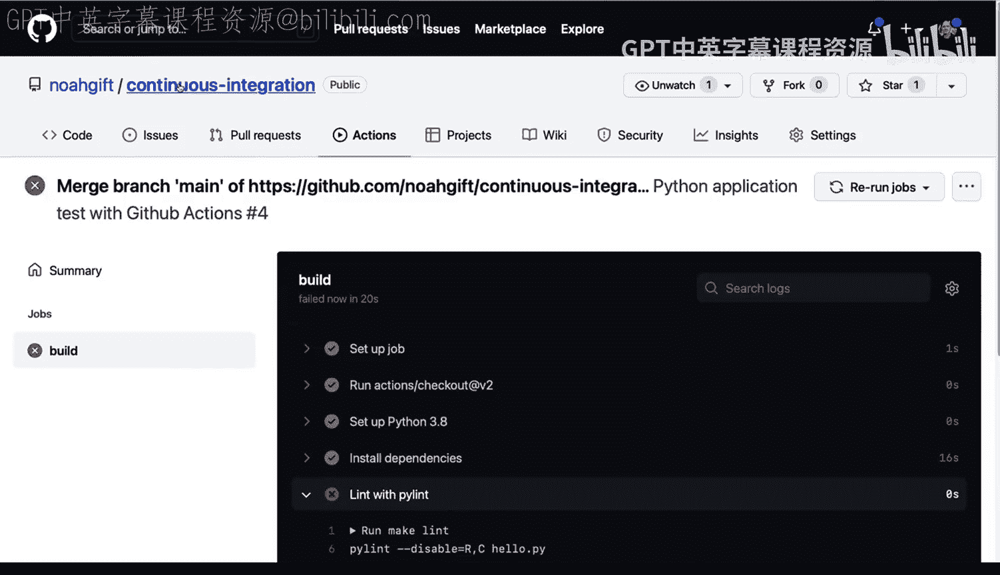

这个过程完美展示了持续集成如何作为一个“机器人质检员”，持续监控代码质量，并在问题引入时立即给出反馈，从而确保主分支的代码始终处于健康状态。

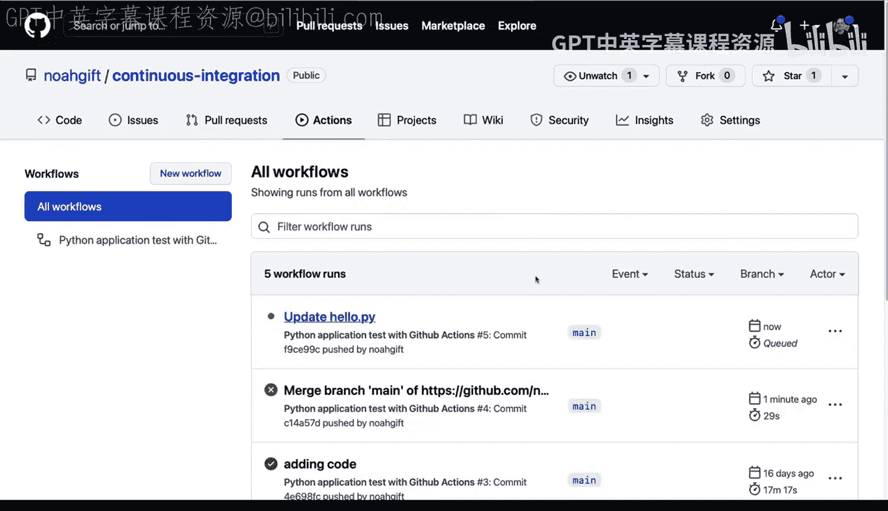

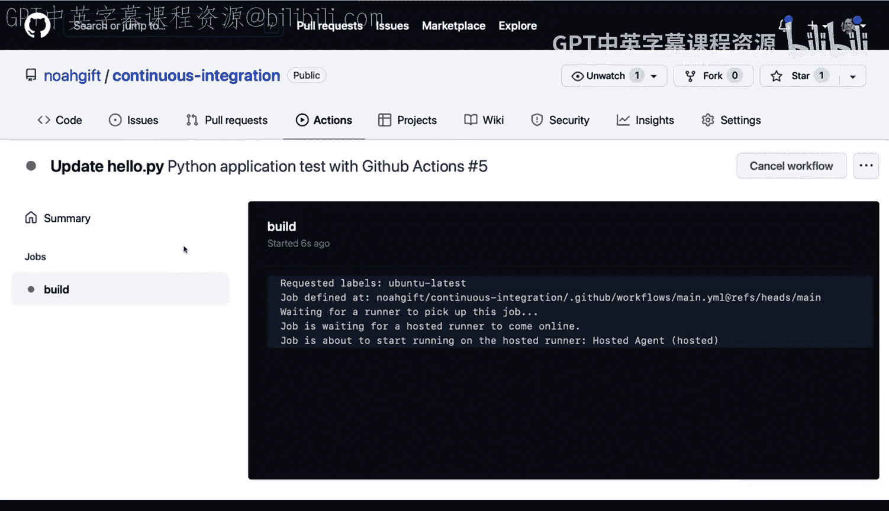

## 课程总结

本节课中，我们一起学习了为Python项目设置持续集成（CI）的完整流程。

我们首先理解了CI的核心价值：通过自动化测试、代码检查和格式化，在代码合并前持续保证质量。接着，我们剖析了一个标准的CI项目结构，其核心是**Makefile**和**自动化工作流配置**（如GitHub Actions）。通过实战，我们在开发环境中运行了CI步骤，并故意引入错误以观察自动化流程如何捕获问题。最后，我们见证了代码推送后，构建服务器如何自动执行“质检”任务，并在发现问题时快速反馈。

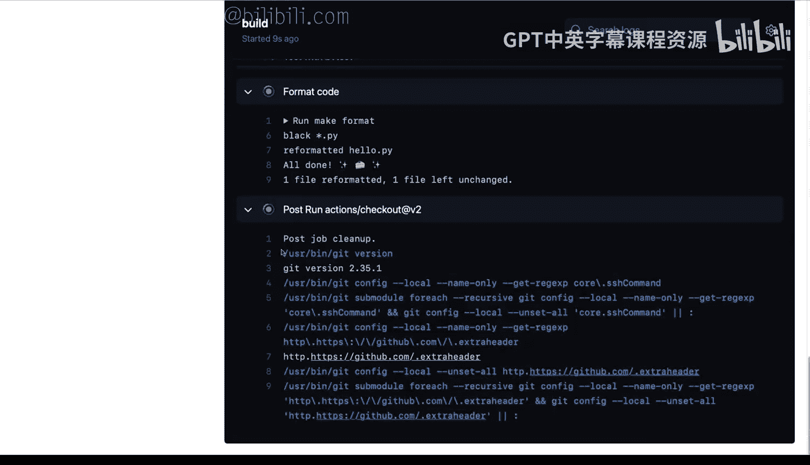

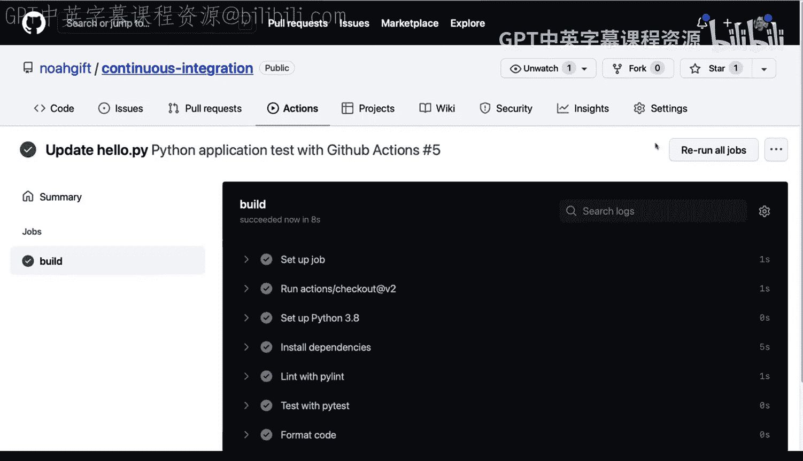

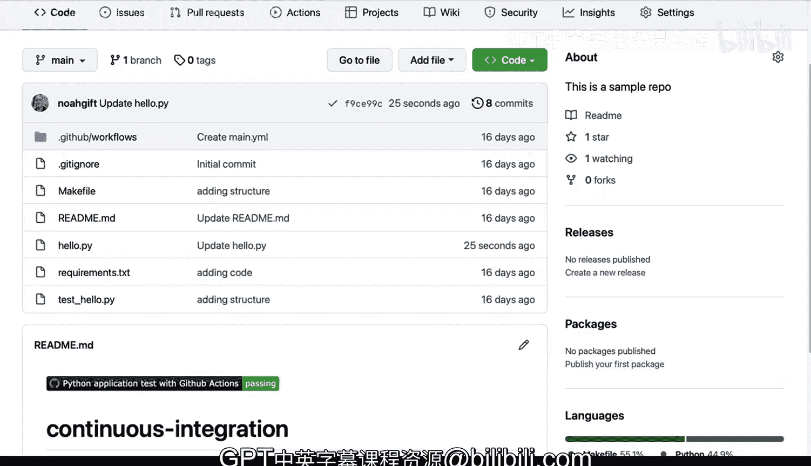

对于任何进行微服务开发、工具开发或软件开发的Python项目，建立这样一个持续集成环境都是至关重要的最佳实践。它不仅能及早发现缺陷，还能统一团队代码风格，为代码的可靠部署打下坚实基础。