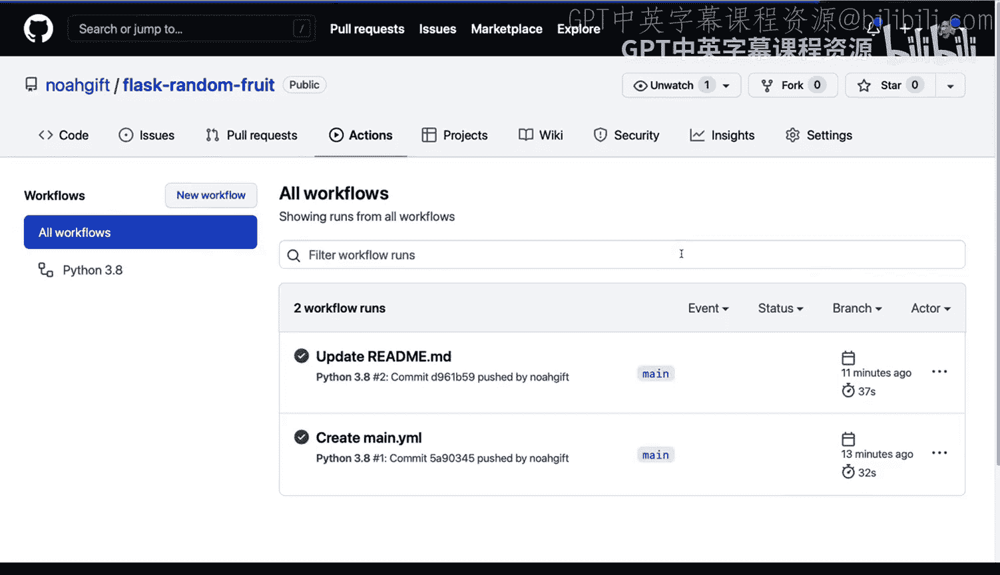
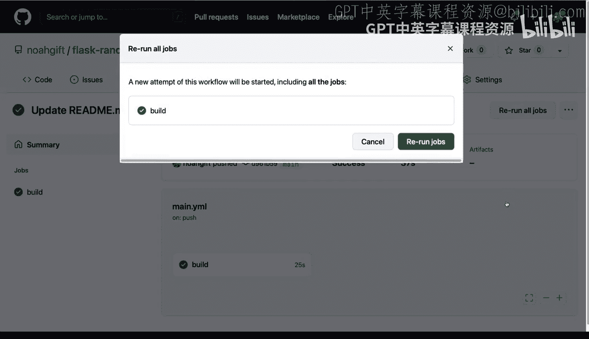
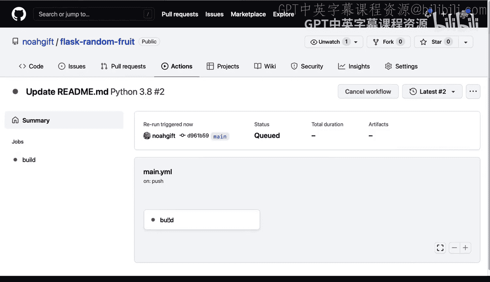
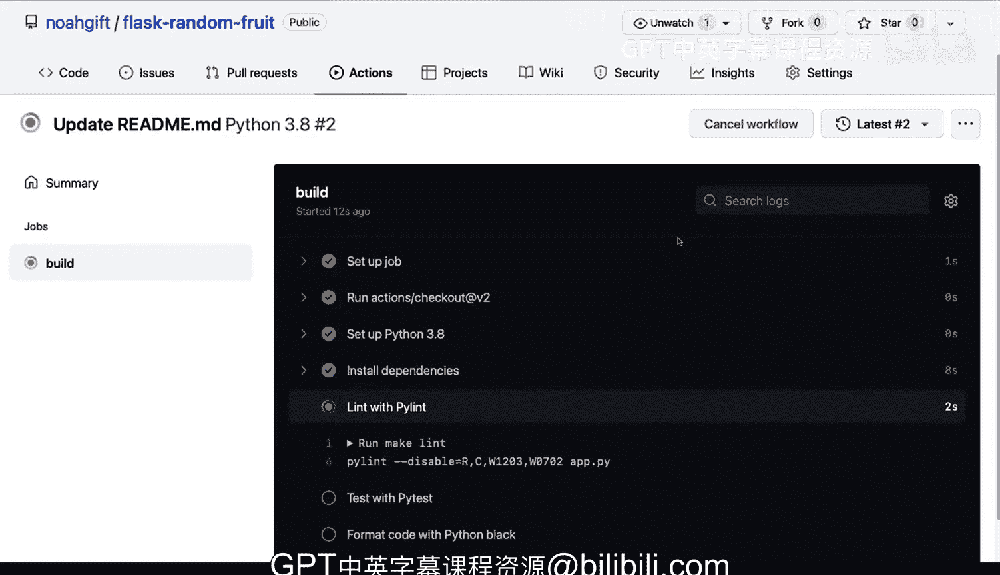

# 数据工程基础：2-4：使用Python构建随机水果Web应用 🍇


在本节课中，我们将学习如何使用Flask框架构建一个能够随机生成水果名称的微型Web应用。我们将从项目结构开始，逐步讲解核心代码、模板、测试以及如何利用持续集成（CI）工具来自动化开发流程。

---

## 项目结构概览

首先，我们需要为项目建立一个清晰的结构。一个典型的Flask微服务项目可能包含以下文件：

*   **`app.py`**: 这是主要的应用文件，包含了Web服务的核心逻辑。
*   **`requirements.txt`**: 列出了项目运行所依赖的Python包。
*   **`test_app.py`**: 包含了用于测试应用功能的代码。
*   **`Makefile`**: 一个包含常用命令（如安装、测试、代码检查）的脚本文件，用于简化开发流程。
*   **构建系统配置文件**（如GitHub Actions的`.yml`文件）：用于在持续集成环境中自动执行任务。

这些文件共同构成了一个既适合本地开发，也适合在持续集成环境中运行的项目基础。

---

## 核心应用代码解析

上一节我们介绍了项目的整体结构，本节中我们来看看构成应用核心的`app.py`文件是如何工作的。

```python
import random
from flask import Flask, render_template

app = Flask(__name__)

def random_fruit():
    """
    此函数从预定义的列表中随机选择一个水果并返回。
    """
    fruits = ['Apple', 'Cherry', 'Orange']
    return random.choice(fruits)

@app.route("/")
def home():
    """
    定义Web应用的根路由（主页）。
    它调用random_fruit函数，并将结果传递给HTML模板进行渲染。
    """
    fruit = random_fruit()
    return render_template("index.html", fruit=fruit)
```

代码的核心逻辑如下：
1.  **`random_fruit`函数**：它创建了一个包含三种水果的列表，并使用`random.choice()`方法随机返回其中一个。
2.  **路由`@app.route(“/”)`**：这定义了当用户访问网站根目录（主页）时，Flask应该执行`home()`函数。
3.  **`render_template`**：这个Flask函数用于渲染一个HTML模板（`index.html`），并将`random_fruit()`函数生成的结果（`fruit`变量）传递给它。

---

## HTML模板与数据渲染

我们已经看到Python代码如何生成数据，接下来需要了解如何将这些数据展示给用户。这通过HTML模板实现。

以下是`index.html`模板的内容：

```html
<!DOCTYPE html>
<html>
<head>
    <title>Random Fruit Generator</title>
</head>
<body>
    <h1>Random Fruit: {{ fruit }}</h1>
    <p>Refresh the page for more random fruit.</p>
</body>
</html>
```

这个模板与普通HTML的唯一区别在于 `{{ fruit }}` 部分。这是Jinja2（Flask使用的模板引擎）的语法。当Flask渲染这个页面时，它会用我们从Python代码中传递过来的`fruit`变量的实际值（例如“Apple”）替换掉 `{{ fruit }}`。

---

## 使用Makefile自动化任务

手动运行安装、测试、代码检查等命令很繁琐。我们可以使用`Makefile`来定义和自动化这些任务。

以下是一个典型的`Makefile`示例，它定义了四个常用命令：

```makefile
install:
    pip install --upgrade pip &&\
        pip install -r requirements.txt

lint:
    pylint --disable=R,C,W1203 app.py test_app.py

test:
    python -m pytest -vv test_app.py

format:
    black *.py

all: install lint test format
```

以下是每个命令的作用：
*   **`make install`**: 安装项目所需的所有Python依赖包。
*   **`make lint`**: 使用`pylint`工具检查代码风格和质量。
*   **`make test`**: 使用`pytest`运行`test_app.py`文件中所有的测试。
*   **`make format`**: 使用`black`工具自动格式化Python代码，使其风格统一。
*   **`make all`**: 按顺序执行以上所有任务，这是进行本地持续集成检查的快捷方式。

在终端中运行 `make all`，即可一键完成安装、代码检查、测试和格式化。

---

## 编写与运行测试

为了保证应用功能的可靠性，我们需要为它编写测试。以下是`test_app.py`文件中的一个简单测试示例：

```python
import app

def test_random_fruit():
    """
    测试random_fruit函数是否返回预期列表中的水果。
    """
    fruit = app.random_fruit()
    assert fruit in [‘Apple‘, ‘Cherry‘, ‘Orange‘]
```

这个测试导入了我们的主应用`app`，然后调用`random_fruit()`函数。**断言（assert）** 语句会检查函数的返回值是否在 `[‘Apple‘, ‘Cherry‘, ‘Orange‘]` 这个列表中。如果返回值不在列表中，测试就会失败。

运行 `make test` 或 `pytest` 命令即可执行这个测试。

---

## 运行应用与持续集成

最后，让我们启动应用并理解持续集成的价值。

在终端运行 `python app.py` 启动Flask开发服务器。在类似GitHub Codespaces的环境中，你可以直接打开浏览器预览应用。访问主页，你会看到类似“**Random Fruit: Orange**”的文字，刷新页面，水果名称会随机变化。

现在，如果我们修改了代码，如何确保没有引入错误呢？这就是持续集成系统的用途。我们配置的构建系统文件（如GitHub Actions工作流）会在每次代码变更时自动执行 `make all` 中的任务（安装、检查、测试、格式化）。如果任何一步失败，系统会发出通知。这为微服务的开发建立了质量保障，确保代码始终处于可测试、可部署的状态。



---





## 总结



本节课中我们一起学习了构建一个Flask随机水果Web应用的完整流程。我们从搭建项目结构开始，编写了生成随机数据的核心函数和Web路由，利用HTML模板渲染页面，并通过`Makefile`自动化开发任务。我们还为应用编写了简单的功能测试，并了解了如何通过持续集成系统自动化执行这些测试，从而保障代码质量。这个工作流是构建小型、健壮微服务的优秀实践。