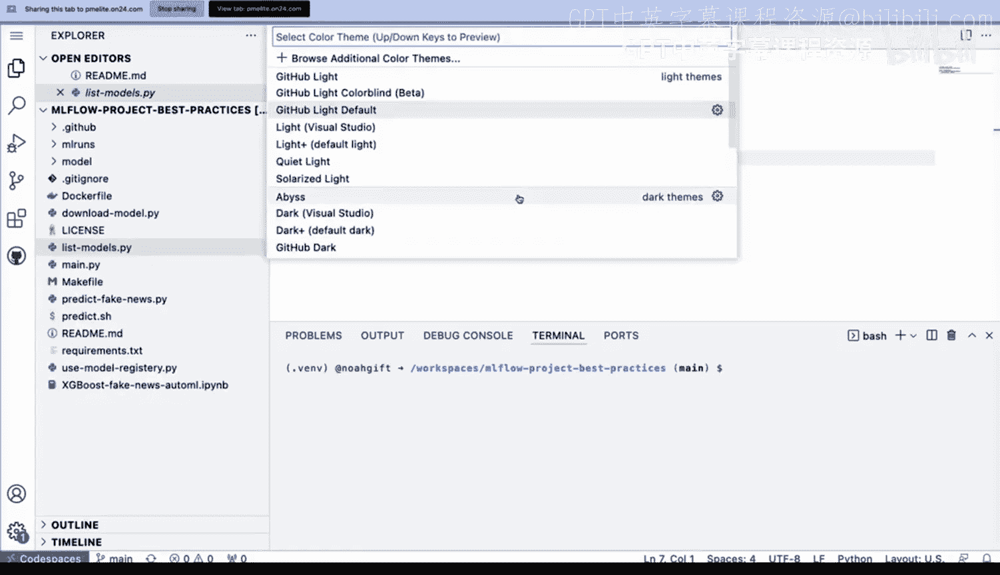
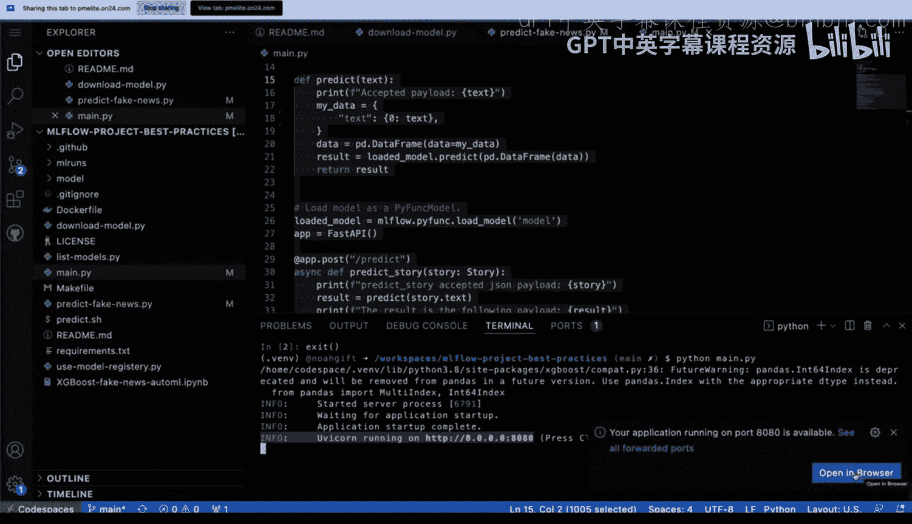
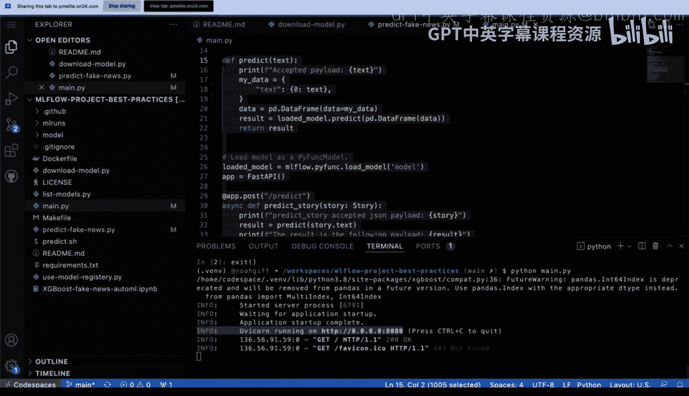
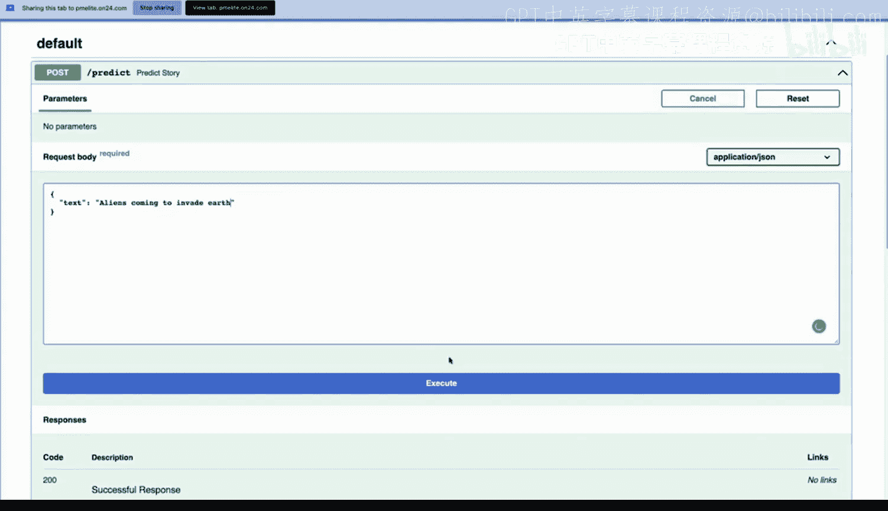
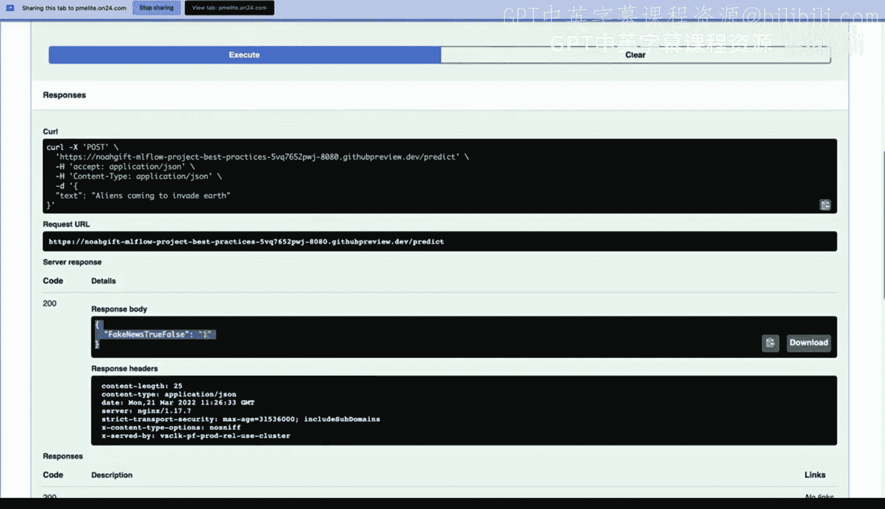
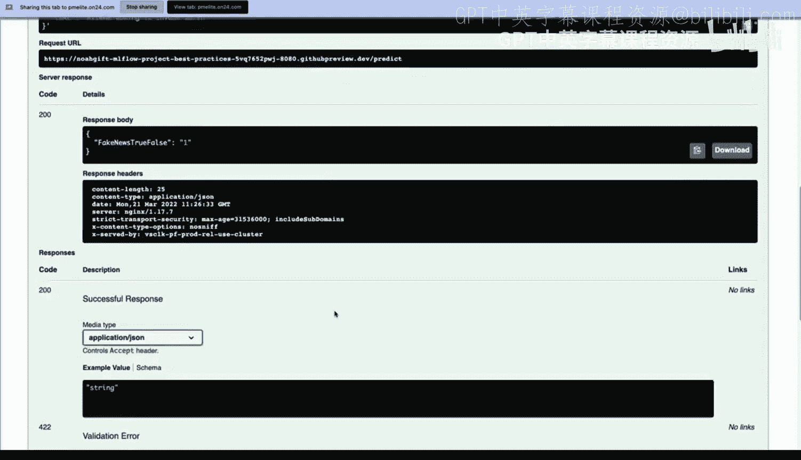
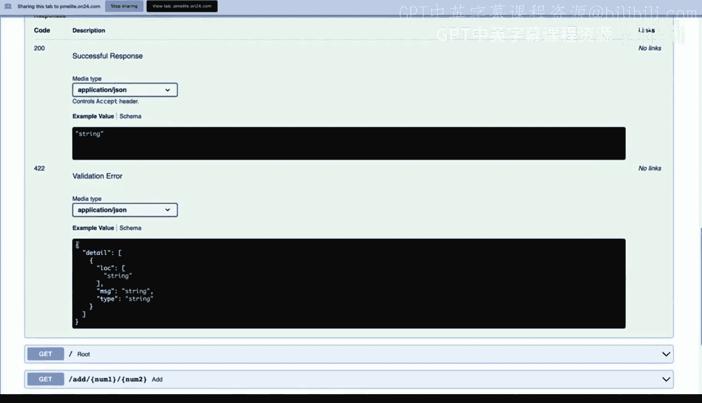
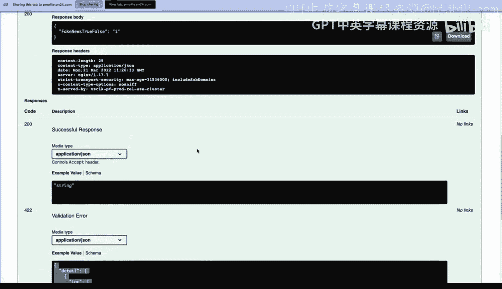
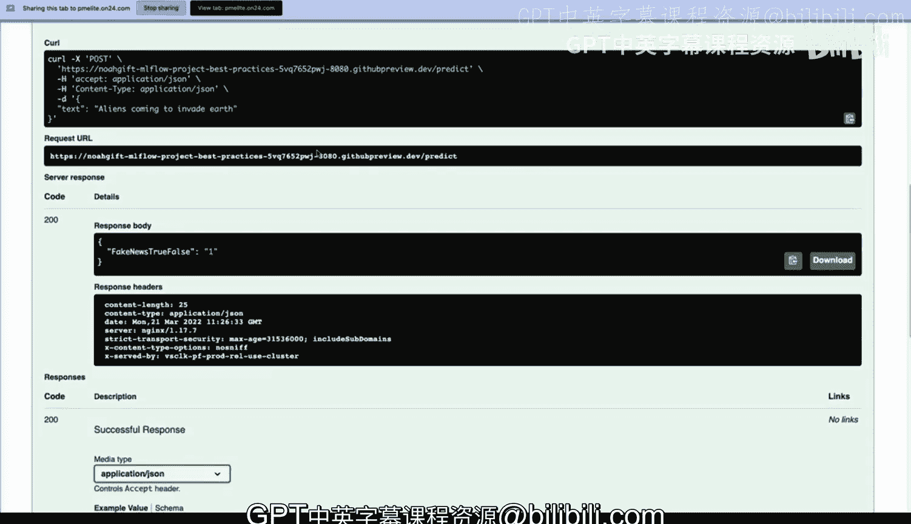

# 数据工程基础：2-4：部署Python Lambda微服务 🚀


在本节课中，我们将学习如何将一个在Databricks中训练并注册的机器学习模型，下载到本地开发环境，并构建成一个独立的、可部署的微服务。我们将使用FastAPI创建一个简单的Web服务，该服务能够接收文本输入并返回模型预测结果（例如，判断是否为假新闻）。整个过程将演示如何将云端模型“本地化”，并为其构建一个轻量级的API接口。

---

## 概述

上一节我们介绍了在Databricks中注册和管理模型。本节中，我们来看看如何将这个已注册的模型下载到本地环境，并封装成一个独立的Python微服务。我们将使用GitHub Codespaces作为云开发环境，并最终通过FastAPI框架暴露一个预测端点。

这个代码仓库包含了一个高层架构图。


具体来说，在这个高层架构中，你可以看到我们之前的工作流程：我们访问了Cagle，创建了文件系统，执行了自动化流程，注册了最佳模型，并点击了“服务”按钮。

但现在，我打算在一个基于云的开发环境中进行交互。

首先，我可能会在GitHub Codespaces中尝试操作，这可能是一个适合实验的良好环境。之后，我们会通过容器化的微服务将其部署出去。这样，我们几乎可以假装Databricks不存在，只需下载模型并开始使用它。

让我们开始实验如何做到这一点。

首先，我将点击上方名为“Code”的按钮。

我将进入一个代码空间，并打开我之前设置好的现有代码空间。

这个环境类似于AWS Cloud9，它允许我在这个代码空间内测试想法和运行代码。

让我展示几件我们可以做的事情。

我们可以列出这个追踪系统中所有可用的模型。

这实际上非常有趣，因为在一个传统的独立scikit-learn类型环境中...



实际上，让我先改变一下背景色，让眼睛更舒服些。

我将把颜色主题改为Visual Studio Dark。


好了，这样对我来说容易多了。

这里的好处是，注意这段特定的代码会连接到Databricks系统，然后要求“显示所有已注册的不同模型”。让我们试试看。

运行 `python list_models.py`。

注意，它会发起一个API调用，因为我之前创建了一个Databricks令牌。这是一个环境变量，现在我可以连接到Databricks文件系统了。

看，我们应该能...我甚至可以抓取那个模型。我可以执行类似这样的命令，或者用grep。

我需要用grep。像这样。

好了。看，这就是我刚创建的“text-only-fake-news”模型。实际上这很简洁，我已经注册了模型，现在几乎可以假装Databricks不存在。我可以开始将其视为一个独立的项目。

另一件我们可以做的事情是，我也可以下载这个模型。

看看这个。如果我到这里。

注意，这是我下载的另一个不同类型的模型。

但我实际上可以创建这个脚本的另一个版本，或者制作一个类似Chameleon的工具，把这个模型放到不同的地方。

所以，我打算这样做。我想我会像这样替换它。使用新模型的令牌或ID，也就是那个假新闻模型。

我想如果我查看这里的内容。是这个，`68AFF...`，基本上就是这个载荷。我准备把它替换掉。看看会发生什么。

让我们开始做吧。保存文件。

首先，让我们看看我们使用的Python版本。是的，Python 3.8，我认为没问题。

我认为这应该能工作。因为模型必须以特定的Python版本序列化，有时Python 3.8和3.7之间可能会有问题，但目前我认为这会奏效。

我将运行 `python download_model.py`。

好了，我们成功下载了这个模型。看，它把模型放到了这个目录里。我们可以查看它。我们可以这样做：`ls -dl`。

我想查看模型的位置。

我们进入这里并运行。啊哈，我们看到它有一个`requirements.txt`文件，模型就在这里。所以，实际上我真正关心的是这两段代码。

现在，我注意到这里有一个`model`目录，里面是我之前的另一个模型。我可以直接覆盖它，我认为这是个好主意。

我准备这样做。我将复制这个数据到这里。

覆盖我现有的模型。

让我们试试看会发生什么。使用通配符 `*`，复制到`model`目录。

好了。那么如果我运行`get_status`，它应该是一个不同的模型了，因为我更改了下载的模型，更改了这里，还更改了`input_example`。因为现在的输入示例会不同，它应该非常简单，只有一个列，这很简洁，因为我几乎不需要做任何处理。

从这里，我可以直接运行`get_status`。我会提交这个更改。

使用命令 `git commit -m “添加新模型”`。

然后推送。我们先拉取一下。好了，合并。然后执行`git push`。

我让这个运行起来了。那么，我如何构建一个能与之交互的脚本呢？

之前我必须处理一个非常复杂的示例，实际上我可以去掉所有这些。我要更改这段代码，因为我只需要创建一个包含`text`字段的载荷。仅此而已。

所以，我将在这里创建一个数据框，放入一些看起来像假新闻的内容。事实上，我可以参考这里的输入示例。

看看数据的样子。事实上，我可以直接复制这个载荷作为起点。我相信我可以直接把它导入pandas，让我们试试，因为这样很好，它给了我们结构。

让我们在这里输入`ipython`。然后说 `import pandas as pd`。然后我可以执行 `pd.DataFrame(...)`。我原以为可以直接扔进去...不，那文本太大了。也许我不想用那个。

这里的文本。让我们试试这段文本。“Aliens are coming...”，我将用它创建一个数据框，然后我可以基于之前的代码进行修改。

我们可以选择远程调用这个模型，或者也应该能在本地运行预测。我认为这会奏效。所以，我们基本上可以本地加载这个东西，或者我们可以做一个更小的版本。

让我看看这个，我们可能想用这个。我认为实际上我们想做的是，在这一点上，我可以直接构建一个Flask应用，那可能更容易。

让我们试试这个。我改错了文件，让我改这个，也就是这里的文本。我们保留这个文本。我们继续这样。

这样我们就有了一个非常简单的数据框。注意，这就是我需要做的全部：从磁盘加载我刚下载的模型，然后这段代码将进行预测，它会使用加载的模型。在Flask中，我创建一个端点，它将接收这个基于文本的输入进行预测，然后我基本上将其转换为JSON并返回一个JSON响应。

让我们运行这个，这应该是个好例子。我输入 `python main.py`，这应该能工作。我们马上就能知道。

好的，看起来它正在运行，很好。在这种情况下，我们需要... 我想我需要打开这个浏览器窗口。



并将这个地址粘贴回我们的窗口。这样我们可以在两者之间切换。


这确实让事情复杂了一点，但让我们试试。这样我就能看到它了。现在，为了与这个模型交互...



我可以访问`/docs`。这里的好处是，现在我有了一个Web服务，它再次与Databricks没有接口。在这一点上，我们只有一个模型，它使用FastAPI（一个Python Web服务），我们可以直接使用这段代码。这真的很棒，因为我现在只需要把这个东西打包并导入。

所以，如果我点击`POST`，我应该能测试这个端点。然后输入我需要的内容。比如，“aliens are coming to invade Earth”，某种假新闻故事。

让我们看看它是否预测那是假新闻。



看，它返回了“fake news”，返回值是1，我相信这代表“真”（是假新闻）。我们能够从这里获得整个输入返回，所以这个端点工作正常。

然后，如果我愿意，我可以用这种风格构建Chameleon工具，我可以用这种风格构建许多不同的东西。






接下来尝试的好事情可能是，看看我们是否也能构建一个不错的小Chameleon工具，也能导入并使用这个库。这将为我们接下来容器化这两个系统并建立持续交付流水线做好准备。



---

## 核心步骤与代码

以下是实现上述过程的核心步骤和代码片段。

### 1. 列出已注册模型
首先，我们需要一段代码来从Databricks模型注册表中列出所有模型。这需要一个有效的Databricks个人访问令牌（作为环境变量`DATABRICKS_TOKEN`）和工作区地址。

```python
# list_models.py
import os
from databricks_registry_client import list_registered_models

# 从环境变量获取令牌和工作区地址
token = os.environ.get('DATABRICKS_TOKEN')
workspace_url = os.environ.get('DATABRICKS_HOST')

models = list_registered_models(workspace_url, token)
for model in models:
    print(f"Model Name: {model['name']}, Version: {model['latest_version']}")
```


### 2. 下载特定模型
接着，下载我们需要的模型（例如“text-only-fake-news”）到本地目录。


```python
# download_model.py
import os
import mlflow

# 设置Databricks追踪URI和令牌
os.environ['DATABRICKS_HOST'] = 'https://your-workspace.cloud.databricks.com'
os.environ['DATABRICKS_TOKEN'] = 'your-personal-access-token'


model_name = "text-only-fake-news"
model_version = "1" # 或 "latest"

# 下载模型到本地目录 ./model
model_uri = f"models:/{model_name}/{model_version}"
local_path = mlflow.artifacts.download_artifacts(artifact_uri=model_uri, dst_path='./model')
print(f"Model downloaded to: {local_path}")
```

### 3. 构建FastAPI微服务
下载模型后，我们创建一个简单的FastAPI应用来提供预测服务。

```python
# main.py
import pandas as pd
import mlflow.pyfunc
from fastapi import FastAPI, HTTPException
from pydantic import BaseModel

# 定义请求体结构
class PredictionRequest(BaseModel):
    text: str

# 加载本地模型
model_path = "./model"
loaded_model = mlflow.pyfunc.load_model(model_path)

# 创建FastAPI应用
app = FastAPI(title="Fake News Predictor")

@app.post("/predict", summary="预测新闻真伪")
async def predict(request: PredictionRequest):
    """
    接收一段文本，预测其是否为假新闻。
    - **text**: 需要预测的新闻文本。
    """
    try:
        # 将输入文本转换为模型期望的DataFrame格式
        input_data = pd.DataFrame([{"text": request.text}])
        # 进行预测
        prediction = loaded_model.predict(input_data)
        # 假设模型输出1表示假新闻，0表示真新闻
        result = "fake news" if prediction[0] == 1 else "real news"
        return {"input_text": request.text, "prediction": result, "prediction_value": int(prediction[0])}
    except Exception as e:
        raise HTTPException(status_code=500, detail=str(e))


@app.get("/")
async def root():
    return {"message": "Fake News Prediction API is running. Go to /docs for interactive API documentation."}

# 运行命令: uvicorn main:app --reload
```

### 4. 测试API
运行服务后（例如使用 `uvicorn main:app --reload`），可以访问 `http://localhost:8000/docs` 进入交互式API文档页面。在 `/predict` 端点中，尝试发送以下JSON请求体：

```json
{
  "text": "Aliens are coming to invade Earth next Tuesday."
}
```


服务将返回类似这样的预测结果：


```json
{
  "input_text": "Aliens are coming to invade Earth next Tuesday.",
  "prediction": "fake news",
  "prediction_value": 1
}
```


---

## 总结

本节课中，我们一起学习了如何将一个在云端Databricks平台训练并注册的机器学习模型，转化为一个独立的、本地可运行的Python微服务。关键步骤包括：
1.  **环境准备**：在GitHub Codespaces等云开发环境中设置项目。
2.  **模型获取**：使用MLflow API从Databricks模型注册表列出并下载目标模型。
3.  **服务构建**：利用FastAPI框架，创建一个接收文本输入并返回模型预测结果的Web API。
4.  **本地测试**：运行服务并通过交互式文档测试其功能。


这个过程的核心价值在于实现了**模型与训练平台的解耦**。下载的模型可以被打包、容器化，并部署到任何支持Python的环境（如AWS Lambda、Azure Functions、Kubernetes等），为构建可扩展的数据工程和机器学习流水线奠定了基础。下一步，你可以探索如何将此FastAPI应用Docker化，并集成到CI/CD流程中实现自动部署。