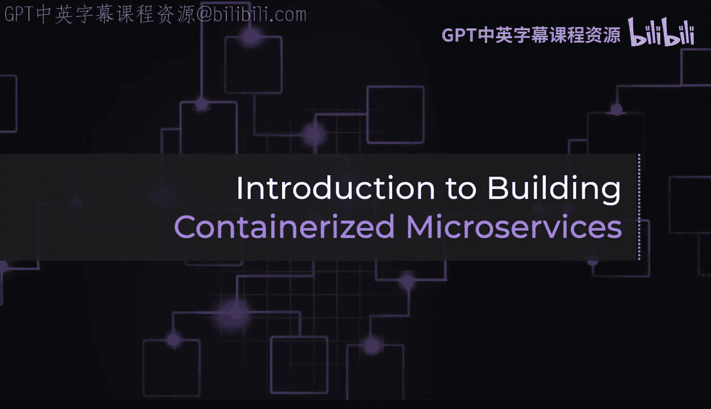

# 数据工程基础：2-4：容器化微服务构建导论 🐳

在本节课中，我们将要学习微服务和容器的核心概念。我们将探讨如何将业务逻辑与运行时环境打包在一起，形成一个可复制的产品，并了解如何将其部署到不同的环境中，包括无服务器环境。我们还将简要介绍使用C#和Python两种语言来部署微服务。

---

## 微服务与容器

上一节我们介绍了数据工程的基础工具，本节中我们来看看如何构建和部署应用。微服务是一种将应用程序构建为一套小型、独立服务的方法。容器技术则为这些服务提供了轻量级、可移植的运行环境。

将一段逻辑（功能）应用到某个端点（endpoint）时，微服务与容器是绝佳的搭配。关键在于，你需要将这段逻辑及其源代码，连同其运行时环境一起打包。

**核心概念公式**：
`可部署产品 = 业务逻辑 + 源代码 + 运行时环境`

当你将这些元素打包在一起时，你就创建了一个**可复制的产品**。这个产品可以部署到许多不同的环境中，包括像AWS Lambda这样的无服务器环境。此外，你还可以使用多种编程语言，例如C#或Python。

在本教程的后续部分，我们将实际查看C#和Python的示例，并使用这些技术来部署微服务。

---

## 核心优势

以下是容器化微服务带来的主要优势：

*   **环境一致性**：容器确保了应用在开发、测试和生产环境中的运行行为完全一致。
*   **可移植性**：打包好的容器镜像可以在任何支持容器运行时的系统上运行。
*   **资源高效**：容器共享主机操作系统内核，比传统虚拟机更轻量，启动更快。
*   **易于扩展**：每个微服务可以独立地进行横向扩展。

---

## 总结

本节课中我们一起学习了微服务和容器的基本概念。我们理解了将应用逻辑、代码和运行时打包成容器镜像的重要性，这创造了一个可重复部署的单元。我们还了解到，这种架构支持多语言开发并能灵活部署在各种云环境中，为构建现代、可扩展的数据工程应用奠定了基础。