# 数据工程基础：2-4：部署容器化机器学习微服务 🚀

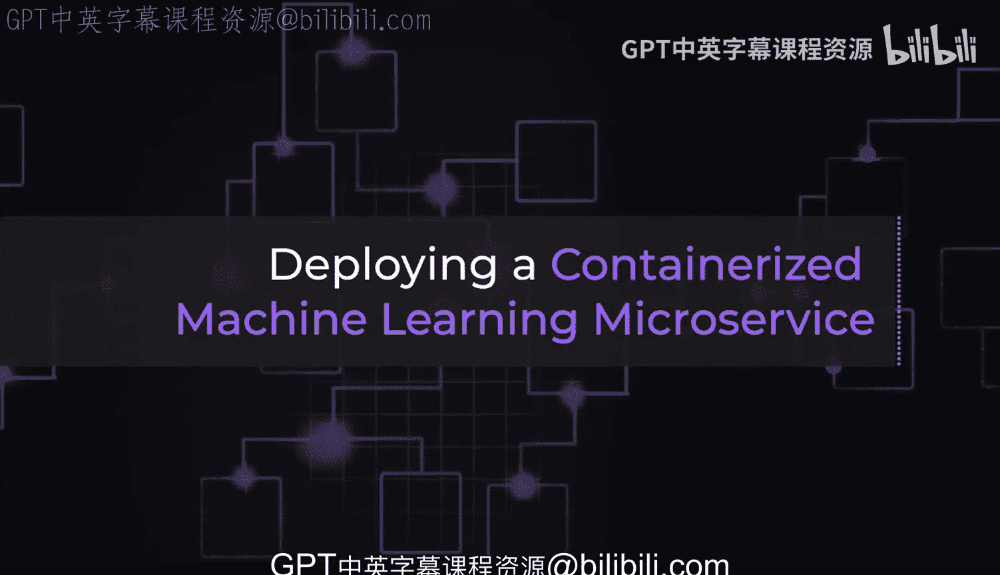

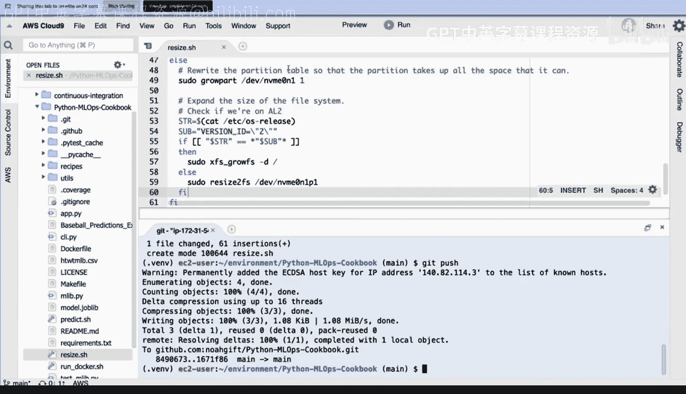

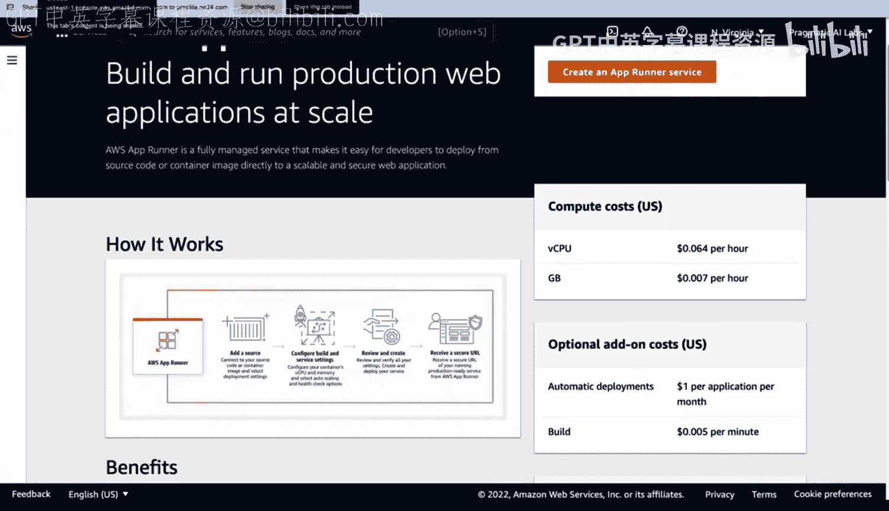


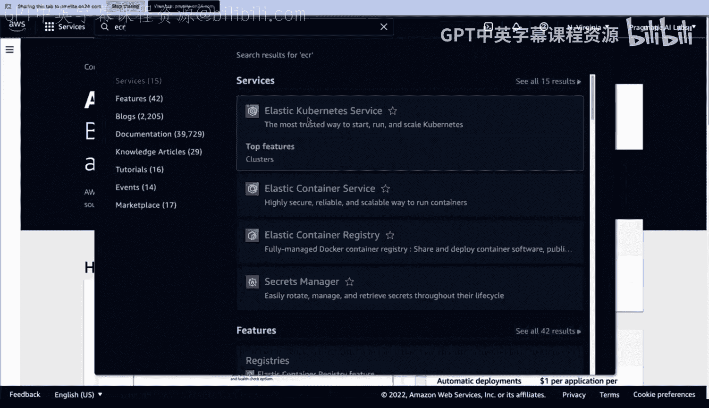

在本节课中，我们将学习如何将一个机器学习模型打包成Docker容器，并将其部署为可扩展的微服务。我们将使用AWS的Elastic Container Registry (ECR) 来存储容器镜像，并使用AWS App Runner来自动化部署和持续交付流程。

---

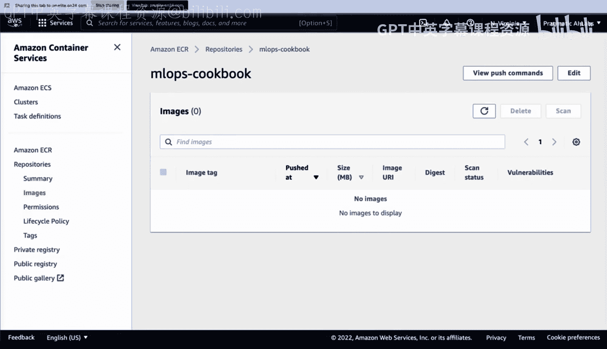

## 概述

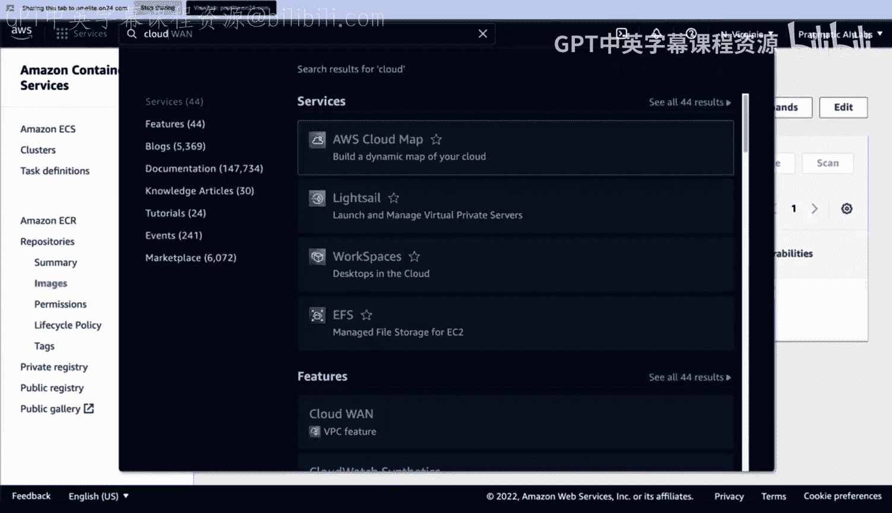

我们将通过一个具体的例子，演示如何将两个不同的机器学习项目容器化并部署到云端。第一个项目是一个简单的身高体重预测模型，第二个是一个更复杂的文本分类（假新闻检测）模型。整个过程涵盖了从本地构建、测试到云端推送和自动化部署的关键步骤。

---

## 创建容器仓库

上一节我们介绍了容器化的概念，本节中我们来看看如何为我们的模型创建存储位置。

首先，我们需要在AWS Elastic Container Registry (ECR) 中创建一个仓库来存储我们的容器镜像。这个仓库将存放我们的微服务及其关联的模型。

以下是创建仓库的步骤：
1.  登录AWS管理控制台，导航到ECR服务。
2.  点击“创建仓库”。
3.  为仓库命名，例如 `emlops-cookbook`（用于存放身高体重模型）。
4.  点击“创建仓库”完成操作。

创建完成后，ECR会提供一组用于推送镜像的命令。我们需要复制这些命令，稍后在本地环境中使用。

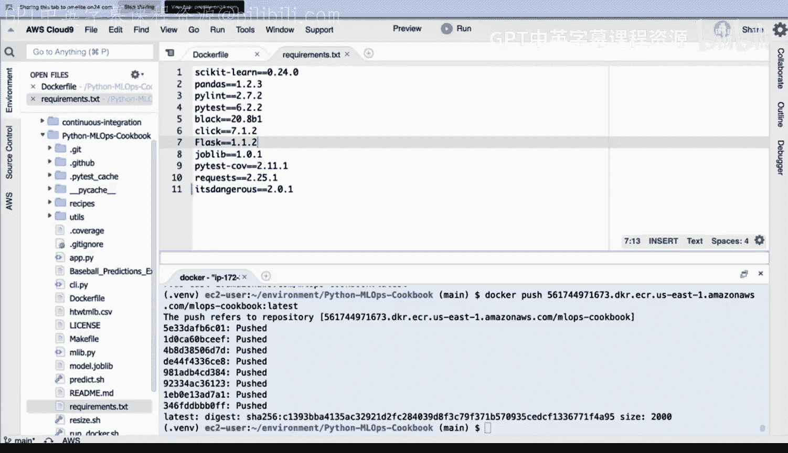

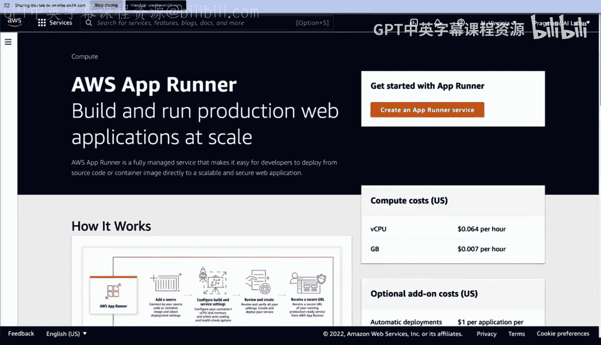

---

## 构建并测试本地微服务

在将应用推送到云端之前，我们需要在本地环境中构建Docker镜像并确保微服务能够正常运行。

我们回到Cloud9开发环境。首先，需要登录到ECR。使用ECR提供的登录命令进行身份验证：
```bash
aws ecr get-login-password --region <region> | docker login --username AWS --password-stdin <account-id>.dkr.ecr.<region>.amazonaws.com
```

接下来，我们查看项目目录中的Dockerfile。它定义了如何构建镜像，通常包括从基础镜像（如Python 3.8）开始、设置工作目录、安装依赖包以及配置启动命令。

在构建之前，最好先在本地运行微服务进行测试。使用命令启动应用：
```bash
python app.py
```

如果遇到依赖包版本冲突（例如Flask版本问题），可以通过更新`requirements.txt`文件来解决。使用`pip freeze`命令查看当前安装的包版本，并固定Flask到兼容的版本（例如`Flask==1.1.2`）。

解决依赖问题后，再次测试，确保服务可以正常启动。

---

## 构建并推送Docker镜像

确认微服务在本地运行无误后，我们就可以开始构建Docker镜像了。

使用以下命令在本地构建镜像，并为其打上标签：
```bash
docker build -t emlops-cookbook .
docker tag emlops-cookbook:latest <account-id>.dkr.ecr.<region>.amazonaws.com/emlops-cookbook:latest
```

构建完成后，使用ECR提供的推送命令将镜像上传到我们之前创建的仓库中：
```bash
docker push <account-id>.dkr.ecr.<region>.amazonaws.com/emlops-cookbook:latest
```

至此，我们的第一个模型镜像已经成功推送到了容器仓库。容器化的优势在于，任何更新只需要构建并推送新的镜像到仓库，部署流程会自动处理后续步骤。

---

## 使用AWS App Runner部署服务

现在，我们的镜像已经存储在ECR中，接下来可以将其部署为一个可公开访问的微服务。

我们使用AWS App Runner来完成部署。以下是部署步骤：
1.  在AWS控制台导航到App Runner服务。
2.  点击“创建服务”，选择“容器注册表”作为源。
3.  选择我们刚刚推送镜像的ECR仓库（`emlops-cookbook`）。
4.  配置服务名称、实例大小等设置。关键一步是启用“持续部署”，这样每次向ECR推送新镜像时，App Runner会自动更新服务。
5.  为服务分配合适的IAM角色以访问ECR。
6.  点击“创建并部署”。

部署过程需要几分钟。完成后，App Runner会提供一个HTTPS端点URL，这就是我们机器学习API的生产级访问地址。我们可以在服务详情中查看监控指标、日志和活动记录。

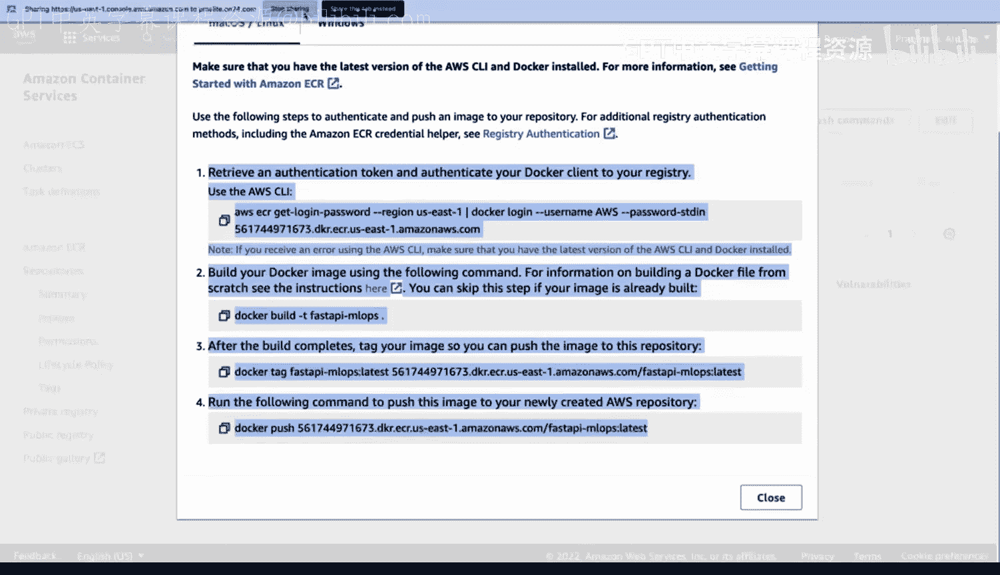

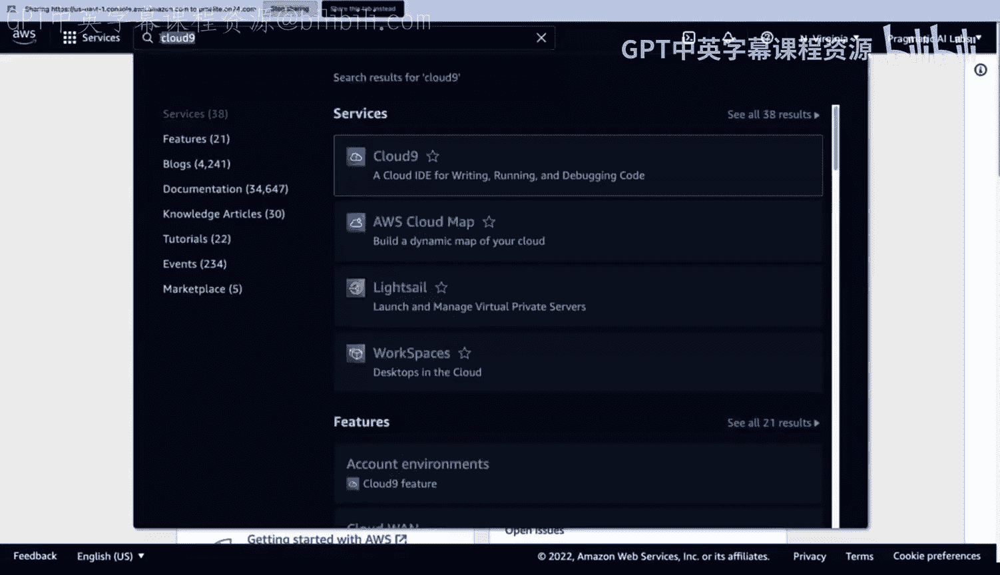

---

## 部署第二个模型服务

为了展示流程的通用性，我们现在来部署第二个机器学习服务。这是一个基于FastAPI的、用于假新闻检测的文本分类模型。

首先，为这个新项目在ECR中创建另一个仓库，例如命名为 `fastapi-mlops`。

然后，在新的项目目录中，使用其Dockerfile构建镜像。这个Dockerfile可能使用了不同的基础镜像（如AWS Lambda基础镜像），但核心步骤相似：复制代码、模型文件和依赖，然后安装。
```bash
docker build -t fastapi-mlops .
```

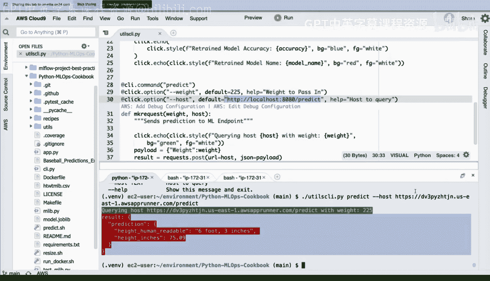

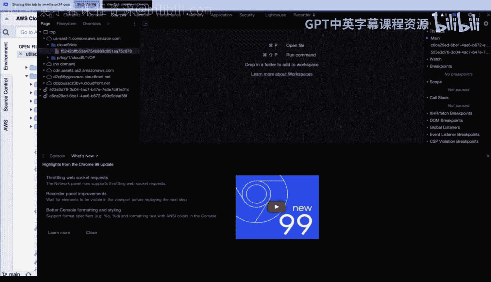

在推送之前，可以在本地运行容器进行快速测试，确保API能够响应请求。
```bash
docker run -p 8080:8080 <image-id>
```

测试无误后，为镜像打标签并推送到第二个ECR仓库。
```bash
docker tag fastapi-mlops:latest <account-id>.dkr.ecr.<region>.amazonaws.com/fastapi-mlops:latest
docker push <account-id>.dkr.ecr.<region>.amazonaws.com/fastapi-mlops:latest
```

最后，在App Runner中创建第二个服务，指向 `fastapi-mlops` 仓库，并同样启用持续部署。部署完成后，我们就拥有了两个独立运行的机器学习微服务端点。

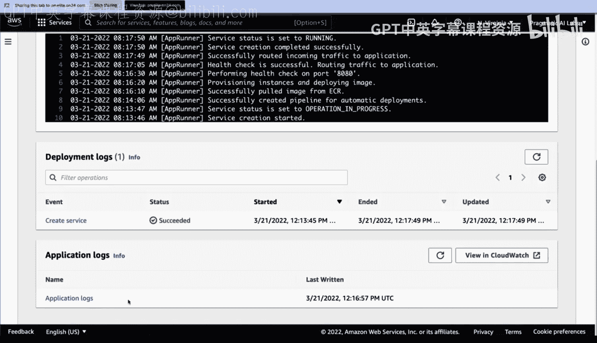


---

## 测试与调用已部署的服务

服务部署成功后，我们需要验证它们是否工作正常。

对于第一个服务（身高体重预测），我们可以使用浏览器或命令行工具（如`curl`）调用其端点。例如，使用项目自带的CLI工具进行调用：
```bash
./cli predict --host https://your-apprunner-url.com --height 155
```

对于第二个服务（假新闻检测），FastAPI通常会生成交互式API文档（Swagger UI）。我们直接访问服务URL的 `/docs` 路径，在网页界面中输入示例文本（如“aliens are coming”）并执行，即可看到预测结果（如“Fake news”）。

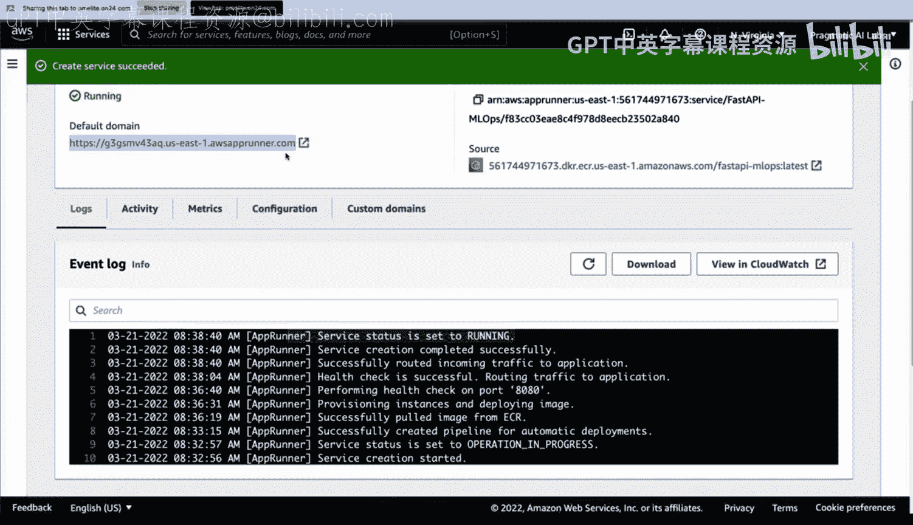

在App Runner的控制台，我们可以查看每个服务的调用指标（如请求次数、延迟）和CloudWatch日志，确认服务正在被成功调用并运行。

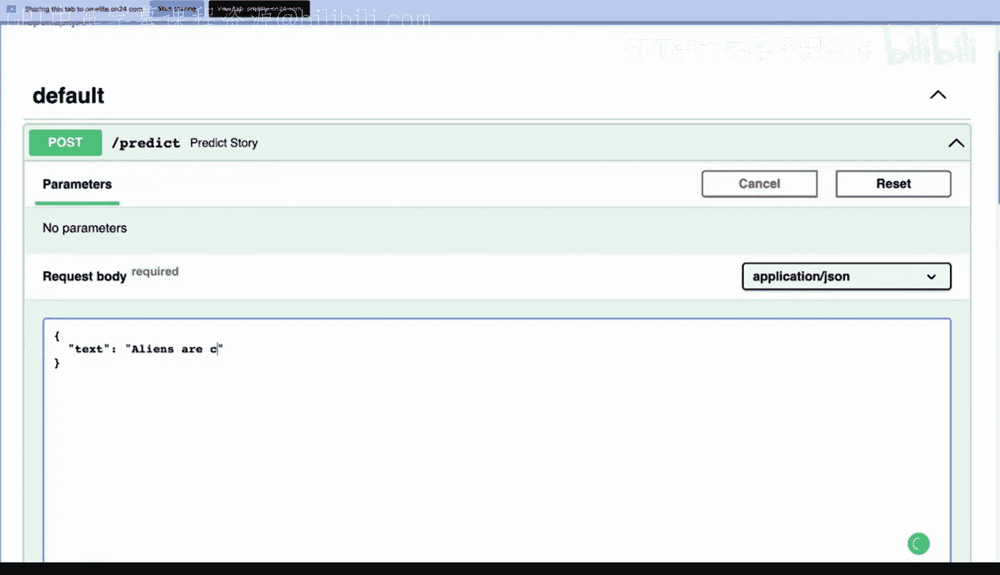

---

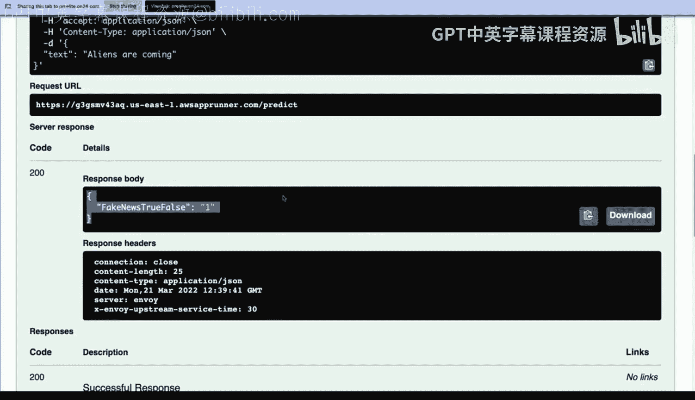

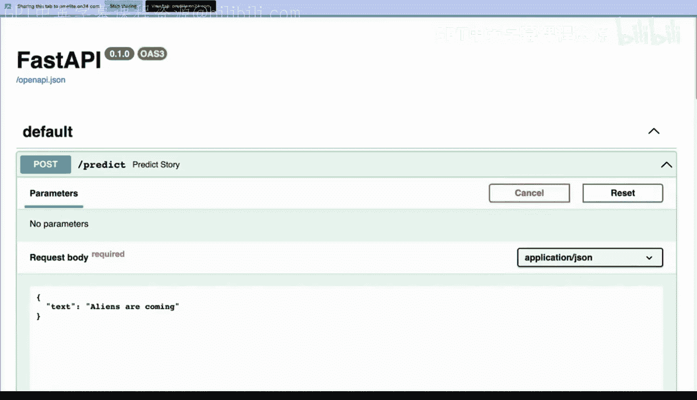

## 模型来源与MLOps工作流总结

本节课中我们一起学习了完整的容器化部署流程。最后，我们来总结一下模型微服务可能的来源，这构成了灵活MLOps工作流的基础：

一个容器化的机器学习微服务，其核心模型可以来自以下几种途径：
1.  **下载预训练模型**：从模型库（如Hugging Face、TensorFlow Hub）下载现有模型，可能进行微调（迁移学习）。
2.  **自动化机器学习（AutoML）**：使用平台（如Databricks、Amazon SageMaker）的AutoML功能自动生成模型。
3.  **从零开始训练**：传统方式，完全由自己的数据和算法从头训练模型。
4.  **调用外部端点**：模型本身托管在第三方服务，微服务仅作为代理调用其API。

无论模型来自何处，一旦将其与微服务代码一起容器化，后续的部署和更新流程就变得统一且简单。通过将镜像推送到容器注册表，并利用像AWS App Runner这样的服务，我们可以轻松实现持续部署，确保每次模型或代码的更新都能自动、可靠地到达生产环境。

---

## 总结

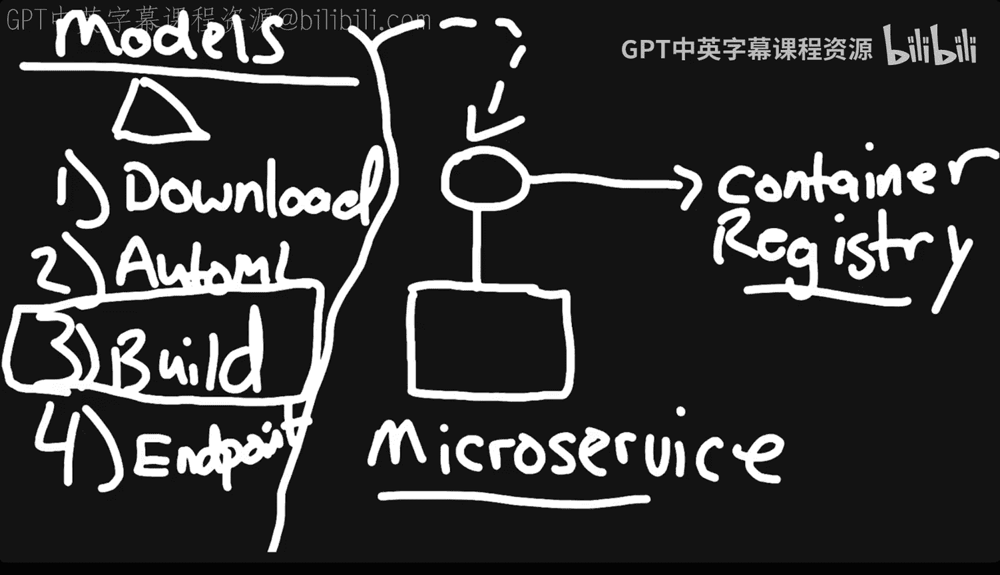

在本节课中，我们完整实践了将机器学习模型容器化并部署为云微服务的流程。我们学习了如何创建ECR仓库、在本地构建和测试Docker镜像、将镜像推送到云端仓库，以及最终使用AWS App Runner配置自动化部署。我们还探讨了模型的不同来源，强调了容器化在实现标准化、可重复的MLOps工作流中的关键作用。通过这种方法，机器学习应用的部署和维护变得高效且易于管理。