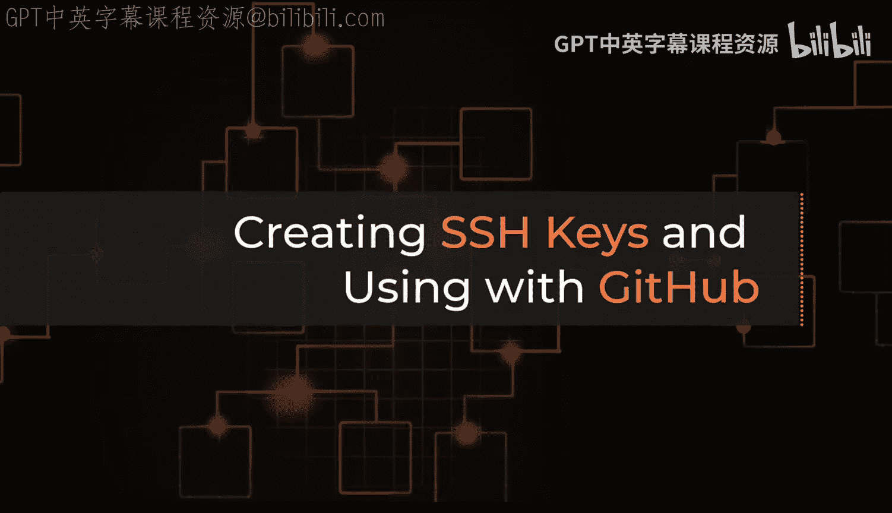
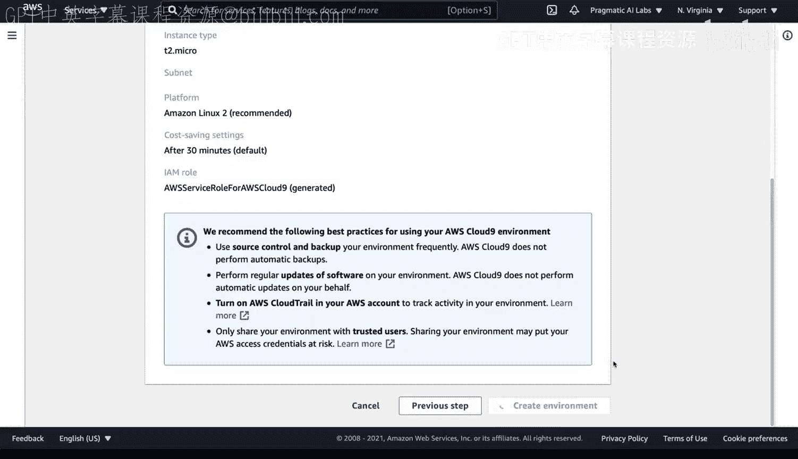
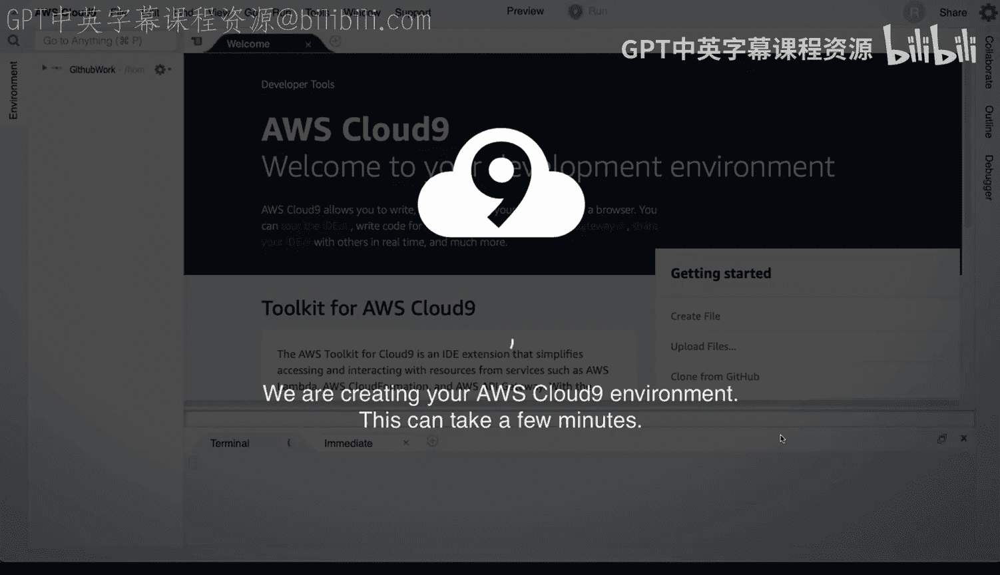
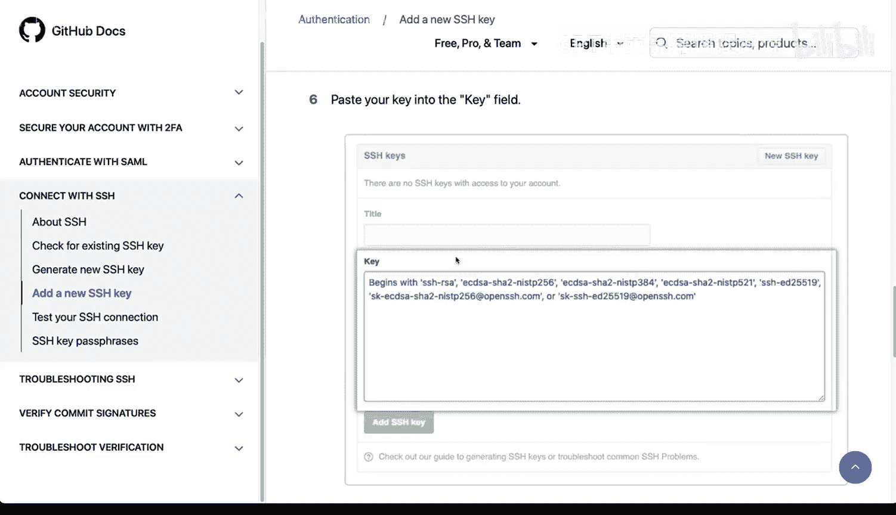
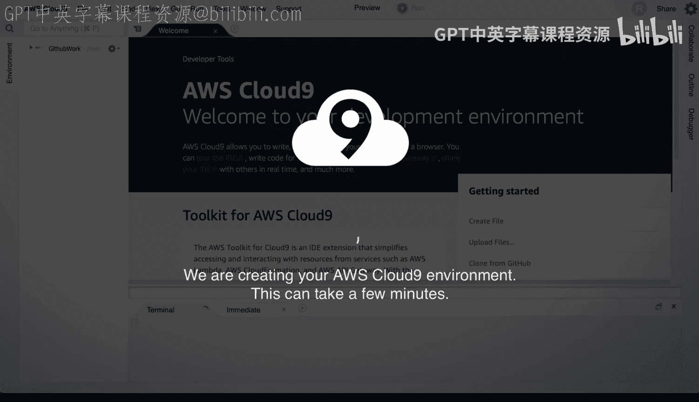
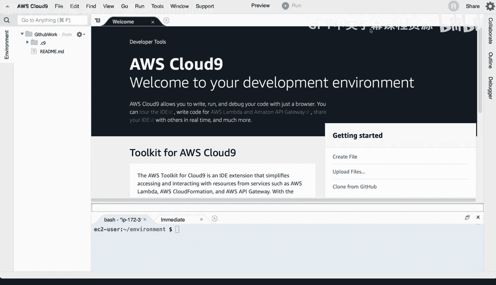
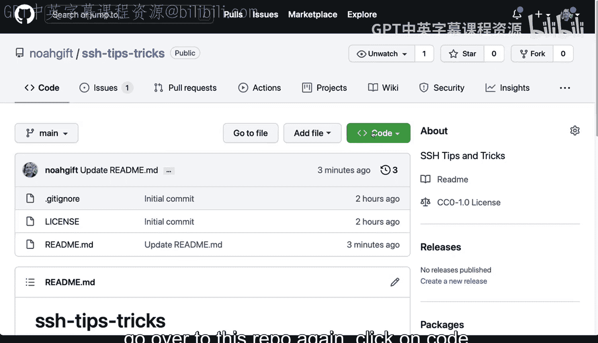
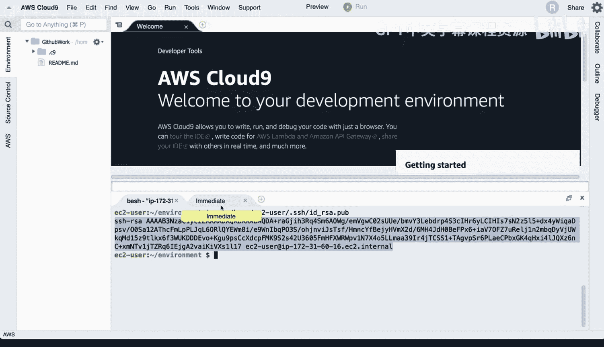
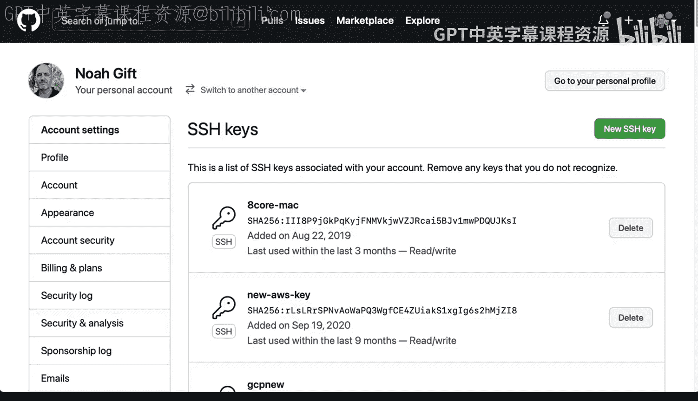
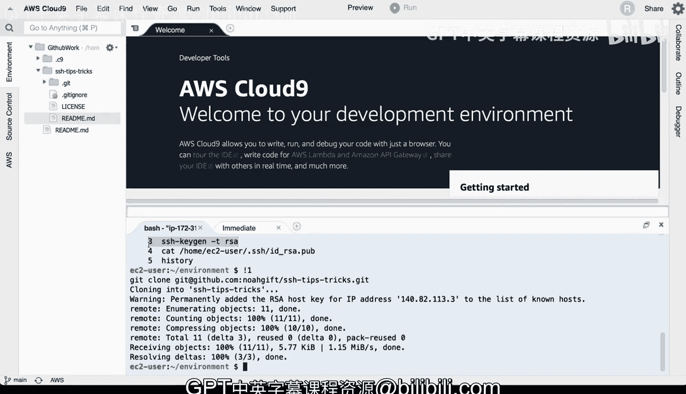

# 数据工程基础：2-4：创建SSH密钥并与GitHub配合使用 🔑




在本节课中，我们将学习如何通过SSH密钥安全地连接到GitHub仓库。这是数据工程项目中第一天就会遇到的常见任务。我们将创建一个SSH密钥对，并将其添加到GitHub账户，从而无需密码即可与远程仓库进行加密通信。

## 准备工作：云端开发环境

上一节我们介绍了SSH连接的基本概念，本节中我们来看看具体的操作步骤。首先，我们需要一个可以执行命令的开发环境。这里我们使用AWS Cloud9，它是一个基于云的集成开发环境，功能类似于GitHub Codespaces或Azure Cloud Shell。

我们将这个环境命名为“GitHub Work”，用于编辑GitHub仓库。创建时保留默认设置，例如使用Amazon Linux 2操作系统，并在30分钟无活动后自动超时。环境启动需要几秒钟时间。

虽然这个云端环境功能齐全，但为了与GitHub仓库进行读写交互，我们必须建立安全的通信渠道。

## 创建SSH密钥对

要与GitHub安全通信，我们需要创建SSH密钥。SSH密钥是一对加密密钥，包括一个私钥（必须保密）和一个公钥（可以共享）。以下是创建密钥的步骤：

1.  打开终端，输入以下命令生成新的RSA密钥对：
    ```bash
    ssh-keygen -t rsa
    ```
2.  系统会提示你选择保存密钥的文件位置。通常按回车键接受默认路径（例如 `/home/ec2-user/.ssh/id_rsa`）。
3.  接着，你可以选择为密钥设置一个密码（可选）。直接按两次回车可以跳过，不设置密码。





命令执行成功后，会在 `.ssh` 目录下生成两个文件：`id_rsa`（私钥）和 `id_rsa.pub`（公钥）。

## 获取并复制公钥

创建密钥后，我们需要获取公钥的内容，以便将其添加到GitHub。公钥可以公开分享，用于验证你的身份。

使用 `cat` 命令查看并复制公钥内容：
```bash
cat ~/.ssh/id_rsa.pub
```
终端会显示一串以 `ssh-rsa` 开头的长文本。这就是你的公钥。请完整地复制它。







## 将公钥添加到GitHub账户



现在，我们需要让GitHub知道这个公钥属于你。以下是添加公钥到GitHub的步骤：

1.  登录你的GitHub账户。
2.  点击右上角的个人头像，选择 **Settings**（设置）。
3.  在左侧边栏中，找到并点击 **SSH and GPG keys**。
4.  点击绿色的 **New SSH key** 按钮。
5.  在“Title”字段中，为这个密钥起一个易于识别的名字（例如“Bash Duke Coursera SSH”）。
6.  将刚才复制的公钥内容粘贴到“Key”字段中。
7.  点击 **Add SSH key** 按钮。系统可能会要求你输入GitHub密码进行确认。

添加成功后，你的本地环境就获得了访问GitHub仓库的权限。



## 测试SSH连接

让我们测试一下配置是否成功。回到Cloud9的终端。

你可以使用 `history` 命令查看之前输入过的命令，这对于重复长命令非常方便。找到之前尝试克隆仓库时使用的 `git clone` 命令，通常可以通过输入 `!1` 来执行历史记录中的第一条命令。



现在，再次尝试克隆你的GitHub仓库：
```bash
git clone git@github.com:你的用户名/你的仓库名.git
```
如果一切配置正确，这次命令应该会成功执行，并将仓库的代码克隆到你的本地环境中。这表明SSH密钥已生效，你可以开始读写仓库中的代码了。

## 总结



本节课中我们一起学习了如何创建和使用SSH密钥连接GitHub。整个过程可以概括为三个核心步骤：使用 `ssh-keygen` 命令生成密钥对，从 `.pub` 文件中复制公钥，最后将公钥添加到GitHub账户的设置中。完成这些步骤后，你就能通过加密的SSH通道，无需密码即可安全地与GitHub仓库进行交互，这是进行协作开发和数据工程工作的基础技能。