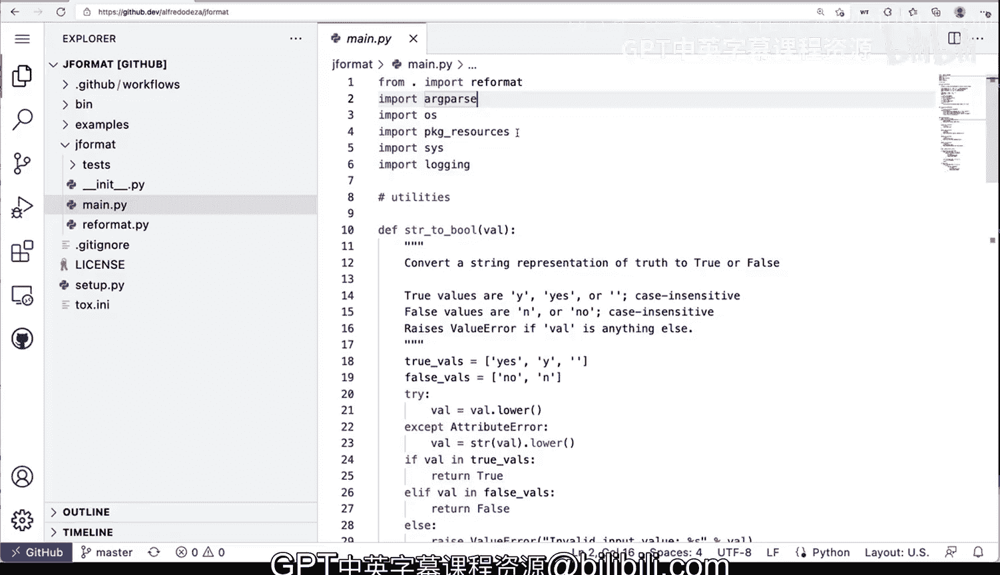

# Python、Bash和SQL数据工程基础：2-4：Python项目初始设置 🐍


在本节课中，我们将要学习如何为一个Python项目进行初始设置。一个结构清晰的项目是代码可维护性和可扩展性的基础。

## 概述：为什么需要项目结构？

Python项目之所以有用，是因为它提供了结构，而结构带来了秩序。秩序之所以重要，是因为它为项目的成长奠定了基础。

虽然Python作为一种脚本语言，从单个文件开始非常容易，但当需要更多文件、支持文件时，情况会迅速变得复杂。例如，许可证、自述文件、文档、测试、工具脚本或依赖声明，以及打包等问题，这些都是一个项目需要涵盖的内容。

接下来，我们将快速浏览一个项目，并了解其中一些你可能感兴趣的组成部分。

## 项目结构详解

以下是一个名为 `J format` 的简单Python命令行工具项目在Github上的结构。我们将逐一介绍其中的关键目录和文件。

### 目录与文件说明

*   **`.github/` 目录**：当你需要进行一些自动化操作时，这个目录很有用。例如，它包含一个YAML工作流文件，这是Github用于在拉取请求时进行自动化操作（如测试）所必需的。你可能在项目初期不需要它，但了解其存在的原因是有益的。
*   **`bin/` 目录**：这是可选的，因为在Python中有多种实现方式。它包含一个脚本，允许我们在打包和分发项目时安装这个特定的脚本。我们稍后也会看到通过 `setup.py` 和Python打包工具来实现的另一种方式。
*   **`examples/` 目录**：你可能希望在项目中包含示例文件，用于展示基本用法。虽然这里的示例文档化程度不高，但这是你可能会看到的一种做法。
*   **`.gitignore` 文件**：这个文件允许你更有效地使用Git，忽略某些不应纳入版本控制的文件。特别是在Python项目中，有许多文件（如缓存、虚拟环境）需要被忽略。
*   **`LICENSE` 文件**：包含项目许可证总是一个好主意。在这个案例中，我们使用的是MIT许可证。
*   **`.tox.ini` 文件**：用于配置Tox测试工具。这在本地终端运行测试，尤其是需要测试多个Python版本时非常有用。
*   **`setup.py` 文件**：允许你进行一些基本的打包配置。我们将在后续课程中详细介绍如何进行打包。
*   **`tests/` 目录**：这是你存放测试文件的地方。有时测试目录会放在项目根目录下，与 `examples` 和 `.github` 并列；有时则会放在项目内部。这没有严格规定。放在内部可能意味着你会将测试文件与项目代码一同分发。
*   **`_init_.py` 文件**：这非常常见，尤其是当你打算将项目创建为一个可导入的模块时。它标志着该目录是一个Python包。
*   **`main.py` 文件**：对于命令行工具，这是你放置主要代码或脚本入口点的地方。例如，你可以在这里定义一个 `main` 函数。

### 核心代码示例

在 `main.py` 文件中，通常可以找到一个主函数作为程序的入口点。例如，在代码的第42行附近，你可能会看到类似的结构：

```python
def main():
    # 这里是程序的主要逻辑
    pass

if __name__ == "__main__":
    main()
```

同时，在文件的顶部，通常会从项目中的其他模块导入功能。例如：

```python
from . import reformat  # 从当前包的顶层目录导入reformat模块
```

这种结构定义了一种秩序，让你知道将不同的内容放在何处。如果你想添加更多测试，就放到 `tests/` 目录；如果需要更多支持文件或子模块，也可以在相应位置添加。

## 总结



本节课中，我们一起学习了Python项目初始设置的基本要素。我们看到了一个典型项目包含的目录和文件，如 `.github/`、`bin/`、`examples/`、`.gitignore`、`LICENSE`、`setup.py`、`tests/` 以及核心的 `__init__.py` 和 `main.py` 文件。这种结构化的方法为代码组织、测试、文档化和分发奠定了基础，在后续的课程中我们将会持续应用这些概念。