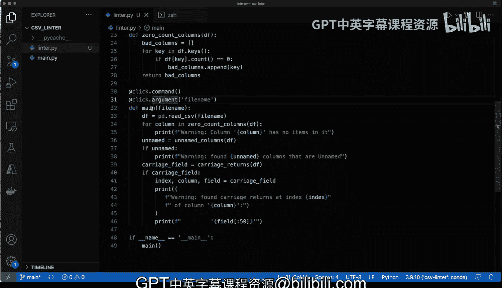

# 数据工程基础：2-4：使用Click构建命令行工具 🛠️


在本节课中，我们将学习如何使用Python的Click库来构建一个命令行工具。我们将从一个简单的脚本开始，逐步将其改造为一个功能更完善、用户友好的命令行应用程序。

## 概述

我们将分析一个名为“Lter”的简单命令行工具示例。该工具的主要功能是加载一个CSV文件，并使用pandas库在后台检测文件中的一些潜在问题。通过本教程，你将学会如何使用Click库来装饰你的Python函数，使其能够接收命令行参数，并自动获得帮助菜单和错误报告等功能。

## 代码结构与初始状态

首先，我们来看一下示例代码的初始结构。代码中包含一些辅助函数，但目前它们不是重点。

最重要的部分是第47行的 `if __name__ == "__main__":`。这行代码使得脚本可以在终端中作为命令行工具直接执行。如果没有这行代码，`main` 函数就不会被自动调用。

当前，脚本使用了一个技巧：它将命令行的最后一个参数（即文件名）传递给 `main` 函数（第31行）。目前，代码中虽然导入了 `click` 库，但尚未使用它。

## 引入Click库进行改造

现在，我们将使用Click库来改进这个命令行工具。首先，确保已经正确导入Click。

```python
import click
import pandas as pd
```

接下来，我们需要改造 `main` 函数。使用Click的第一步是使用一个 **装饰器**。装饰器是一种特殊的语法，用于修改函数的行为。

我们将使用 `@click.command()` 这个装饰器来声明 `main` 函数是一个命令行工具的一部分。

```python
@click.command()
def main():
    # ... 原有的函数逻辑
```

## 定义命令行参数

我们的工具需要接收一个参数：要处理的CSV文件路径。在Click中，我们可以使用 `@click.argument()` 装饰器来定义参数。

我们在 `main` 函数上方添加这个装饰器，并指定参数名为 `filename`。

```python
@click.command()
@click.argument('filename')
def main(filename):
    # 现在，filename参数会从命令行自动传入这个函数
    # ... 原有的函数逻辑
```

这段代码的意思是：工具将接受一个名为 `filename` 的单一参数，并将其传递给 `main` 函数。

## 运行改造后的工具

保存修改后，让我们在终端中再次运行这个工具。

```
python lter.py examples/carriage.csv
```

你会发现工具的行为和之前一样，成功加载并处理了文件。但现在，我们获得了一些“免费”的新功能。

## Click带来的优势

**1. 自动生成的帮助菜单**
现在，如果你运行工具时加上 `--help` 标志，就会看到一个清晰的帮助菜单。

```
python lter.py --help
```

帮助菜单会显示工具的使用方法（Usage）和可用的选项（Options）。虽然目前选项不多，但这个框架允许你轻松地添加更复杂的标志和选项。

**2. 自动错误报告**
如果你忘记提供必需的 `filename` 参数，Click会自动给出清晰的错误提示。

```
python lter.py
```
输出会类似于：`Error: Missing argument ‘FILENAME’.`

这提供了即时的、用户友好的错误反馈。

**3. 强大的扩展基础**
通过这个简单的起点，你可以继续添加更多功能。例如，你可以添加可选标志来控制程序的行为，或者添加多个参数来处理不同的输入。

## 总结

本节课中，我们一起学习了使用Click库构建Python命令行工具的基础步骤。

1.  **导入Click库**：`import click`
2.  **使用装饰器**：用 `@click.command()` 装饰主函数，使其成为命令行接口。
3.  **定义参数**：用 `@click.argument(‘arg_name’)` 装饰器来定义命令行参数，这些参数会自动注入到被装饰的函数中。



通过这简单的三步，你的脚本就从一个普通的Python程序，转变为一个拥有自动帮助文档、参数解析和错误报告功能的专业命令行工具。你可以在此基础上，继续探索Click库的更多功能，如添加选项（`@click.option`）、命令组等，来构建更复杂的应用程序。