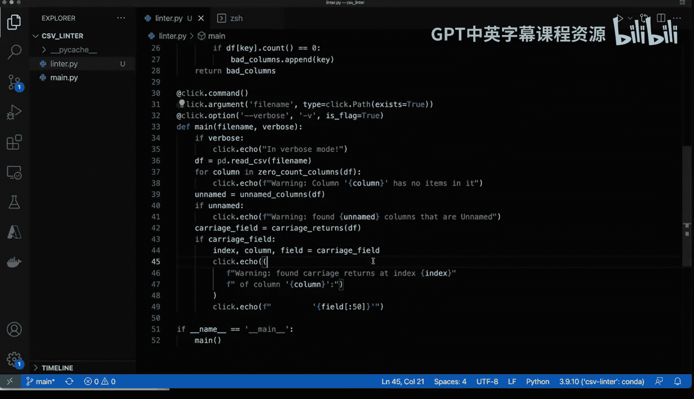

# 数据工程基础：2-4：探索高级命令行工具特性


在本节课中，我们将学习如何增强一个基于Click库构建的Python命令行工具，使其功能更强大、对用户更友好。我们将重点介绍如何添加参数类型检查、可选标志以及确保跨平台输出一致性的方法。

上一节我们介绍了如何使用Click库创建一个基础的命令行工具。本节中，我们来看看如何为其添加一些高级特性，以提升工具的健壮性和用户体验。

## 添加参数类型检查

以下是增强工具的第一步：为命令行参数添加类型检查。这能提供更精确的错误报告。

```python
import click

@click.command()
@click.argument('filename', type=click.Path(exists=True))
def main(filename):
    print(f"Processing file: {filename}")
```

在上面的代码中，`type=click.Path(exists=True)` 告诉Click，`filename` 参数必须是一个存在的文件路径。如果用户提供了一个不存在的路径，Click会自动生成一个清晰的错误信息。

例如，在终端中执行 `python my_tool.py /some/nonexistent/path`，工具会报错：“Invalid value for ‘FILENAME’: Path ‘/some/nonexistent/path’ does not exist.”。这比让程序在后续步骤中崩溃要友好得多。

## 添加可选标志（Options）

接下来，我们为工具添加一个可选标志，例如一个控制输出详细程度的 `--verbose` 标志。

```python
import click

@click.command()
@click.argument('filename', type=click.Path(exists=True))
@click.option('-v', '--verbose', is_flag=True, help='Enable verbose output.')
def main(filename, verbose):
    if verbose:
        click.echo("Running in verbose mode.")
    click.echo(f"Processing file: {filename}")
```

在上面的代码中：
*   `@click.option()` 装饰器用于定义可选标志。
*   `-v` 和 `--verbose` 是标志的别名，用户使用任意一个都可以。
*   `is_flag=True` 表示这是一个布尔标志，出现即为 `True`。
*   `help` 参数用于在帮助信息中描述此选项。

现在，运行 `python my_tool.py --help`，你会在帮助菜单中看到新增的 `-v, --verbose` 选项。执行 `python my_tool.py existing_file.txt --verbose` 会触发详细模式下的输出。

## 使用 `click.echo` 确保输出一致性

最后，我们介绍一个确保工具在不同操作系统上都能正确输出的最佳实践：使用 `click.echo` 代替内置的 `print` 函数。

```python
# 使用 click.echo 替代 print
click.echo(f"Processing file: {filename}")
```

`click.echo` 的功能与 `print` 类似，但它能更好地处理不同平台（如Windows、Linux、macOS）的终端差异，并妥善处理Unicode字符。这能确保你的工具无论在哪里运行，输出都是稳定和一致的。



本节课中我们一起学习了如何为Click命令行工具添加高级特性。我们首先通过 `click.Path` 为参数添加了存在性检查，以提供清晰的错误报告。然后，我们使用 `@click.option` 添加了可别名化的布尔标志，以增加功能选项。最后，我们介绍了使用 `click.echo` 来替代 `print`，以确保工具跨平台的输出一致性。这些改进使得命令行工具更加健壮和用户友好。