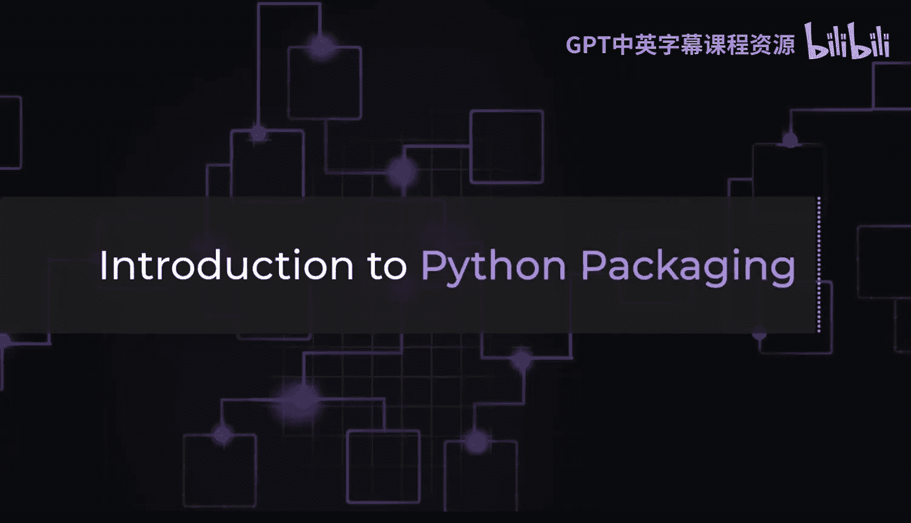
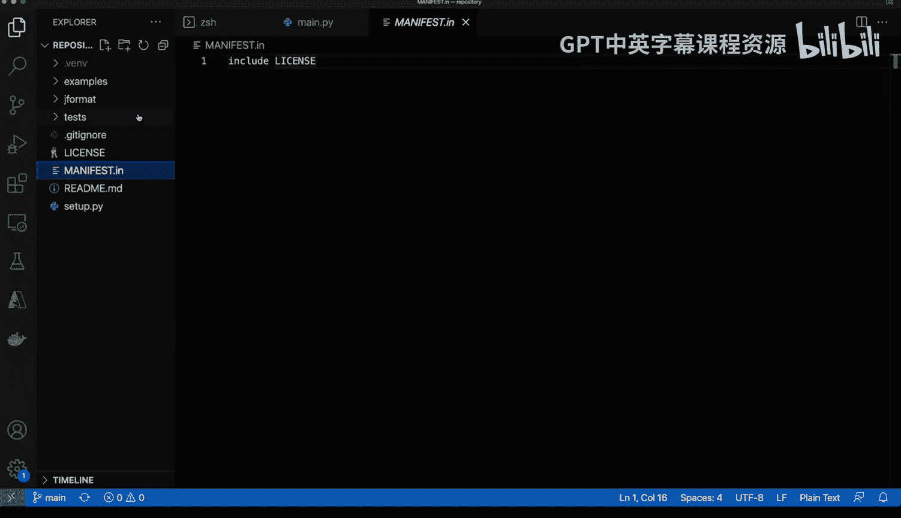

# Python、Bash和SQL数据工程基础：2-4：Python打包技术入门 🐍📦




在本节课中，我们将要学习Python项目打包的基础知识。打包是将你的代码、依赖和配置组织起来，以便于分发、安装和运行的过程。我们将从创建虚拟环境开始，逐步了解打包所需的核心文件。

## 虚拟环境：项目隔离的第一步

上一节我们介绍了打包的概念，本节中我们来看看如何为项目创建一个独立的运行环境。虚拟环境允许你将项目所需的库与系统全局安装的库隔离开来，便于管理和清理。

我们有一个小型项目，但编辑器提示`click`库无法导入。首先需要安装`click`作为项目依赖。处理Python项目打包时，你首先会遇到的就是虚拟环境。

创建虚拟环境的一种方法是使用`python -m venv`命令。我喜欢使用`.venv`作为目录名，这会创建一个隐藏的虚拟环境目录。

```bash
python -m venv .venv
```

编辑器此时可能检测到虚拟环境已创建，并提示你激活它。在某些情况下，编辑器会自动刷新并激活环境。但了解如何手动激活虚拟环境也很有用。

你可以使用`source`命令来激活虚拟环境。

```bash
source .venv/bin/activate
```

激活后，你会看到终端提示符发生了变化，前面显示了`(.venv)`。现在我们可以开始安装项目依赖了。

验证虚拟环境是否激活的一个好方法是检查`python`命令的路径。

```bash
which python
```

该命令应指向`.venv`目录下的路径，而不是系统的Python路径。这是判断虚拟环境是否激活的标志之一，除了提示符的变化。

现在，我们可以使用`pip`来安装`click`库。

```bash
python -m pip install click
```

`click`库已通过`pip`安装完成。之后，你需要重新加载编辑器窗口，以便编辑器识别到新激活的虚拟环境和已安装的库。编辑器需要知道当前激活的是哪个虚拟环境。

如果你在VS Code中打开一个新的终端，它会自动为你激活该虚拟环境。这是Python打包，特别是VS Code编辑器的一个实用功能。

## 打包项目：核心文件解析

虚拟环境是打包需要了解的第一件事，但让我们进一步了解你将与之交互的几个核心文件。

首先，我们创建了`.venv`目录，项目所有依赖都将安装在这里。我们的项目名为`jformat`，包含几个文件。

以下是项目打包中几个特定的文件：

*   **`LICENSE`文件**：包含项目的许可证信息。
*   **`README.md`文件**：你可以在这里放置项目文档。
*   **`MANIFEST.in`文件**：这个文件允许你在打包时，指定包含或排除某些文件模式。例如，如果你有辅助图片但不想分发它们，可以在这里添加排除路径。在本例中，我们选择包含`LICENSE`文件，因为它通常不会自动包含在Python项目中。
*   **`setup.py`文件**：这是另一个你将打交道的重要文件。它是Python中的一个约定，用于配置如何打包和分发你的工具、程序、库或项目，以便将其上传到像PyPI这样的平台。

综上所述，拥有`setup.py`、`MANIFEST.in`和一个虚拟环境，你就具备了使用Python打包技术的基本条件。

## 总结



本节课中我们一起学习了Python打包的入门知识。我们从创建和激活虚拟环境开始，它确保了项目的依赖隔离。接着，我们探讨了打包项目的核心文件：`setup.py`用于配置项目打包信息，`MANIFEST.in`用于控制哪些文件被包含在分发包中。掌握这些基础是分发和共享Python项目的重要第一步。