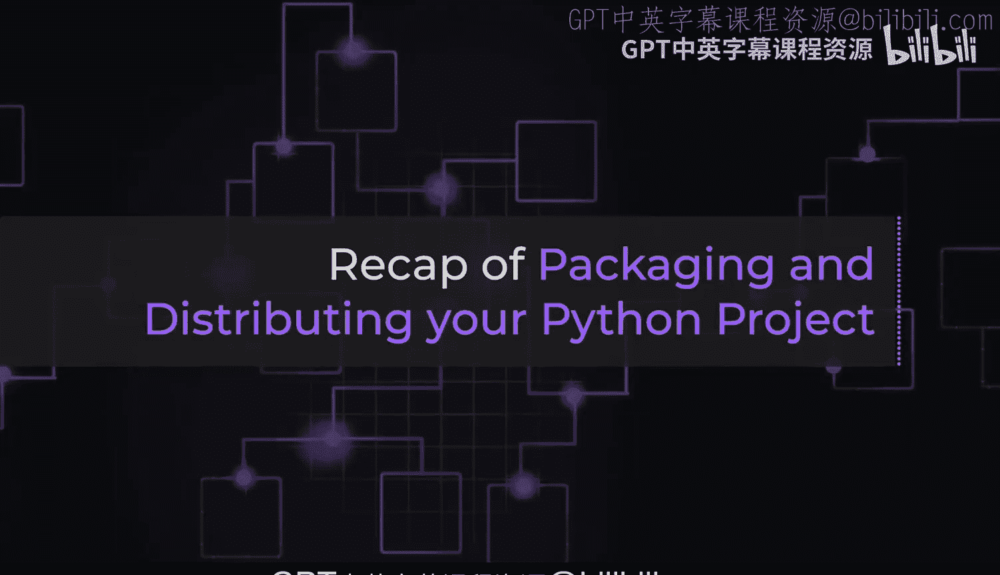

# Python、Bash和SQL数据工程基础：2-4：Python项目打包与分发总结 🚀

在本节课中，我们将要学习如何将一个Python项目打包并分发到全球。我们将从理解打包所需的关键文件开始，逐步学习如何配置项目、构建包，并最终将其上传到PyPI，以便其他用户能够轻松安装。

---

## 项目打包基础 📦

上一节我们介绍了数据工程中Python的基本应用，本节中我们来看看如何将你的代码打包成一个可分享的库。

打包一个Python项目涉及几个核心文件。这些文件告诉打包工具如何组织你的代码、管理依赖以及包含哪些资源。

以下是打包时你可能会看到并需要配置的重要文件：

*   **`setup.py`**：这是打包过程的中心配置文件。它使用`setuptools`库来定义项目的元数据（如名称、版本、作者）和依赖项。
*   **`setup.cfg`**：一个配置文件，可以用来声明`setup.py`中的一些设置，使配置更清晰、更静态。
*   **`pyproject.toml`**：一个较新的标准文件，用于声明项目构建系统的要求和配置，可以被`pip`和现代构建工具识别。
*   **`MANIFEST.in`**：这个文件用于指定除了Python源代码文件外，哪些额外的文件（如数据文件、文档）应该被包含在分发包中，或者哪些文件应该被排除。

## 配置与构建 🔧

理解了核心文件后，接下来我们需要配置它们并实际构建出可分发的包。

我们使用`setuptools`库中的函数和`setup()`函数来配置项目。`MANIFEST.in`文件则用于精确控制包含或排除某些特定路径的文件。

以下是构建和测试包的基本步骤：

1.  在项目根目录下，运行 `python setup.py sdist bdist_wheel` 命令。这会生成源代码包（`sdist`）和预构建的wheel包（`bdist_wheel`）。
2.  为了隔离环境，建议使用虚拟环境。你可以使用 `python -m venv venv` 创建，然后激活它来安装和测试你的包。
3.  在虚拟环境中，使用 `pip install .` 安装你刚刚构建的本地包，以验证其能否正常工作。

## 分发与发布 🌍

项目打包并测试无误后，就可以将其发布到公共仓库，供全世界的用户使用了。

我们将使用Twine工具来上传和注册你的项目到PyPI（Python包索引）。这允许你注册一个新版本，其他用户就可以从任何地方通过`pip install your-package-name`来安装它。

通过利用这些分发渠道，你可以有效地分享你的Python项目。这为你如何获取任何项目、打包它并分发它奠定了良好的基础。

---

本节课中我们一起学习了Python项目打包与分发的完整流程。我们从认识`setup.py`、`MANIFEST.in`等关键文件开始，学习了如何配置和构建分发包，最后掌握了使用Twine将包发布到PyPI的方法。现在，你应该具备了将你的代码项目打包并分享给全球社区的良好基础。