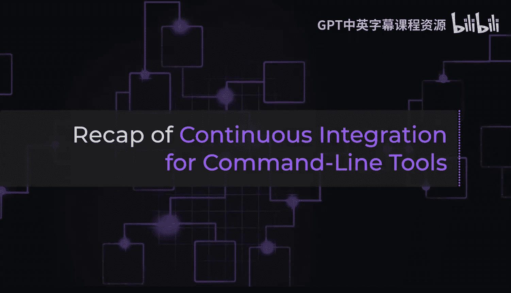

# 数据工程基础：2-4：命令行工具持续集成要点回顾 🛠️

在本节课中，我们将学习如何自动化持续集成流程，涵盖从发布到链接、再到测试不同Python版本的各个方面。这些方法将帮助你构建一个非常健壮的命令行工具。

## 概述

上一节我们介绍了持续集成的基本概念，本节中我们来看看实现自动化的具体方式。自动化是软件开发实践的基石，它能让你在进行修改或发布新版本时感到自信和安全。

## 自动化持续集成的方法

以下是几种可以自动化持续集成流程的关键方法。

*   **自动化发布流程**：将软件发布到包管理器（如PyPI）或代码仓库（如GitHub）的过程可以实现自动化，减少人为错误。
*   **自动化链接管理**：确保项目依赖（如通过`requirements.txt`或`pyproject.toml`定义）的版本被正确管理和更新。
*   **自动化多版本测试**：在多个Python版本（例如3.8, 3.9, 3.10）上自动运行测试套件，以保证代码的广泛兼容性。

## 核心实践要点

这些自动化实践不仅适用于命令行工具项目，也适用于任何Python软件项目，乃至任何类型的软件项目。

*   **以自动化为开发基础**：将自动化脚本和流程（如使用GitHub Actions、GitLab CI/CD或Jenkins）集成到开发工作流中。
*   **提升变更信心**：当代码库的每次提交都能触发自动化的构建、测试和检查时，开发者可以更自信地进行代码修改。
*   **保障发布安全**：自动化的发布流水线能确保每次版本发布都经过一致且可靠的步骤，降低了发布风险。

## 总结

本节课中我们一起学习了自动化持续集成的核心要点。通过实现发布、链接管理和多环境测试的自动化，你可以为任何软件项目建立一个健壮、可靠且高效的开发基础，从而在项目的整个生命周期中保持代码质量和开发效率。