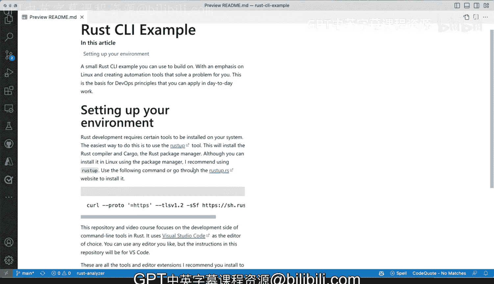

# 数据工程基础：2-4：命令行开发环境配置 🛠️


在本节课中，我们将学习如何为构建命令行工具配置一个 Rust 开发环境。我们将介绍 Rust 的安装、推荐的开发工具（如 VS Code 扩展），以及如何使用 Cargo 工具链来格式化代码、检查错误和优化代码质量。

---

## 概述

与 Python 不同，Rust 需要特定的安装和配置步骤来搭建开发环境。本节将指导你完成这些步骤，并展示一个高效的工作流程。一旦你构建并发布了二进制文件，目标系统就不再需要安装 Rust，这是 Rust 在构建命令行工具时的一个显著优势。

## 安装 Rust

首先，我们需要安装 Rust。推荐使用 `rustup` 工具进行安装，而不是通过 Linux 的包管理器。`rustup` 会处理 Rust 工具链的安装和更新。

以下是安装命令：

```bash
curl --proto '=https' --tlsv1.2 -sSf https://sh.rustup.rs | sh
```

运行此命令后，它会创建几个目录，并将 `cargo`（Rust 的包管理器和构建工具）的 `bin` 目录添加到你的系统路径中。你的 Shell 环境也会相应更新，以便访问这些路径。

> **注意**：虽然演示中使用了 macOS，但 `rustup` 在 Linux 系统上的安装过程类似。请避免使用系统自带的包管理器安装 Rust。

## 配置开发工具

上一节我们介绍了如何安装 Rust 本身，本节中我们来看看如何配置一个高效的代码编辑环境。

### Visual Studio Code 扩展

推荐使用 Visual Studio Code 作为 Rust 的开发环境。你需要安装以下扩展来获得更好的开发体验：

*   **Rust Analyzer**：这是核心扩展。它提供代码补全、类型提示、悬停文档、查找引用和错误检查等功能，远超基础的代码补全。
*   **GitHub Copilot**（可选）：如果你已拥有许可证，这个 AI 代码助手可以为 Rust 开发提供代码建议，帮助你更快上手，尤其适合从 Python 转向 Rust 的开发者。

安装 Rust Analyzer 后，你会在编辑器底部看到相关状态指示。GitHub Copilot 安装并登录后，其图标也会出现在底部状态栏。

## 认识项目结构

现在，让我们快速浏览一个典型的 Rust 命令行项目结构，了解我们将要处理的主要组件。

以下是一个由 `cargo` 生成的典型项目文件列表：

*   **`Cargo.toml`**：这是项目的配置文件，类似于 Python 的 `setup.py` 或 `pyproject.toml`。它定义了项目的元数据、依赖项等信息。
*   **`Cargo.lock`**：此文件由 `cargo` 自动生成，用于锁定项目依赖的确切版本，确保构建的可重现性。
*   **`.gitignore`**：版本控制系统忽略文件，通常也由 `cargo` 自动生成，会忽略 `target/` 等目录。
*   **`src/` 目录**：这是存放 Rust 源代码文件（`.rs` 后缀）的主要目录。例如，`src/main.rs` 是二进制程序的入口点。
*   **`target/` 目录**：当你编译或构建项目时，生成的所有文件（包括最终的二进制文件）都会放在这个目录里。
*   **`examples/` 目录（可选）**：你可以在这里放置示例代码，用于展示你的命令行工具如何使用。

## 使用 Cargo 工具链

了解了项目结构后，我们来看看如何使用 `cargo` 命令来保证代码质量和正确性。`cargo` 是 Rust 的核心工具，我们主要使用它的三个子命令。

以下是三个关键的 `cargo` 工作流命令：

1.  **`cargo fmt`**：此命令用于格式化代码。无论你的代码格式多么混乱，运行 `cargo fmt` 后，它都会按照 Rust 社区的通用风格规范重新格式化，确保代码风格一致。
    ```bash
    cargo fmt
    ```

2.  **`cargo clippy`**：这是一个代码 linting 工具。它会分析你的代码，并给出改进建议（例如，更简洁的写法、潜在的陷阱等）。它不报错，但提供优化提示。
    ```bash
    cargo clippy
    ```

3.  **`cargo check`**：此命令会快速检查代码能否通过编译，而无需真正生成可执行文件。它能非常迅速地反馈语法或类型错误，是高效的错误检查工具。
    ```bash
    cargo check
    ```

> **提示**：`rustup` 在安装 Rust 时，已经包含了 `cargo fmt` 和 `cargo clippy` 等工具。此外，之前安装的 **Rust Analyzer** 扩展会在你编写代码时，在后台实时运行类似 `cargo check` 的检查，并用红色波浪线直接在编辑器中标出错误，同时提供修复建议。

## 总结

本节课中我们一起学习了如何配置一个完整的 Rust 命令行开发环境。我们从使用 `rustup` 安装 Rust 开始，然后配置了 Visual Studio Code 及其关键扩展（Rust Analyzer 和可选的 GitHub Copilot）。接着，我们熟悉了由 `cargo` 生成的典型项目结构。最后，我们实践了使用 `cargo fmt`、`cargo clippy` 和 `cargo check` 来格式化、优化和检查代码的核心工作流程。这个环境能帮助你高效、规范地开发 Rust 命令行工具。



强烈建议通过 `rustup.rs` 网站或上述命令行来安装和更新 Rust。