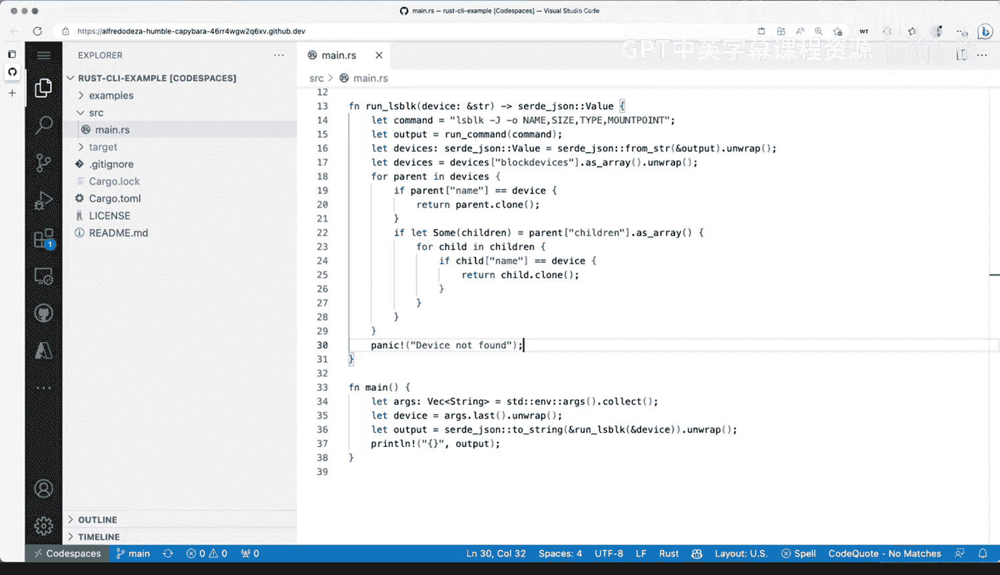

# Rust 命令行工具开发：2-4：首个命令行工具实战 🛠️


在本节课中，我们将学习如何使用 Rust 构建第一个命令行工具。我们将创建一个 `lsblk` 命令的替代工具，用于在容器化环境中列出块设备信息。我们将涵盖 Rust 环境的设置、代码结构解析、编译与运行，以及初步的错误处理概念。

---

## 环境准备与工具安装

在开始编写代码之前，我们需要确保 Rust 开发环境已正确安装并配置。

首先，我们确认当前的操作系统环境。我们使用的是 Ubuntu 20.04 LTS 版本。

接下来，我们运行 `rustup` 命令来安装 Rust 工具链。这个过程会下载并安装包括 `cargo`、`clippy` 在内的必要组件。

安装完成后，我们需要执行 `source $HOME/.cargo/env` 命令。这确保了在终端中可以直接使用 `rustc` 和 `cargo` 命令。

我们可以通过以下命令验证安装是否成功：
```bash
which rustc
which cargo
rustc --version
```
如果一切正常，`rustc --version` 应显示类似 `1.68.2` 的版本号。至此，Rust 环境已准备就绪。

---

## 问题定义与业务需求

上一节我们完成了环境搭建，本节中我们来看看要解决的具体问题。

我们的业务需求是创建一个能替代 `lsblk` 命令的工具。在标准的容器化环境中，直接运行 `lsblk` 命令可能会失败，并提示“不是块设备”。这是因为容器环境中的设备并非真实的物理块设备。

为了解决这个问题，我们的策略是使用 `lsblk -J` 命令。该命令会以 JSON 格式输出设备信息。我们的 Rust 工具将解析这个 JSON 输出，并提取出用户指定的特定设备信息。

---

## 代码结构解析

现在，让我们深入查看实现这个工具的 Rust 代码。代码的主要逻辑位于 `main.rs` 文件中。在 Rust 中，程序默认从 `main` 函数开始执行。

以下是代码的核心组成部分：

1.  **`run_command` 函数**：此函数负责执行外部系统命令。
    *   它接收一个命令字符串。
    *   使用 `split_whitespace().collect()` 将命令按空格分割，并收集到一个字符串向量 (`Vec<String>`) 中。这类似于 Python 中的列表。
    *   使用 `std::process::Command` 来执行命令，并将命令的输出解析为字符串。
    *   如果命令执行失败，它会引发一个错误。

2.  **`run_lsblk` 函数**：此函数封装了获取块设备信息的逻辑。
    *   它定义了要执行的命令：`lsblk -J`。
    *   调用 `run_command` 函数来获取 JSON 格式的输出。
    *   使用 `serde_json` 库来反序列化 JSON 数据。
    *   遍历 JSON 数据中的块设备列表，寻找与给定设备名（如 `sdb`）匹配的项。
    *   如果找到匹配项，则返回该设备的信息；否则，目前代码会直接 `panic`（崩溃）。请注意，在生产代码中应更优雅地处理错误。

3.  **`main` 函数**：这是程序的入口点。
    *   它从命令行参数中获取用户输入的设备名称（例如 `sdb1`）。
    *   调用 `run_lsblk` 函数来查找设备信息。
    *   将找到的信息打印到控制台。

这个简单的工具尚未使用任何命令行参数解析框架，因此缺少帮助菜单和更健壮的错误处理，但这对于初步理解已足够。

---

## 编译与运行工作流

理解了代码结构后，我们来看看如何构建和运行这个工具。Rust 使用 `cargo` 作为包管理和构建工具。

以下是开发过程中常用的命令：

*   **`cargo check`**：快速检查代码语法和类型是否正确，而不进行编译。这是一个快速的验证步骤。
*   **`cargo build`**：编译项目并生成可执行文件。可执行文件默认位于 `target/debug/` 目录下，并以项目名（在 `Cargo.toml` 中定义，例如 `block-rs`）命名。
*   **`cargo run <arguments>`**：这是一个组合命令，它会先编译项目（如果代码有变动），然后立即运行生成的可执行文件，并传递指定的参数。这是最常用的开发命令。

例如，要查找设备 `sdb1` 的信息，我们可以运行：
```bash
cargo run sdb1
```
如果代码没有错误，你将看到工具输出该设备的 JSON 信息。

---

## 当前局限与改进方向

在本节中，我们将审视当前工具的不足之处，并探讨未来的改进空间。

目前这个工具是一个功能性的原型，但存在一些明显的限制：

*   **错误处理不完善**：当设备未找到或 `lsblk` 命令执行失败时，程序会直接 `panic`，这对用户不友好。
*   **缺少命令行功能**：没有帮助信息 (`--help`)，也没有对输入参数进行验证或灵活解析。
*   **代码可维护性**：所有逻辑都集中在 `main.rs` 中，随着功能增加会变得难以管理。

在后续的课程中，我们将学习如何使用像 `clap` 这样的命令行解析库来增强工具，并引入更系统的错误处理机制（例如使用 `Result` 类型和 `?` 操作符），以及如何更好地组织代码模块。

---

## 总结

本节课中我们一起学习了使用 Rust 构建首个命令行工具的完整流程。

我们从设置 Rust 开发环境开始，明确了要解决的业务问题——创建一个容器环境下可用的 `lsblk` 替代工具。我们逐行分析了工具的核心代码，包括命令执行、JSON 解析和设备查找逻辑。接着，我们实践了使用 `cargo build` 和 `cargo run` 来编译和运行工具。最后，我们讨论了当前版本的局限性，为后续的优化和改进指明了方向。



通过这个实战练习，你已经掌握了 Rust 命令行工具开发的基础工作流，为学习更复杂的项目打下了坚实的基础。