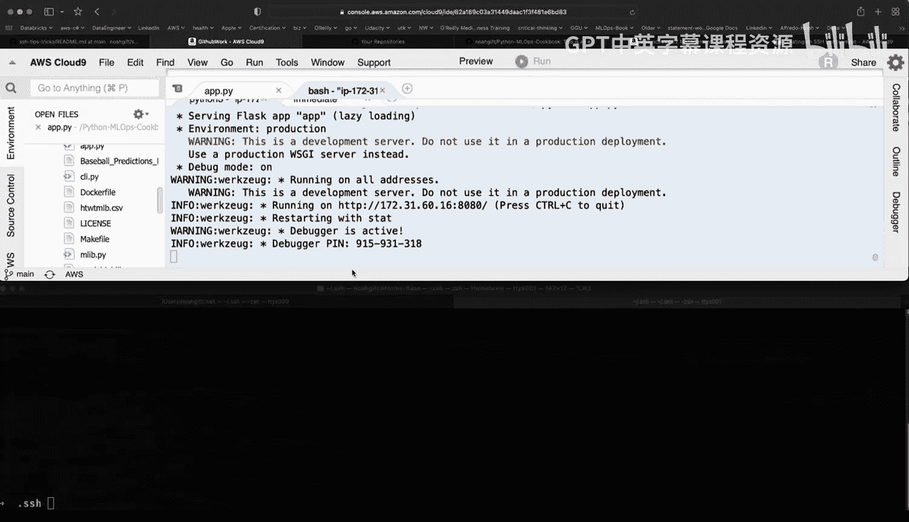
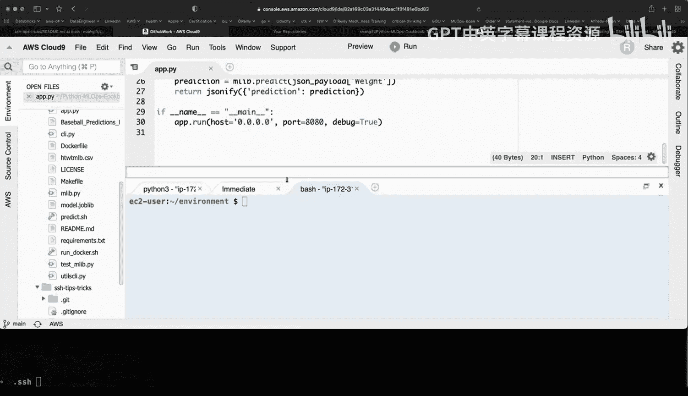
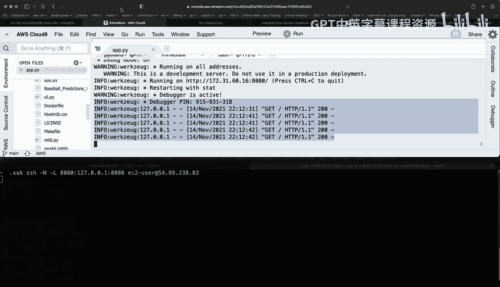
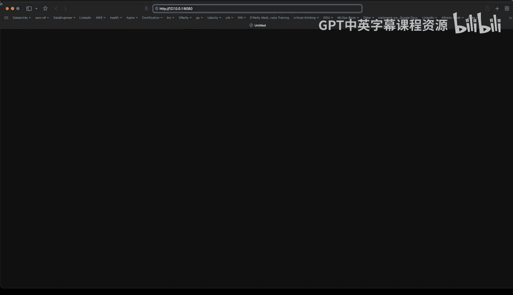
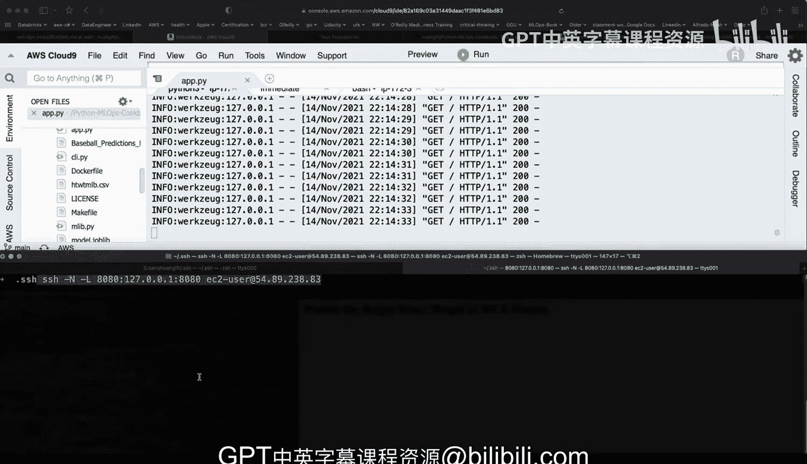

# 数据工程基础：2-4：SSH隧道示例演练 🚀


在本节课中，我们将学习如何使用SSH隧道（也称为端口转发）技术，来安全地访问运行在远程服务器上的本地网络服务。我们将通过一个具体的Flask Web应用示例，演示如何从本地浏览器访问远程服务器上运行的应用程序。


---

## 概述

SSH隧道是一种强大的网络技术，它允许你将远程服务器上的特定网络端口“映射”到本地计算机的端口上。这意味着，即使服务（如一个网站或数据库）只在远程服务器的内部网络（如`127.0.0.1:8080`）上运行，你也可以通过本地计算机直接访问它，就像服务运行在本地一样。这对于远程开发、调试和访问受防火墙保护的内部服务至关重要。

上一节我们介绍了SSH的基础连接，本节中我们来看看如何利用SSH隧道进行端口转发。

---

## 准备示例应用

首先，我们来看一个具体的例子。这里有一个来自O‘Reilly书籍《Python EmOs Cookbook》的Flask Web应用示例，该示例是关于机器学习模型部署的。

我已经将这个应用克隆到了当前远程服务器环境中。这个应用的核心是一个简单的Flask服务器。

以下是该Flask应用的关键部分代码：

```python
# app.py 示例代码
from flask import Flask
app = Flask(__name__)

@app.route('/')
def hello():
    return “这是一个运行在远程服务器上的Flask应用。”

@app.route('/predict')
def predict():
    # 这里是机器学习预测的逻辑
    return “预测结果”

if __name__ == '__main__':
    app.run(host='127.0.0.1', port=8080)
```

如代码所示，该应用绑定在本地环回地址`127.0.0.1`的`8080`端口上。这意味着它只能从服务器本机访问。

现在，让我们在服务器上启动这个应用。在终端中运行：

```bash
python app.py
```



应用启动后，在**同一个远程服务器**上打开另一个终端，我们可以使用`curl`命令测试应用是否正常运行：



```bash
curl 127.0.0.1:8080
```

如果看到返回的网页信息，则证明应用在服务器本地运行成功。然而，我们无法从自己的个人电脑直接访问这个地址。

---

## 建立SSH隧道

为了从我们的本地计算机访问这个远程服务，我们需要建立一条SSH隧道。这通过SSH的`-L`参数实现。

以下是建立隧道的命令格式：

```bash
ssh -L [本地IP]:[本地端口]:[远程服务地址]:[远程服务端口] [用户名]@[远程服务器地址]
```

在我们的例子中，命令具体如下：

```bash
ssh -L 127.0.0.1:8080:127.0.0.1:8080 your_username@remote_server.com
```

**命令解析：**
*   `-L`: 表示进行本地端口转发。
*   `127.0.0.1:8080`（第一个）：指定在本地计算机上监听的地址和端口。
*   `127.0.0.1:8080`（第二个）：指定远程服务器上目标服务的地址和端口。
*   `your_username@remote_server.com`: 你的SSH登录信息。

执行此命令并输入密码后，SSH连接会建立，同时隧道也开始工作。

---

## 通过隧道访问远程应用

隧道建立后，神奇的事情发生了。你无需对远程应用做任何修改。



现在，请在你的**本地计算机**上打开一个网页浏览器，在地址栏输入：

```
http://127.0.0.1:8080
```



或者

```
http://localhost:8080
```

你会发现，浏览器中显示的内容正是远程服务器上那个Flask应用的主页。你每刷新一次页面，实际上都是通过加密的SSH隧道向远程服务器的`8080`端口发送了一次请求。

如果你此时查看运行Flask应用的远程终端，可以看到类似以下的访问日志，证明请求确实到达了远程服务器：

```
127.0.0.1 - - [日期时间] “GET / HTTP/1.1” 200 -
```


---

## SSH隧道的强大用途

SSH隧道不仅限于转发Web服务。它是一种通用技术，可以转发任何基于TCP协议的服务。

以下是SSH隧道的一些常见应用场景：

*   **访问内部数据库**：将远程服务器上的MySQL（`3306`端口）、PostgreSQL（`5432`端口）等数据库服务转发到本地，方便用本地工具（如DBeaver, TablePlus）进行连接和管理。
*   **远程开发与调试**：就像本例一样，你可以将测试环境或预生产环境的Web服务映射到本地，使用熟悉的本地浏览器和开发者工具进行调试。
*   **绕过网络限制**：访问某些仅限内网访问的Wiki、监控面板或管理后台。
*   **安全连接**：所有通过隧道传输的数据都经过SSH协议加密，即使在不安全的网络中也能保证通信安全。

掌握SSH隧道技术，能让你更灵活、更安全地在分布式环境中工作和开发。

---

## 总结

本节课中我们一起学习了SSH隧道的原理与实战应用。我们首先在远程服务器上启动了一个本地Flask应用，然后通过`ssh -L`命令建立了一条从本地端口到远程端口的加密隧道。最终，我们成功通过本地浏览器访问了原本只能在远程服务器内部访问的Web服务。



记住核心命令格式：`ssh -L [本地端口]:[远程地址]:[远程端口] [用户]@[主机]`。这项技术是数据工程师和开发者在处理远程资源、进行安全调试时的必备技能。