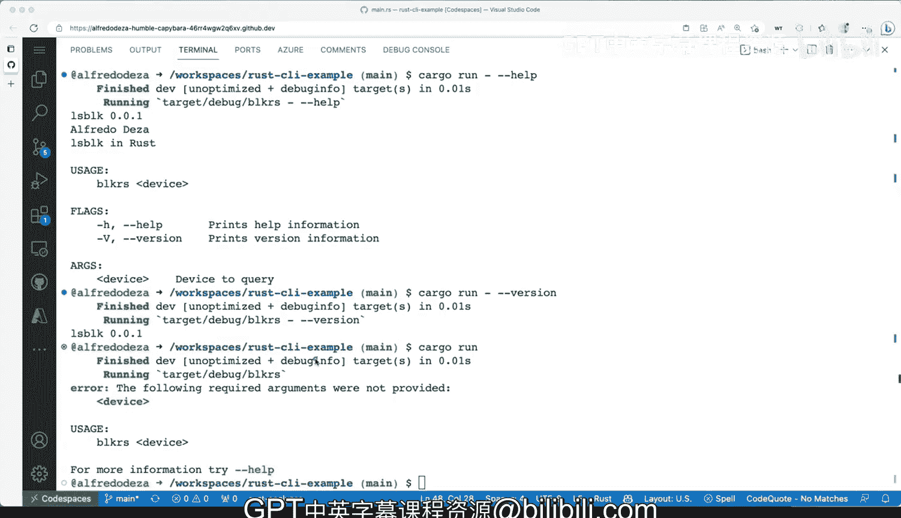

# 数据工程基础：2-4：用户输入参数与选项处理 🛠️


在本节课中，我们将学习如何使用 Rust 语言中的 `clap` 框架，为命令行工具添加参数解析、标志和帮助菜单生成功能，从而构建一个更健壮的工具。

## 概述

上一节我们创建了一个简单的命令行工具。本节中，我们将在此基础上进行升级，使其能够处理用户输入的参数和选项。我们将从一个空项目开始，使用 `cargo` 初始化，并引入 `clap` 框架来管理命令行界面。

## 从零开始创建项目

首先，我们需要创建一个新的 Rust 项目。以下是具体步骤。

以下是使用 `cargo` 初始化项目的命令：

```bash
cargo init --name block_rs .
```

此命令会在当前目录创建一个新的二进制应用包。它会自动生成 `src` 目录、`Cargo.toml` 文件并更新 `.gitignore` 文件。

查看生成的 `Cargo.toml` 文件，其初始内容如下：

```toml
[package]
name = "block_rs"
version = "0.1.0"
edition = "2021"

[dependencies]
```

## 添加项目依赖

接下来，我们需要为项目添加必要的依赖库。我们将使用 `clap` 框架来处理命令行参数，并保留之前使用的 `serde_json`。

以下是更新后的 `Cargo.toml` 文件依赖部分：

```toml
[dependencies]
clap = "2.33.3"
serde_json = "1.0"
```

`clap` 是我们新添加的框架，它将为我们提供构建命令行工具所需的所有功能。

## 构建主函数

项目初始化后，`src/main.rs` 文件会包含一个基础的 `main` 函数。我们需要将之前工具的逻辑复制到这个新项目中。

以下是整合后 `main.rs` 文件的初始代码结构：

```rust
fn main() {
    // 旧的工具逻辑将放在这里
}
```

复制旧代码后，我们可以在终端中运行 `cargo build` 来确保一切都能正确编译和构建。

## 引入 Clap 框架

现在，我们将开始修改 `main` 函数，使用 `clap` 来解析命令行参数，替换之前简单获取最后一个参数的方法。

以下是使用 `clap` 定义应用基本信息的方法：

```rust
use clap::App;

let matches = App::new("block_rs")
    .version("0.0.1")
    .author("Alfredo Deza")
    .about("Lists block devices in Rust")
    .get_matches();
```

这段代码创建了一个新的命令行应用，并设置了版本、作者和描述信息。运行 `cargo run -- --help` 现在可以显示一个基本的帮助菜单。

## 添加命令行参数

我们的工具需要一个位置参数来指定设备名。使用 `clap` 可以方便地定义这个参数。

以下是定义必需的位置参数 `device` 的代码：

```rust
let matches = App::new("block_rs")
    .version("0.0.1")
    .author("Alfredo Deza")
    .about("Lists block devices in Rust")
    .arg(
        Arg::with_name("device")
            .index(1)
            .required(true)
            .help("The block device to list (e.g., sda)"),
    )
    .get_matches();
```

参数 `device` 被定义为第一个位置参数（`index(1)`），并且是必需的（`required(true)`）。现在运行帮助命令，可以看到 `device` 参数已出现在说明中。

## 使用解析后的参数

定义了参数之后，我们需要在代码中获取并使用它的值，替换之前硬编码的逻辑。

以下是如何从解析结果中获取 `device` 参数值的代码：

```rust
let device = matches.value_of("device").unwrap();
// 后续使用 device 变量进行操作
```

现在，运行工具时必须提供设备参数，例如 `cargo run -- sdb`。如果不提供参数，`clap` 会自动显示错误信息，提示缺少必需参数。

## 总结



本节课中我们一起学习了如何为一个 Rust 命令行工具添加专业的参数处理功能。我们从使用 `cargo init` 创建新项目开始，添加了 `clap` 依赖库，并利用该框架定义了应用的元信息和一个必需的位置参数。这使得我们的工具更加健壮，具备了自动生成的帮助菜单、版本信息以及基本的错误处理能力。下一步，我们可以在此基础上进一步改进错误处理机制。