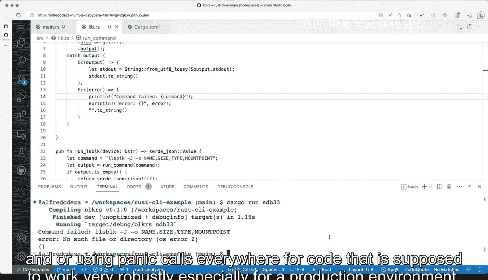

# 数据工程基础：2-4：输出管理、日志记录与错误处理 🛠️

在本节课中，我们将学习如何改进命令行工具，使其能够优雅地处理错误，而不是在遇到问题时直接崩溃。我们将重点学习如何管理输出、记录日志以及进行错误处理，使工具更加健壮和用户友好。

---

到目前为止，我们的命令行工具假设一切都会顺利进行。如果事情不顺利，这实际上会导致很多问题。

我们可以看到这里有几个问题。这里的 `expect` 会导致程序恐慌（panic），并且执行失败时会显示类似的信息。如果我继续往下看，这个 JSON 序列化在序列化出现问题时也会导致恐慌。

继续往下看。实际上，这里有一个 `unwrap`。所以，如果输出中不存在 `block devices`，它也会在这里的 `unwrap` 处导致恐慌。如果我滚动到这里的最下方，又会遇到另一个恐慌，并显示“device not found”消息。

因此有很多恐慌。正如我提到的，如果你只是想写一些演示代码或示例，恐慌是可以接受的。但对于生产级代码来说就不太合适了。我的意思是，你仍然可以在生产级代码中使用恐慌，当我们遇到完全无法恢复的错误时，我们绝对希望 100% 恐慌并停止一切执行，这没问题，但这并不常见，而且肯定不是我们在这里想做的。我们希望继续执行，我们希望处理这些错误，并提供一些消息输出。

现在，如果我们用一个不存在的设备运行 `cargo run`，我们会得到很多不一定对用户有用的信息，比如“thread main panicked”、“fail to execute command”、“OS code”等等。这里有很多信息对用户来说不是很有用。

所以，让我们开始让它变得更好一点。我将移除这个无效的命令，然后再次运行 `clear` 和 `run`，因为这里有一个 `unwrap`。

在最后，如果我运行这个，“device not found”也会导致恐慌。所以，这是我们想要改进的两种情况。

---

## 修复“device not found”恐慌

让我们开始修复它们。我们要做的第一件事是停止最后那个恐慌消息。我们不想那样做。我认为在这里返回一个空的 JSON 是完全可接受的。

我们将不得不传入或从 `third_json` 返回一个值。所以，我们将移除这个恐慌，当我们使用 `third_json` 库时，我们不会返回 `null`。我们将调用这个宏并返回一个 JSON 中的空对象。

现在，我们这样做，而不是说“device not found”（这可能对也可能不对），我们将对可能使用这个库的任何其他工具保持友好。

我将重置并运行 `sdb33`。现在我们将得到的输出是一个空对象。没有找到 `sdb3`。所以这个结果意味着没有找到任何东西。因此没有必要恐慌。这已经友好多了。如果你在一个 CD 系统中使用这个工具，你不需要解析错误，但你想有一些东西来处理。

所以，现在一些依赖这个结果的代码可以说：“好吧，我要查看所有的块设备，但因为返回了一个空对象，或者没有设备，这隐式地表示在运行该命令后没有找到任何东西。”

好的，这是我们修复的一个恐慌。

---

## 处理命令执行失败

让我们移除这个 `file expect`，滚动并处理这个 `run_command`。错误的命令肯定会导致一些问题。

所以，如果我回去把这个命令改成不存在的命令，然后清除并运行，它会导致我们必须处理的问题。我们不打算在这里改变返回值，它仍然是一个字符串。我们将保持它为字符串。我想做的是，当这个输出在这里失败时，捕获那个失败命令的输出，捕获错误（如果失败），并将其打印到终端，这样我们就可以在这里看到它，但要继续执行，这样我们就不需要处理从 `run_command` 到 `run_lsblk` 函数再到 `main` 函数的错误传递，也不需要到处更改这些定义，因为我们不得不返回一个 `Result` 枚举，其中包含一个值或一个错误。

让我们开始工作。我们将通过创建一个对输出的匹配（`match`）来做到这一点。我将移除 `expect`，去掉 `expect`，这会导致各种问题，因为 `expect` 不在了。

现在我将说，输出将在那里。然后我将……实际上，让我注释掉这部分代码，把它移开，但我把它留在那里作为参考。这是我编写代码时经常使用的方法。我只是注释掉代码，这样我就可以把它作为参考。

所以，我将对输出进行匹配。这当然是我们在这里可以做的。编译器的这个建议看起来几乎正是我想做的。所以，我将接受这个建议。我会做一些修改。

让我们看看这里。所以我们有 `let stdout = String::from_utf8_lossy`。这一行没问题。我们将 `stdout` 转换为字符串是可以的。错误条件……不一定要使用这个。我们要打印，我们想准确打印发生了什么。所以我要说 `println!`，或者实际上，我们可以说 `eprintln!`。我要说“有一个错误”，错误到底是什么。所以我要保存这个。最后，我将创建一个空字符串，如果发生错误就返回它。

好的，我们这里有一个错误条件，我们漏掉了一个括号。现在我们可以移除这个注释了。

让我们回顾一下这里的一些更改，看看实际发生了什么变化。现在编辑器没有抱怨。一切看起来都很好。所以我们保留了返回值，它是一个字符串。参数是这些，然后我们说：“嘿，运行这个命令，当你完成后，让我们看看我们得到了什么。如果我们得到了正确的执行，没有错误，那么就进行解析，将其转换为 UTF-8 字符串，然后返回那个字符串，因为这里没有分号，这将被返回。否则，如果是一个错误，捕获实际的错误，将其打印到终端，然后返回一个空字符串。”

让我们再次运行这个，看看 `run sdb33` 会发生什么。好的，我们取得了一点进展。我们在这里打印出了我们的字符串或错误，比如“No such file or directory (os error 2)”，这没问题。但然后我们又遇到了另一个恐慌。那么，发生了什么？我们在这里遇到了麻烦，因为输出现在是一个空字符串，它不是有效的 JSON。所以当 `block_devices`……让我们看看，这应该是第 24 行。所以这一行会遇到麻烦，因为没有有效的 JSON。

我们在这里可以做的操作是，做一个 `if` 条件判断：如果输出是空的，那么我们肯定可以返回一个空的 JSON，然后继续。

现在让我们再次清除并运行 `cargo run sdb33`。我们越来越接近我期望的结果了。我们打印出了实际的错误。当你这样做时，你实际上可以更进一步，将某些内容发送到标准错误，将某些内容发送到标准输出。这样，当你从像这样的命令行工具捕获输出时，就不会遇到麻烦。

---

## 添加上下文信息

最后一件不一定非常棒，但仍然有用的事情是，我不想在这里添加打印语句或 `println!` 语句，但我还是要添加。我将在这里添加一个“Command failed”，并在这里添加实际的命令。我们实际上可以这样做，并将其包含在 `println!` 中。我要在那里添加一个分号。现在当我运行它时，我会得到更多关于发生了什么的信息。

好了，它告诉我命令失败了。所以现在我有了更多的上下文信息。这是失败的命令，错误是这个，输出将是一个空对象。

---

## 总结

在本节课中，我们一起学习了如何改进命令行工具的错误处理。我们修复了因 `unwrap` 和 `expect` 导致的程序恐慌，改为返回空 JSON 对象或空字符串来优雅地表示“未找到”。我们学习了使用 `match` 语句来捕获和处理命令执行失败，并将错误信息打印到标准错误流，同时继续程序执行。我们还为错误信息添加上下文（如失败的命令本身），使其对用户和开发者都更有用。这些技术对于构建健壮、用户友好的生产级工具至关重要，避免了因未处理的错误而导致程序意外崩溃。