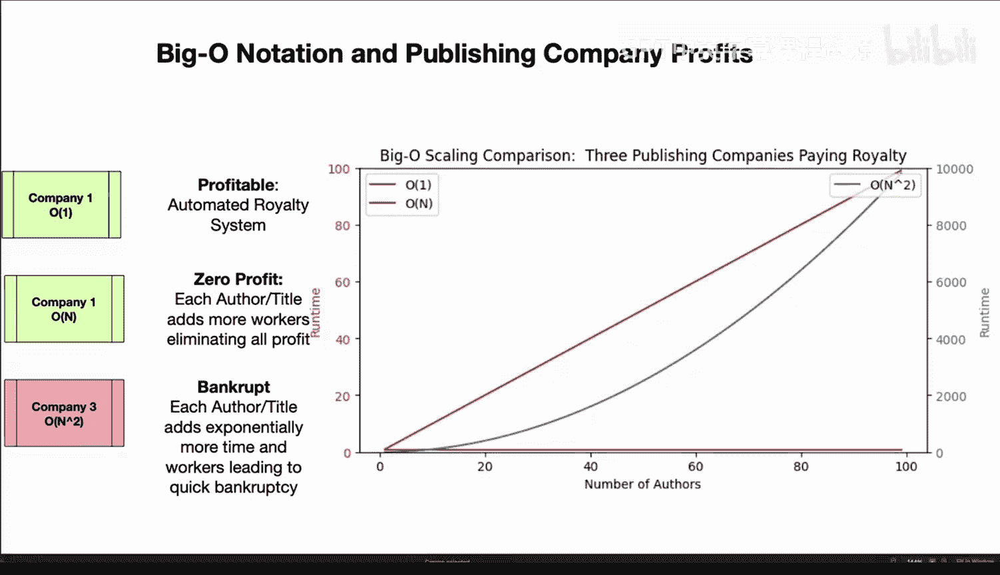
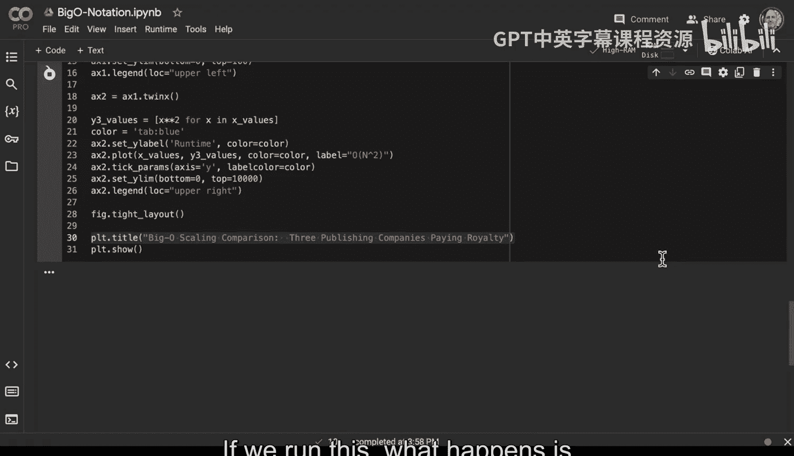
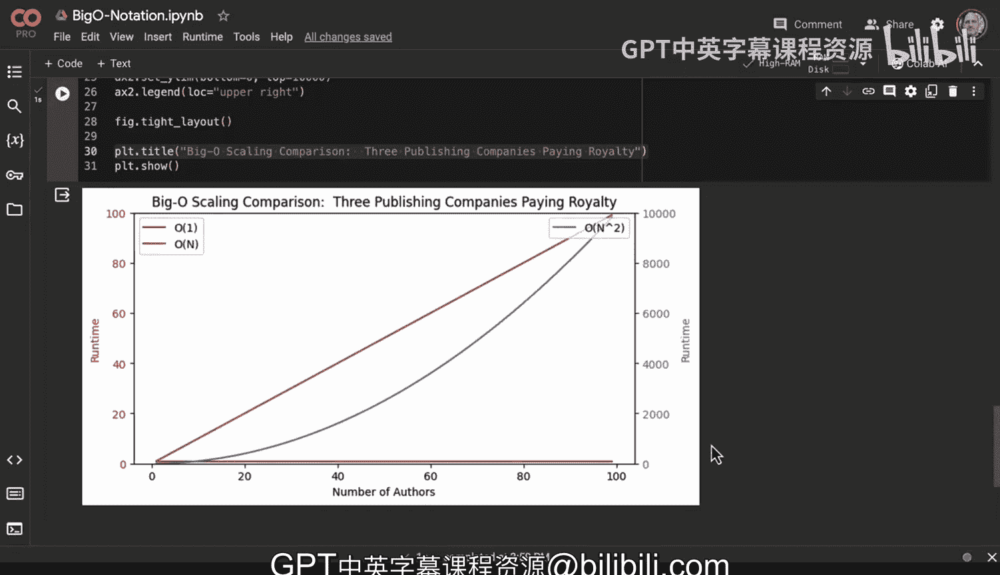

# 数据工程基础：2-4：大O表示法最终挑战详解 📊


在本节课中，我们将通过一个出版公司支付版税的模拟案例，深入理解大O表示法的重要性。我们将看到不同的算法效率如何直接影响公司的盈亏，甚至决定其存亡。

---

## 概述：为什么大O表示法至关重要

我们常听到编程新手说大O表示法无关紧要，不理解为何人们如此关注它。本节将通过一个具体的商业模拟来展示，算法效率的差异确实会产生巨大影响。效率低下可能导致公司破产，而高效算法则能确保公司持续盈利。

上一节我们介绍了算法复杂度的基本概念，本节中我们来看看如何用具体的商业场景来理解它。

---

## 场景设定：三家出版公司

假设有三家出版公司，它们使用不同的系统来处理作者版税支付。它们的效率分别对应三种经典的大O复杂度。

### 公司一：O(1) - 恒定时间
这家公司拥有**自动化版税系统**。无论系统中有100名、1000名还是10000名作者，处理时间都是固定的。这通常通过一个高效的**SQL查询**或自动化流程实现。

**核心特征**：处理时间与作者数量无关。
**公式表示**： `T(n) = c` （c为常数）

### 公司二：O(n) - 线性时间
这家公司利润为零。问题在于，每当新增一名作者或一部作品，他们就需要雇佣更多员工。尽管收入随着作者和作品增加而增长，但所有利润都支付给了员工工资。

**核心特征**：处理时间与作者数量成线性正比。
**公式表示**： `T(n) = k * n` （k为常数）

### 公司三：O(n²) - 平方时间（指数级）
这家公司的系统效率极低。每增加一名作者或一部作品，所需的工作量呈指数级增长（例如，每名作者需要两名员工处理）。工作量增长过快，导致公司迅速破产。

**核心特征**：处理时间与作者数量的平方成正比。
**公式表示**： `T(n) = k * n²`

---

## 效率对比可视化

下图展示了三种复杂度随作者数量增长的趋势：
*   **O(1)**：一条水平线，时间恒定。
*   **O(n)**：一条向上倾斜的直线，时间线性增长。
*   **O(n²)**：一条急剧上升的曲线，时间呈指数级爆炸增长。

可以清晰地看到，**O(n²)** 的效率在数据量增大时会带来灾难性后果。

---

## Python代码模拟



接下来，我们通过Python代码来模拟这三家公司的版税支付过程，直观感受时间消耗的差异。

首先，我们导入必要的库并设置基础参数。

```python
import random
import time
import matplotlib.pyplot as plt

# 假设的作者数量范围
num_authors_list = [1, 5, 10, 50, 100]
```

以下是模拟三种不同效率系统的核心函数：

### 1. 模拟 O(1) - 恒定时间系统
无论有多少作者，处理时间固定为1秒。

```python
def pay_royalties_o1(num_authors):
    """O(1) 复杂度：固定时间支付版税"""
    time.sleep(1)  # 模拟固定处理时间，例如一个自动化SQL查询
    return 1
```

### 2. 模拟 O(n) - 线性时间系统
处理时间随作者数量线性增加。

```python
def pay_royalties_on(num_authors):
    """O(n) 复杂度：时间随作者数量线性增长"""
    total_time = 0
    for _ in range(num_authors):
        time.sleep(0.1)  # 模拟为每位作者处理工作
        total_time += 0.1
    return total_time
```

### 3. 模拟 O(n²) - 平方时间系统
处理时间随作者数量呈平方级增长，效率极低。

```python
def pay_royalties_on2(num_authors):
    """O(n²) 复杂度：时间随作者数量平方增长"""
    total_time = 0
    for i in range(num_authors):
        for j in range(num_authors):  # 嵌套循环是 O(n²) 的典型特征
            time.sleep(0.001)  # 模拟每项微小但重复的工作
            total_time += 0.001
    return total_time
```

---

## 运行模拟并绘制图表

现在，我们运行模拟并收集数据，最后用图表展示结果。

```python
# 存储结果的列表
times_o1 = []
times_on = []
times_on2 = []

# 对不同作者数量进行模拟
for n in num_authors_list:
    times_o1.append(pay_royalties_o1(n))
    times_on.append(pay_royalties_on(n))
    times_on2.append(pay_royalties_on2(n))

# 绘制对比图
plt.figure(figsize=(10, 6))
plt.plot(num_authors_list, times_o1, label='O(1) - 公司一 (自动化)', marker='o')
plt.plot(num_authors_list, times_on, label='O(n) - 公司二 (线性)', marker='s')
plt.plot(num_authors_list, times_on2, label='O(n²) - 公司三 (平方)', marker='^')

plt.xlabel('作者数量')
plt.ylabel('处理时间 (秒)')
plt.title('大O表示法缩放对比：三家出版公司支付版税')
plt.legend()
plt.grid(True)
plt.show()
```

运行上述代码后，你将得到一张清晰的图表。图表显示：
*   **O(1) 线**保持水平，代表高效稳定。
*   **O(n) 线**平稳上升，代表成本可控但随规模增长。
*   **O(n²) 线**急速攀升，仅需少量作者增长，处理时间就会变得不可接受，这模拟了“末日场景”——低效的系统会迅速拖垮公司。



---

## 核心结论与总结

本节课我们一起学习了如何用大O表示法分析实际业务场景中的算法效率。

1.  **O(1) 恒定复杂度**是理想状态，代表高度自动化的高效系统，是工程设计的追求目标。
2.  **O(n) 线性复杂度**在数据量不大时可以接受，但必须意识到其成本会随规模线性增长，需要管理预期。
3.  **O(n²) 平方复杂度（或更糟的指数复杂度）** 是必须避免的。在涉及大规模数据的系统中，这类算法会导致性能灾难，正如模拟中第三家公司迅速破产所揭示的。



因此，认为“数学或指数关系不重要”的想法是危险的。在数据工程和软件开发中，对算法复杂度的理解直接关系到系统的可扩展性、成本控制乃至商业成败。请务必重视大O表示法，它不仅是面试知识点，更是构建健壮、高效系统的基石。