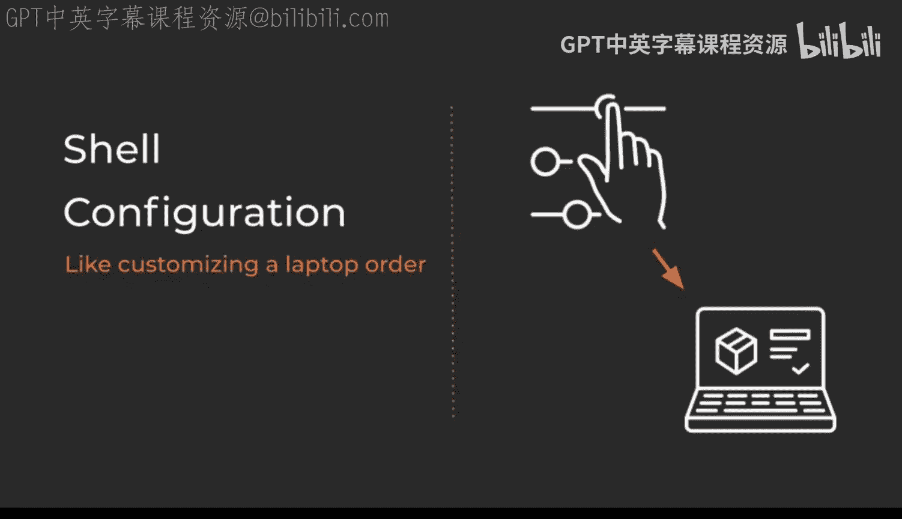

# 数据工程基础：2-4：Bash Shell环境配置简介 🐚


在本节课中，我们将要学习如何配置你的Shell环境。掌握环境配置是成为数据工程、MLOps和云计算领域专家的关键技能。我们将探讨Shell配置文件的重要性、最常见的`.bashrc`文件，以及一些新兴的配置技术。

## 为什么需要配置Shell环境？ ⚙️

上一节我们介绍了课程概述，本节中我们来看看为什么需要关心Shell配置。这很像定制一台新笔记本电脑：你会选择内存大小、GPU型号和屏幕尺寸，以打造最适合自己需求的工具。配置Shell环境也是如此，目的是构建一个能让你在开发项目时最高效工作的环境。

## 核心配置文件 📁

理解了配置的重要性后，接下来我们介绍两个最关键的配置文件。

### .bashrc 文件

`.bashrc`是你在编辑环境时最常更改的文件。它几乎存在于所有你可能登录的云系统、Docker环境或虚拟机中。该文件在每次启动新的交互式Bash shell时被执行，用于设置环境变量、别名和函数。

例如，你可以在其中添加一个别名来简化常用命令：
```bash
alias ll='ls -la'
```

### .zshrc 文件

最后，我们谈谈一些正在发展的技术，例如通过Oh My Zsh等第三方库使用的`.zshrc`文件。对于希望完全自定义并优化工作流程的开发者来说，这是一种新兴趋势。

## 总结 📝




本节课中我们一起学习了Shell环境配置的基础知识。我们了解了像定制硬件一样定制Shell环境的重要性，认识了`.bashrc`这一在各类系统中通用的核心配置文件，并简要了解了像`.zshrc`这样用于深度定制的新兴技术。正确配置这些文件，能确保你每次打开终端时，环境都处于最佳工作状态。