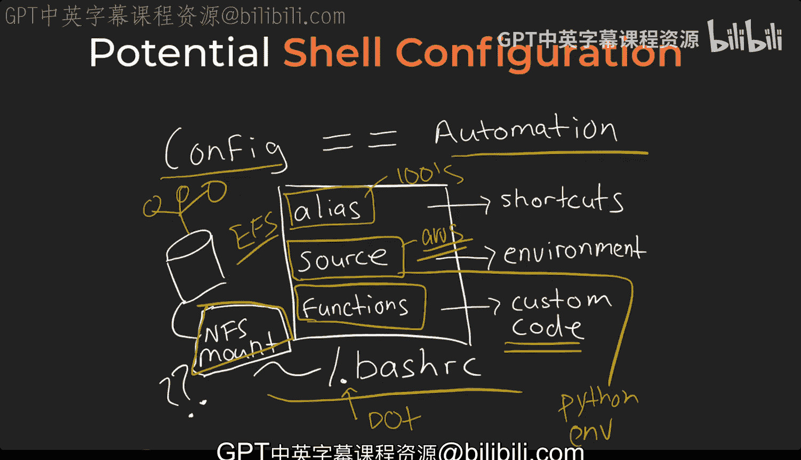

# 数据工程基础：2-4：Shell配置文件解析 🐚


在本节课中，我们将要学习Shell配置文件的概念、作用及其核心组成部分。Shell配置文件是自动化Shell环境设置的关键，对于高效使用命令行和数据工程工作至关重要。

---

## 什么是Shell配置文件？

Shell配置文件是自动化的一种形式。没有配置文件，在Linux环境中需要手动执行许多步骤，这些步骤可能非常复杂。配置文件的核心目的是简化并自动化这些过程。

## 配置文件的位置与命名

一个常见的配置文件位于用户的主目录下，路径是 `~/.bashrc`。
*   `~` 代表用户的主目录。
*   `/` 表示文件位于该目录内。
*   `.bashrc` 是一个以点开头的隐藏文件。

在Shell环境中，以点开头的文件默认是隐藏的。使用 `ls` 命令或某些GUI文件管理工具时，默认不会显示它们。

## 配置文件的核心组成部分

上一节我们介绍了配置文件的基本概念，本节中我们来看看它的几个核心组成部分。

### 1. 别名

别名类似于网页浏览器中的书签。它允许你输入一个快捷命令，该命令会指向某个路径、命令或其他资源。

以下是定义别名的基本语法：
```bash
alias ll='ls -la'
```
随着你在某个公司或个人项目中不断使用Shell，你可能会开发出数百个自定义别名。这是一种高效的自动化形式。

### 2. 集中式挂载点与共享配置

在大型或分布式环境中，确保所有用户拥有一致的体验至关重要。这可以通过集中式文件系统实现。

*   **亚马逊** 有弹性文件系统。
*   **谷歌** 有网络文件系统。
*   每个云平台和纯Linux环境都支持某种形式的集中式文件系统。

其理念是，在网络中的任何机器上登录，所有机器都能提供完全相同的用户体验。这意味着你无需反复进行繁琐的设置。将配置文件放在集中式挂载点，是实现完全自动化的有效方法之一。

### 3. 文件嵌套与来源

配置文件本身可以“引入”其他文件。这是通过 `source` 命令实现的。

例如，在AWS等云环境中，登录时 `.bashrc` 文件可能会引入大量自定义命令和环境设置。Python虚拟环境也是如此，它会引入一个bash脚本来设置库路径，确保所有包都安装到特定位置。

### 4. 自定义Bash函数

随着技能提升，你可能会开始编写小的Bash函数。这些自定义代码价值巨大。

它们可以执行诸如挂载文件系统、进行深度学习或数据清洗等操作。自定义代码的潜力几乎是无限的，你可以将这些函数引入到你的 `.bashrc` 文件中。

---

## 总结




本节课中我们一起学习了Shell配置文件。我们了解到，配置文件是Shell环境中自动化的基础，它允许你执行非常高级的操作。任何使用数据或机器学习的开发者，都应具备配置 `.bashrc` 文件的基本能力。它通过别名、共享环境设置和自定义代码，极大地提升了工作效率和一致性。