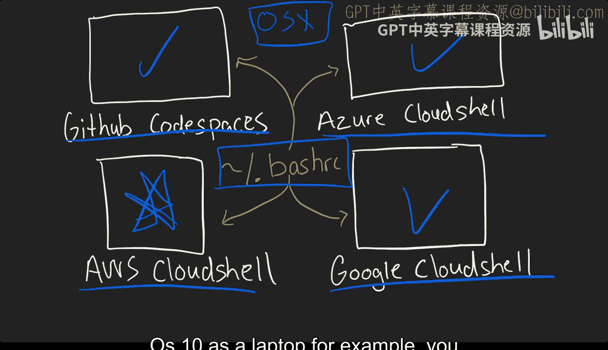
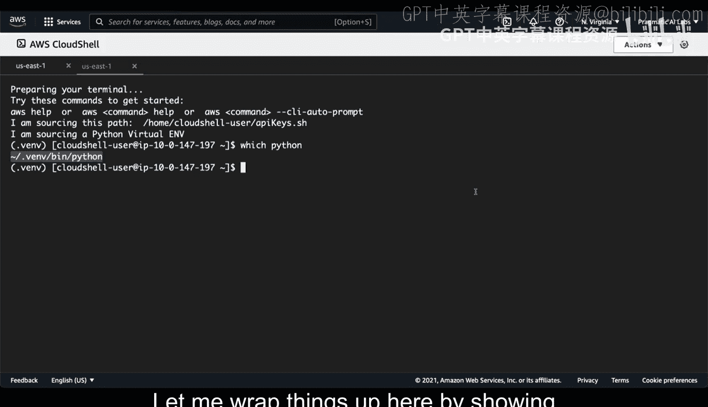
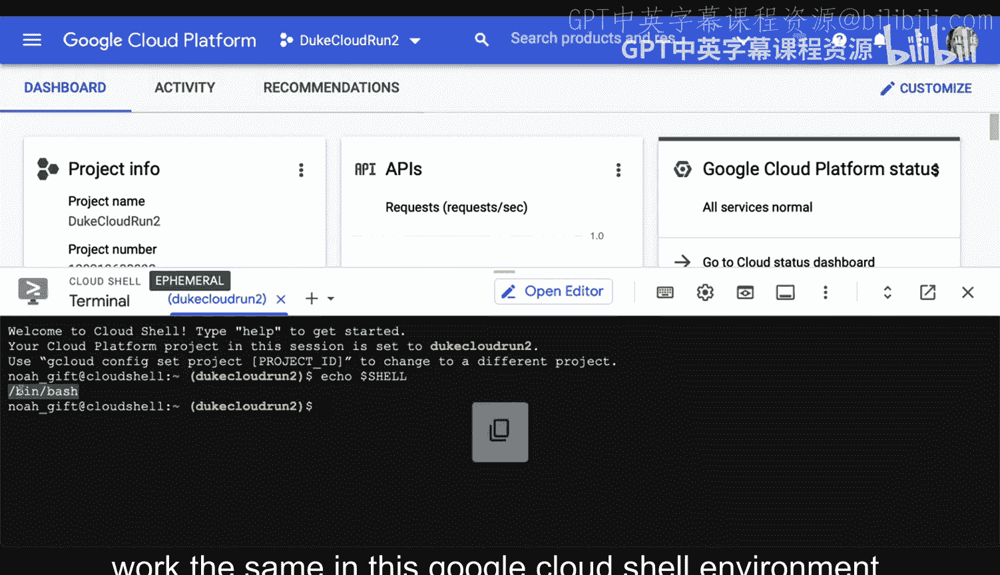
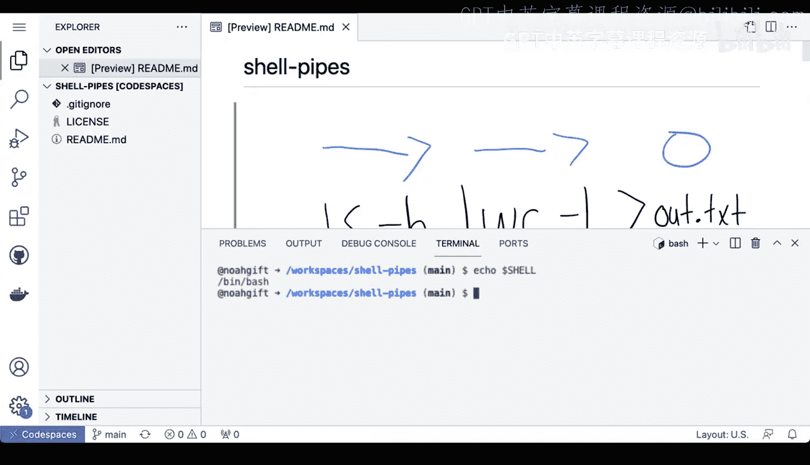
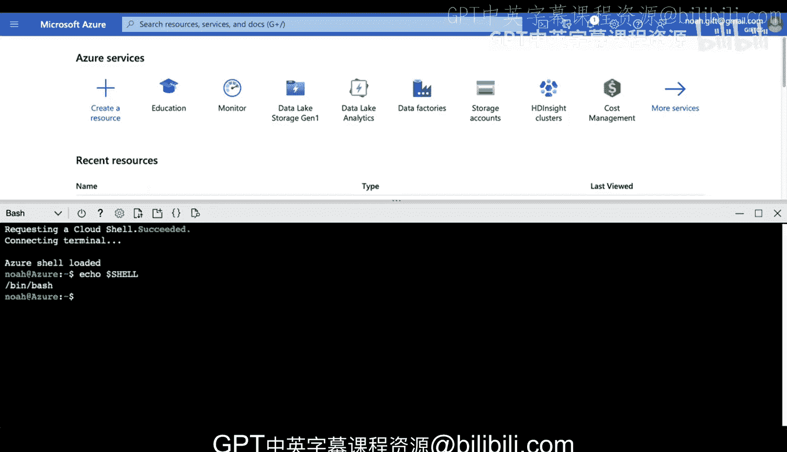

# 数据工程基础：2-4：配置Bashrc文件 🛠️


在本节课中，我们将学习`.bashrc`文件的概念及其在配置Shell环境中的核心作用。我们将了解如何通过编辑此文件来创建命令别名、设置环境变量以及自动加载脚本，从而提升在不同计算环境（如AWS、GitHub Codespaces等）中的工作效率。

## 理解.bashrc文件 🌳

上一节我们介绍了Shell环境的基础知识，本节中我们来看看`.bashrc`文件的核心概念。`.bashrc`文件是Bash Shell的配置文件，它就像一棵树的根基。在不同的云Shell环境中，例如AWS CloudShell、GitHub Codespaces、Azure Cloud Shell和Google Cloud Shell，都使用`.bashrc`文件来配置环境。每个环境还会在此基础上添加自己特有的“秘方”以适应其独特需求。我们将主要关注AWS CloudShell环境，但也会简要展示其他环境，以说明一旦掌握`.bashrc`文件的配置，就能将其应用于所有环境。此外，如果你使用的是macOS等操作系统，同样可以应用这些技巧。



## 在AWS CloudShell中开始配置 🚀

现在，让我们进入AWS CloudShell环境开始实践。当你首次打开任何CloudShell环境时，建议先执行以下命令来确认当前使用的Shell。

```bash
echo $SHELL
```

这个命令会告诉我们正在使用Bash Shell。确认后，我们可以列出主目录的内容。

```bash
ls -la ~/
```

此命令显示主目录下的文件，你会看到诸如`.bash_history`、`.bash_logout`、`.bash_profile`等文件。虽然这些文件都可以编辑，但大多数人选择编辑`.bashrc`文件，因为它是存储交互式Shell常用设置的集中位置。

接下来，我们使用`vim`编辑器打开并查看`.bashrc`文件。

```bash
vim ~/.bashrc
```

打开后，你可以看到AWS环境已经预置了一些配置，例如`aws_completer`路径、用户特定的别名和函数。我们的目标是在此基础上进行自定义。

## 创建命令别名 ⚡

命令别名是命令的快捷方式，可以显著减少输入。让我们在`.bashrc`文件中添加一个别名。

以下是添加别名的步骤：
1.  在`.bashrc`文件末尾添加一行：`alias srccode='cd ~/src'`
2.  保存并关闭文件。
3.  为了使更改生效，你需要打开一个新的终端标签页（这会启动一个新的交互式Shell并读取配置文件），或者执行`source ~/.bashrc`命令。

现在，输入`alias`命令，你会看到新添加的`srccode`别名。尝试运行`srccode`，如果提示目录不存在，只需先创建它：`mkdir ~/src`。之后，`srccode`命令就能成功将你切换到`~/src`目录。

## 管理环境变量与API密钥 🔑

在数据工程项目中，配置API密钥等环境变量非常常见。我们可以通过`.bashrc`文件自动加载这些变量。

首先，创建一个存储API密钥的脚本文件。

```bash
vim ~/api_keys.sh
```

在该文件中，我们可以设置一些环境变量。

```bash
export SECRET_1="123"
export SECRET_2="abc"
```

保存文件后，我们需要让`.bashrc`文件在启动时自动加载这个脚本。编辑`.bashrc`文件，添加以下内容。

```bash
# 设置API密钥文件路径
export PATH_TO_API_KEYS="$HOME/api_keys.sh"
echo "I am sourcing this path: $PATH_TO_API_KEYS"
source $PATH_TO_API_KEYS
```

保存`.bashrc`后，打开一个新的终端标签页。你会看到提示信息，并且环境变量`SECRET_1`和`SECRET_2`已经可用，可以通过`echo $SECRET_1`进行验证。这样，Python或Bash脚本就可以直接使用这些密钥了。

## 自动激活Python虚拟环境 🐍

对于数据工程，Python虚拟环境至关重要。我们可以配置`.bashrc`在启动时自动激活特定的虚拟环境。

首先，创建一个Python虚拟环境。

```bash
python3 -m venv ~/venv
```

然后，手动激活它以确认其工作正常。

```bash
source ~/venv/bin/activate
```

激活后，Shell提示符通常会发生变化。为了每次打开Shell都自动激活，我们将激活命令添加到`.bashrc`中。

```bash
echo "I am sourcing a Python virtual environment"
source ~/venv/bin/activate
```



保存`.bashrc`后，打开新的终端标签页。提示符会改变，并且使用`which python`命令可以确认当前Python解释器来自虚拟环境。



## 跨云环境的一致性验证 ☁️

掌握了`.bashrc`的配置后，这些技巧可以无缝应用到其他云Shell环境。无论在Google Cloud Shell、GitHub Codespaces还是Azure Cloud Shell中，你都可以使用相同的`echo $SHELL`命令来确认环境，并应用我们学到的`.bashrc`配置方法。这让你能在任何新环境中快速建立熟悉、高效的工作流。





本节课中我们一起学习了`.bashrc`文件的强大功能。通过配置别名、环境变量和自动加载脚本，你可以个性化Shell环境，大幅提升工作效率。掌握`.bashrc`是每位数据工程师都应该具备的一项基础且高效的技能。