# 数据工程基础：2-4：配置Zshrc与第三方工具Oh My Zsh 🛠️


在本节课中，我们将学习如何在本地机器上配置Zsh环境，并利用强大的第三方工具Oh My Zsh来增强终端的功能，从而提高数据工程工作的效率。

---

## 概述

作为macOS开发者，配置开发环境以使其功能更强大、更美观是一种常见做法。一个非常流行的第三方工具是Oh My Zsh。它通过提供丰富的插件和主题，帮助用户更高效地使用Z shell。

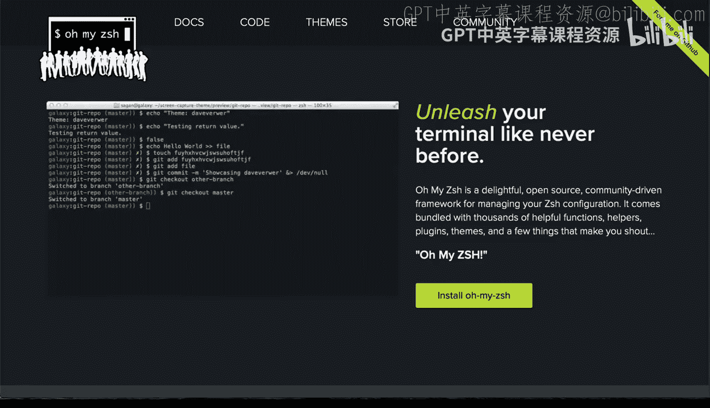

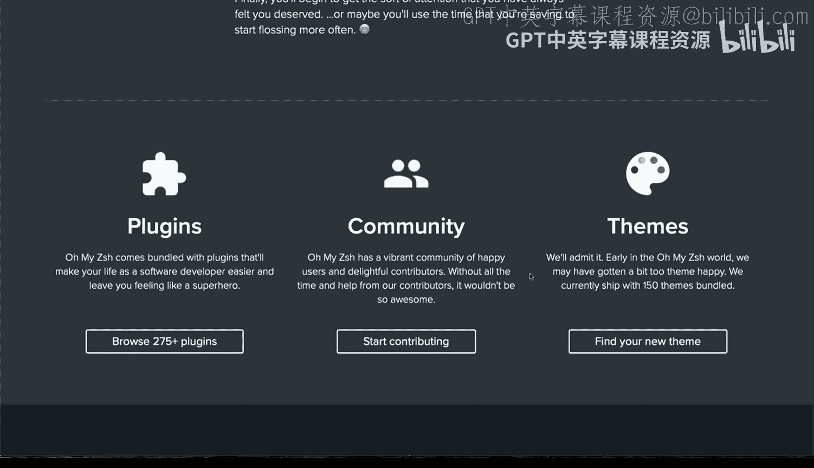

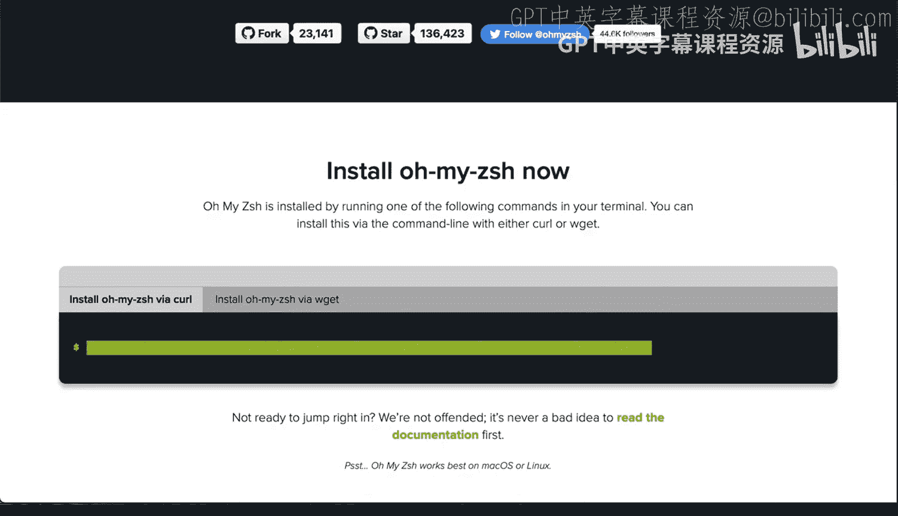

## 安装与初始配置

首先，我们需要安装Oh My Zsh。安装过程非常简单，只需在终端中运行一条命令。

以下是安装Oh My Zsh的命令：
```bash
sh -c "$(curl -fsSL https://raw.github.com/ohmyzsh/ohmyzsh/master/tools/install.sh)"
```

运行此命令后，如果尚未安装，系统将开始安装过程。安装完成后，你的Zsh环境将得到增强，并生成一个配置文件 `~/.zshrc`。

## 探索Oh My Zsh目录

安装成功后，我们可以查看Oh My Zsh的目录结构，其中包含了各种插件和主题。

使用以下命令列出Oh My Zsh目录的内容：
```bash
ls -la ~/.oh-my-zsh/
```

进入插件目录，可以看到大量可用的插件：
```bash
ls -la ~/.oh-my-zsh/plugins/
```

这些插件为开发环境提供了丰富的扩展功能。

## Oh My Zsh的默认增强功能

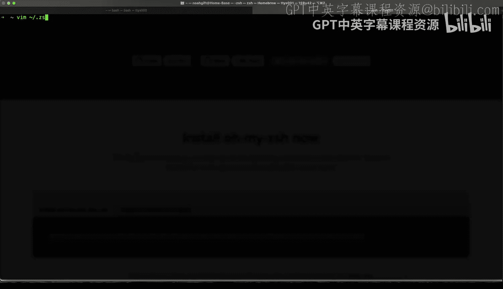

使用Oh My Zsh后，Zsh环境会获得一些非常实用的默认增强功能。

例如，你可以直接输入路径来切换目录，而无需使用 `cd` 命令。只需输入路径并按回车，即可切换到该目录。

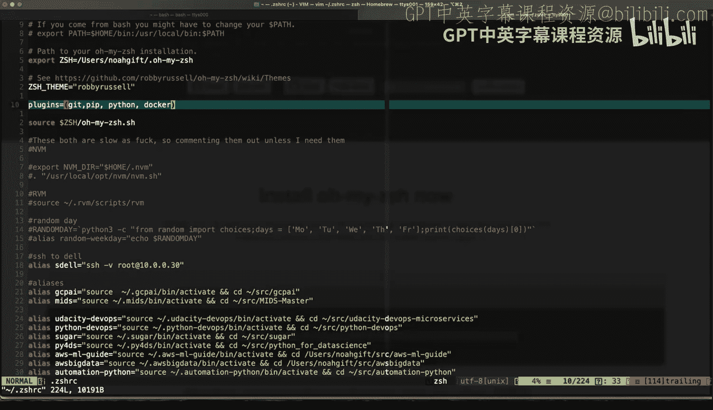

此外，Oh My Zsh默认提供了更长的命令历史记录。你可以使用 `history` 命令查看，与普通的Bash shell相比，历史记录容量显著增加。

## 配置.zshrc文件

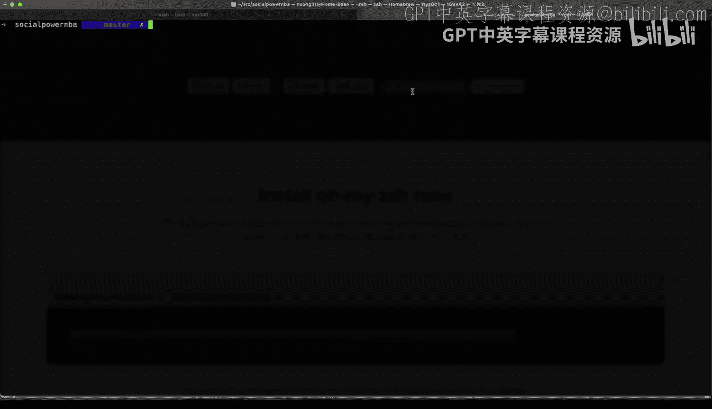

要自定义和进一步配置环境，我们需要编辑 `~/.zshrc` 文件。

使用以下命令打开并编辑该文件：
```bash
vim ~/.zshrc
```

在这个文件中，你可以设置主题、启用插件以及定义别名等。

### 主题与插件配置

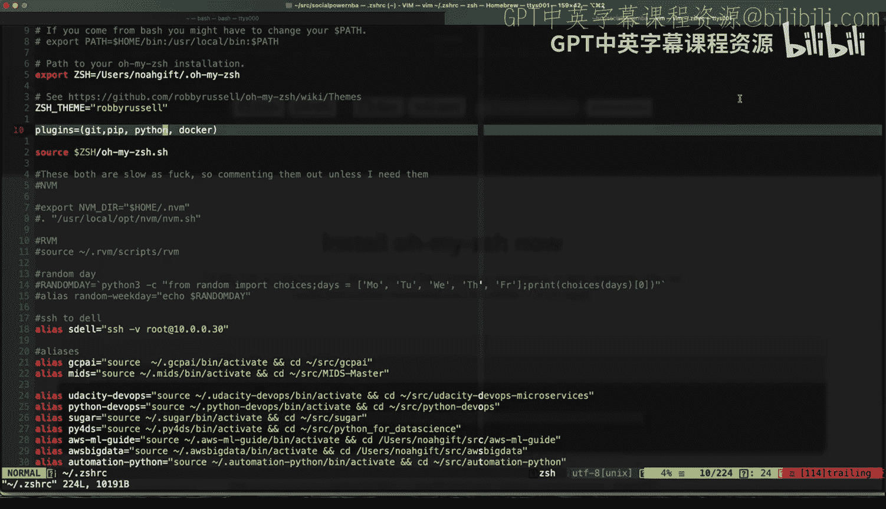

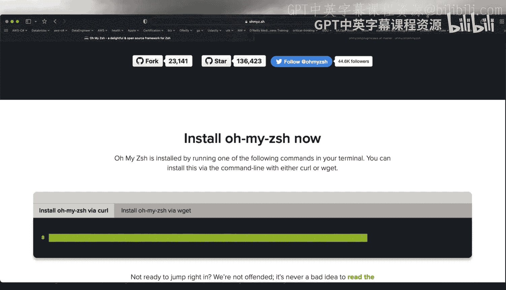

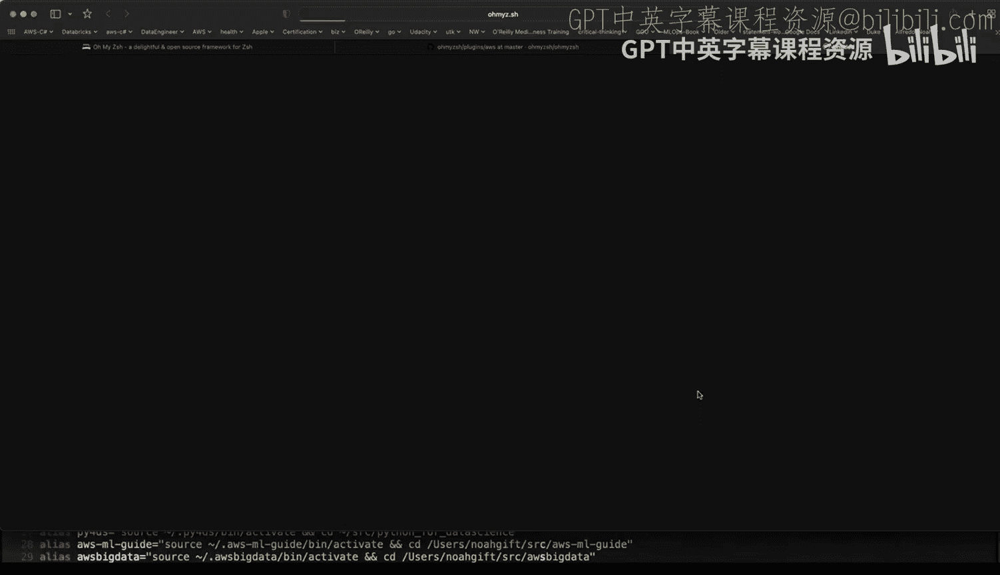

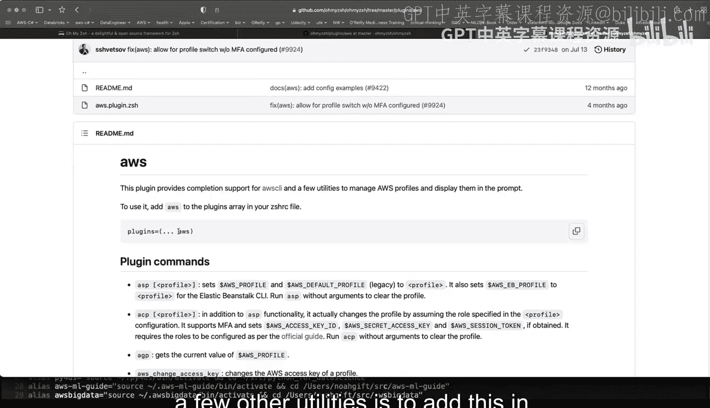

在 `.zshrc` 文件中，你可以找到设置主题和插件的部分。

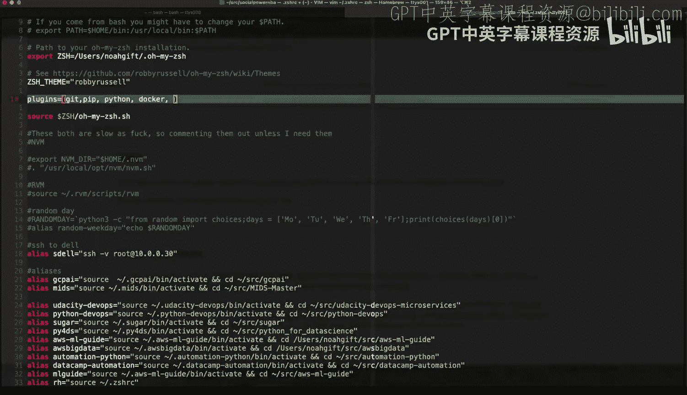

例如，设置主题的配置行可能如下：
```bash
ZSH_THEME="robbyrussell"
```

启用插件的配置行如下。以下示例启用了git、pip、python和docker插件：
```bash
plugins=(git pip python docker)
```

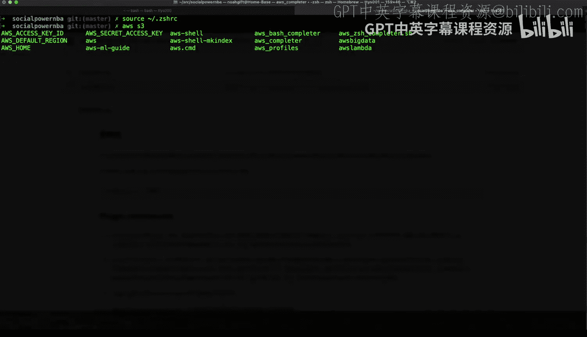

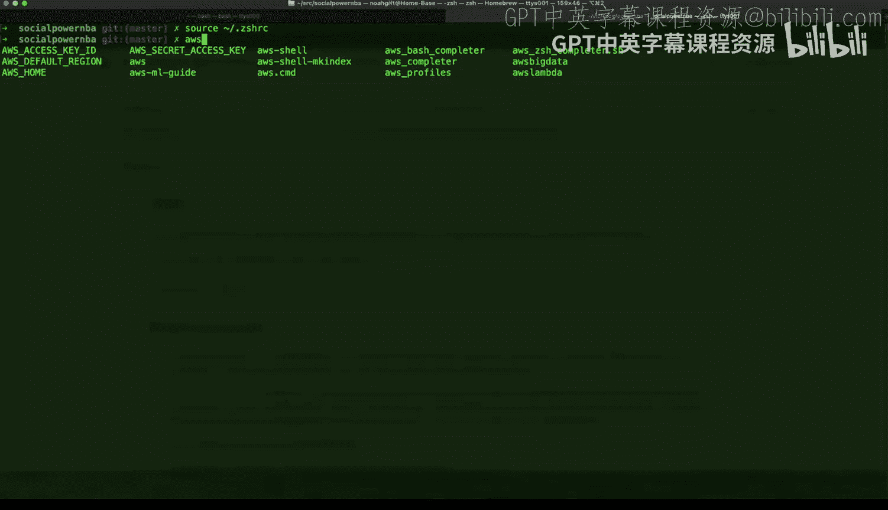

这些插件能提供智能的自动补全功能。例如，进入一个Git项目目录后，终端提示符会自动显示Git分支状态等信息。

## 添加更多插件

Oh My Zsh社区提供了海量的插件。你可以根据需求轻松添加。

例如，要添加AWS命令行工具的自动补全插件，只需在 `plugins` 列表中加上 `aws`：
```bash
plugins=(git pip python docker aws)
```


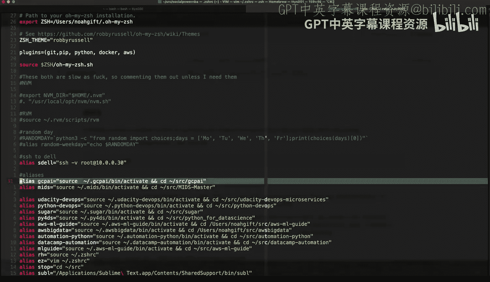

添加后，需要重新加载配置文件以使更改生效：
```bash
source ~/.zshrc
```


现在，输入 `aws` 后按Tab键，就会看到所有AWS相关命令的自动补全提示，这极大地提升了使用效率。

## 使用别名提升效率

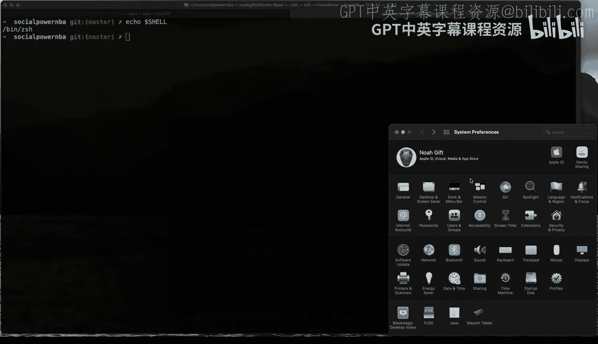

在 `.zshrc` 文件中，另一个强大的功能是定义别名（alias）。别名可以将长的、复杂的命令简化为短的快捷命令。

例如，你可以添加如下别名：
```bash
alias ll='ls -la'
alias gs='git status'
alias activateenv='source venv/bin/activate'
```

通过积累和定制别名，可以让你在终端中的操作变得极其迅速。

## 在macOS上更改默认Shell

你的macOS系统可能默认使用Bash。如果你想将默认登录Shell改为Zsh，可以按以下步骤操作。

1.  打开“系统偏好设置” > “用户与群组”。
2.  解锁后，右键点击当前用户，选择“高级选项”。
3.  在“登录Shell”下拉菜单中，选择 `/bin/zsh`。
4.  点击“好”保存更改。

此外，也可以在“终端”应用的偏好设置中，直接修改某个配置文件的“Shell”路径来更改。

## macOS专属实用命令

在macOS环境下，除了通用Unix命令，还有一些系统专属的实用工具。

例如，`mdfind` 命令可以利用Spotlight索引快速搜索文件，速度远超传统的 `find` 命令。
```bash
mdfind -name "*.txt"
```

另一个强大的命令是 `diskutil`，用于管理磁盘和分区。
```bash
diskutil list
```

掌握这些macOS特有的命令，能让你在本地开发环境中更加得心应手。

## 总结

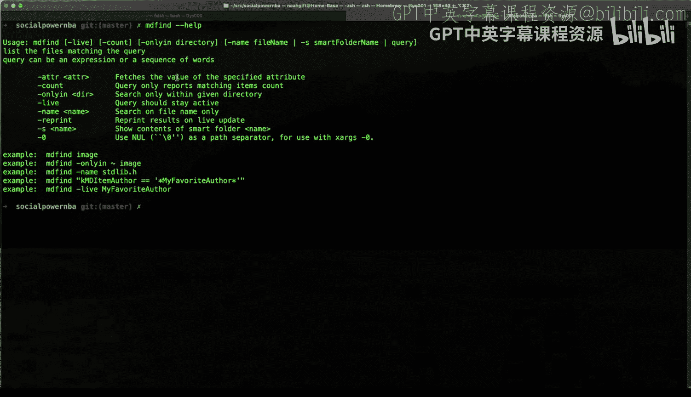


本节课中，我们一起学习了如何配置Zsh环境并利用Oh My Zsh这一强大工具。我们涵盖了从安装、探索目录结构、配置主题插件，到添加自定义插件和别名等一系列步骤。同时，也了解了如何在macOS上更改默认Shell，并介绍了一些系统专属的实用命令。通过合理配置你的Shell环境，可以显著提升作为数据工程师的工作效率和舒适度。