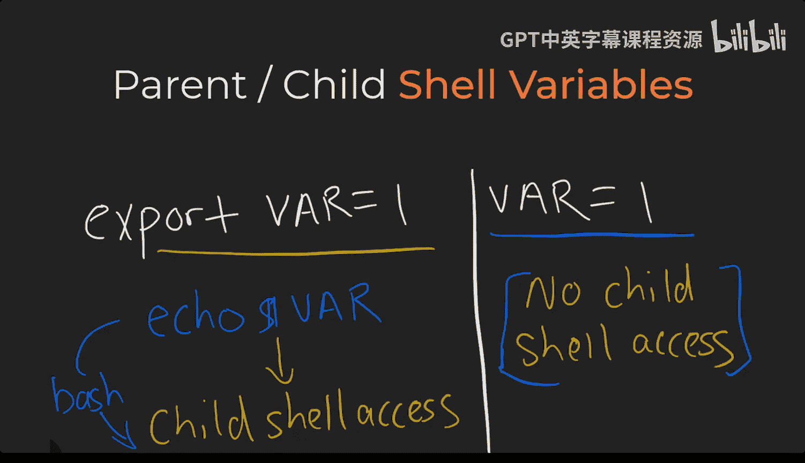
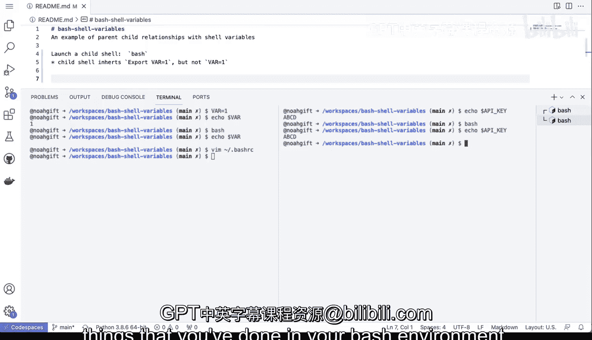

# 数据工程基础：2-4：在交互式提示符中导出Shell变量


在本节课中，我们将要学习Shell变量在父进程与子进程之间的作用域关系。理解`export`命令的用法对于确保变量能在子Shell中被访问至关重要。

## 父进程与子进程中的变量作用域

上一节我们介绍了Shell变量的基本概念，本节中我们来看看变量在不同Shell进程间的传递规则。Shell变量根据其定义方式，作用域会有所不同。



### 本地变量与导出变量

以下是两种定义变量的方式及其区别：

*   **本地变量**：使用 `VAR=value` 格式定义。这种变量仅在当前Shell进程中有效。
    *   **示例**：`my_var="local_value"`
*   **导出变量**：使用 `export VAR=value` 格式定义。这种变量会被“导出”到当前进程的环境变量中，从而可以被该进程启动的任何子进程（子Shell）继承。
    *   **示例**：`export my_exported_var="global_value"`

### 实践演示：变量作用域对比

让我们通过一个实验来直观地理解这两种变量的区别。假设我们打开一个终端（父Shell），并在其中进行以下操作。

首先，我们创建一个本地变量：
```bash
VAR_LOCAL="I_am_local"
```
然后，我们创建一个导出变量：
```bash
export VAR_EXPORTED="I_am_exported"
```
现在，我们在当前Shell中验证这两个变量：
```bash
echo $VAR_LOCAL      # 输出：I_am_local
echo $VAR_EXPORTED   # 输出：I_am_exported
```
接下来，我们启动一个新的子Shell进程：
```bash
bash
```
在这个新的子Shell中，再次尝试访问这两个变量：
```bash
echo $VAR_LOCAL      # 输出为空（变量不存在）
echo $VAR_EXPORTED   # 输出：I_am_exported
```
可以看到，只有使用`export`定义的变量`VAR_EXPORTED`被传递到了子Shell中。

### 在配置文件中正确使用Export

这个知识点在配置Shell环境时尤为重要，例如在编辑`~/.bashrc`文件时。

`~/.bashrc`文件中的命令会在每次启动新的交互式Shell时执行。为了确保你在此文件中设置的变量对所有子Shell和程序都可用，必须使用`export`命令。

以下是`~/.bashrc`中设置变量的推荐方式：
```bash
# 正确：使用export，变量可被子进程继承
export API_KEY="your_api_key_here"
export CUSTOM_PATH="$HOME/my_tools/bin"

# 错误：不使用export，变量仅对当前Shell有效（通常不是你想要的）
TEMP_VAR="will_not_be_passed_down"
```
通过这种方式，当你打开新的终端窗口、标签页，或在脚本中启动子Shell时，这些重要的环境变量都将可用。

## 总结



本节课中我们一起学习了Shell变量的作用域机制。核心要点是：使用`VAR=value`定义的变量是**本地变量**，仅存在于当前Shell；而使用`export VAR=value`定义的变量是**导出变量**，会被添加到环境变量中，从而可以被所有子Shell进程继承。在配置`~/.bashrc`等启动文件时，务必对需要全局使用的变量使用`export`命令，以确保你的自定义设置在整个Shell会话树中生效。